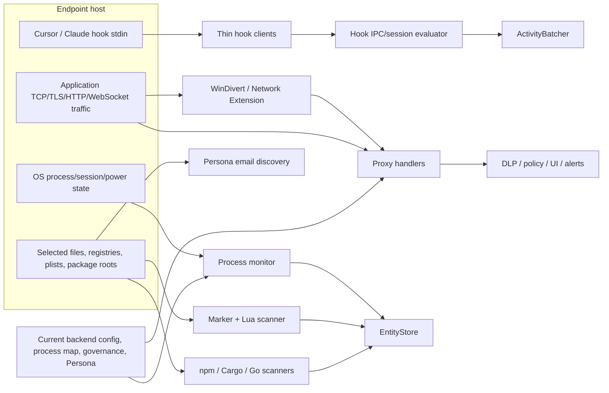

# 05 — Capture and Instrumentation Surface Catalog

## Scope and terminology

A capture point is a place where the endpoint obtains a new observation from an
OS, file, process, local application, network stream, local IPC peer, or current
backend. A state restore, configuration fetch, decision point or export boundary
is labeled separately so it is not mistaken for independent observation.

The machine-readable catalog is
[capture-points.csv](../../../matrices/sensor-intelligence/endpoint-sensor/capture-points.csv).

Modes:

- `Poll`: repeated enumeration or fetch.
- `Event`: callback, file watch, IPC message, process/socket event or IDE hook.
- `Inline`: observation occurs on the request/flow critical path.
- `Startup`: one-time or initial-gate acquisition.
- `Restore`: local persisted state, not a new environmental observation.

## Capture topology

The final two edges are configuration/control inputs, not proof of endpoint
activity.

## Capture-point matrix

| ID | Capture point | Source | Trigger/mode | Native input | Immediate output | Current consumer | Persistence | Blind spots/failure behavior | Status |
| --- | --- | --- | --- | --- | --- | --- | --- | --- | --- |
| C-001 | macOS process enumeration | host process table | configured poll | PID, executable/name/path/parent data available to adapter | `Vec<ProcessInfo>` | `ProcessTable::diff` | prior poll in memory | transient processes between polls; enumeration errors; same-name PID reuse | `Active`, macOS |
| C-002 | Windows process enumeration | Windows process APIs | configured poll | PID/name/path/parent data available to adapter | `Vec<ProcessInfo>` | `ProcessTable::diff` | prior poll in memory | same polling and PID-reuse limits; access-denied/OS errors | `Active`, Windows |
| C-003 | power state channel | OS power/session notifications | event | awake/sleep-like state | watch-channel value | discovery/enforcement loops | memory | platform coverage and missed transitions not independently attested | `Active` |
| C-004 | process correlation | process delta + process map | per new process | `ProcessInfo`, executable/path/parent mappings | Application candidate | `EntityStore` | memory/snapshot | map omissions and many-to-one collapse; not an OS capture itself | `Derived observation` |
| C-005 | configured marker walk | selected user/home/workspace folders | periodic poll | folder rule, marker path, filesystem metadata | matched workspace/marker context | Lua executor | current scan only | only configured folders/markers; permission/read errors; no global file watch | `Active` |
| C-006 | Lua `fs.read` host API | files selected by scripts | per script call | path/content | script-visible string/bytes/JSON | discovery scripts | collector/process memory | gated by sandbox rules, size/encoding/script logic; raw reads not emitted | `Active` |
| C-007 | Lua platform context | local platform/environment helper | per scan | OS/home/platform context | `scan_context` / platform values | discovery scripts | transient | only exposed fields; not cloud/container/runner metadata | `Active` |
| C-008 | Lua collector | discovery script output | per matched script | emitted raw entities, relationships, events, errors, risk | collector graph/result | `convert_results` | transient | converter discards relationships/events/errors/risk and rich fields | `Active but lossy boundary` |
| C-009 | npm discovery | configured npm binary/package roots | periodic poll | filesystem/package metadata | package/application candidates | `EntityStore` | memory/snapshot | npm only; selected locations; no registry/cloud authority | `Active` |
| C-010 | Cargo discovery | configured Cargo binary roots/metadata | periodic poll | filesystem/package metadata | package/application candidates | `EntityStore` | memory/snapshot | Cargo only; selected locations | `Active` |
| C-011 | Go discovery | Go tool/binary roots | periodic poll/tool call | filesystem and child-tool output | package/application candidates | `EntityStore` | memory/snapshot | Go only; child command can hang; tool absence | `Active` |
| C-012 | snapshot load | local snapshot JSON | startup restore | saved entities and delta cursor | restored store state | monitor workers | store memory | stale/corrupt/missing; **not a new observation** | `Active restore` |
| C-013 | Persona IPC query | agent Persona bridge | startup/poll/event | user/tenant/subscriber/token payload | monitor/proxy context | sync, policy, DLP, alerts | process caches | response peer not cryptographically established in checked code; stale/None states | `Active context input` |
| C-014 | browser-extension Persona email IPC | local browser-extension IPC source | Persona discovery request | email candidate payload | `EmailCandidate` | Persona validation/selection | Persona/vault paths | extension availability, response provenance and current production use unresolved | `Conditional` |
| C-015 | OS-account email discovery | local OS account stores | Persona discovery | platform account identifiers | email candidates | Persona coordinator | transient then Persona | local candidate, not authoritative enterprise identity | `Conditional` |
| C-016 | Outlook identity discovery | plist/registry/MAPI/PowerShell sources | Persona discovery | configured account identifiers | email candidates | Persona coordinator | transient then Persona | platform/schema-specific; source errors suppressed; some paths untested | `Conditional` |
| C-017 | Apple Mail discovery | macOS `Accounts.plist` V7–V10 | Persona discovery | account email arrays | email candidates | Persona coordinator | transient then Persona | macOS only; newer/other schemas omitted | `Conditional`, macOS |
| C-018 | Thunderbird discovery | profiles/prefs | Persona discovery | `profiles.ini` and `prefs.js` values | email candidates | Persona coordinator | transient then Persona | simplified INI/JS parsing; profile/read errors | `Conditional` |
| C-019 | Chrome identity discovery | Preferences/Local State/profile dirs | Persona discovery | account/sync/profile email values | email candidates | Persona coordinator | transient then Persona | selected profile naming; synchronous I/O; candidate only | `Conditional` |
| C-020 | Firefox identity discovery | profiles.ini/prefs.js | Persona discovery | Sync/FxA strings | email candidates | Persona coordinator | transient then Persona | simplified parsing/escaping; candidate only | `Conditional` |
| C-021 | Edge identity discovery | Chromium preference/profile state | Persona discovery | account/sync/profile values | email candidates | Persona coordinator | transient then Persona | selected profile naming/locations | `Conditional`, primarily Windows |
| C-022 | Safari identity discovery | Safari/MobileMe plists | Persona discovery | account IDs | email candidates | Persona coordinator | transient then Persona | macOS only; parse errors often empty | `Conditional`, macOS |
| C-023 | Teams identity discovery | Teams settings, OneAuth/MSAL/keychain/registry | Persona discovery | account/user identifiers | email candidates | Persona coordinator | transient then Persona | cookies/localStorage/IndexedDB skipped; secret-bearing command output enters memory | `Conditional` |
| C-024 | Cursor hook stdin | Cursor hook runtime | event/inline | source-specific hook JSON | normalized hook request | local hook IPC | optional JSONL/debug plus session memory | only installed/configured events; parse/IPC failures usually Allow | `Conditional active` |
| C-025 | Claude hook stdin | Claude hook runtime | event/inline | source-specific hook JSON | normalized hook request | local hook IPC | optional JSONL/debug plus session memory | only installed/configured events; parse/IPC failures usually Allow | `Conditional active` |
| C-026 | hook IPC receive | local thin-client socket/pipe | event/inline | normalized request frame | queued session event | `SessionQueue`/evaluator | process memory | peer ACL/auth unresolved; queue and availability limits | `Conditional active` |
| C-027 | prompt-turn aggregation | hook session state | event + idle sweep | prompt/tool/file hook events | activity candidate | `ActivityBatcher` | bounded memory queue | aggregation loses individual event granularity; restart/overload loss | `Active when hooks enabled` |
| C-028 | hook-file watch | installed IDE hook JSON | filesystem event + periodic integrity | file content/metadata | integrity mismatch/repair trigger | hook manager | expected state in memory | watcher gaps, permission failures and reinstall semantics | `Conditional active` |
| C-029 | explicit HTTP listener | application TCP to proxy HTTP port | inline | HTTP request line, URI, headers, body stream, peer | Hyper request context | request handler | transient plus optional logs/alerts | only applications using/routed to proxy; unsupported protocols bypass | `Active` |
| C-030 | explicit CONNECT listener | HTTP proxy client | inline | CONNECT authority, peer stream | tunnel or TLS handling context | CONNECT/TLS handlers | transient | apps not using proxy; tunnel paths can bypass body inspection | `Active` |
| C-031 | Windows socket-layer attribution | WinDivert socket events | event | local/remote tuple, PID/process | attribution-cache entry | proxy request context | TTL memory map | races/port reuse/access gaps; packet/connection mapping confidence not emitted | `Conditional`, Windows |
| C-032 | Windows packet-layer interception | WinDivert network events | inline/event | TCP/UDP packet headers/payload | rewritten/injected redirected packet | proxy listeners/upstream | redirector memory state | filter/port/IPv6/UDP scope; blocking receive shutdown limitation | `Conditional`, Windows |
| C-033 | macOS NE TCP flow | Network Extension | inline/event | `NEAppProxyTCPFlow`, endpoints/audit/application data available to provider | relay/control connection and metadata | Rust proxy listener | process/extension memory | extension startup may lack IPC; platform attribution/flow failures | `Conditional`, macOS |
| C-034 | macOS NE UDP flow | Network Extension | inline/event | `NEAppProxyUDPFlow` | rejection/handling result | extension | transient | configured interception focuses UDP 443 rejection, not full UDP payload sensor | `Conditional`, macOS |
| C-035 | TLS ClientHello/SNI | intercepted TCP stream | inline | first TLS record bytes | SNI/protocol/destination evidence | transparent resolver/MITM | transient/cache | fragmented/invalid/no-SNI/encrypted-client-hello cases; read bounds | `Conditional active` |
| C-036 | original destination metadata | kernel NAT lookup or extension metadata | inline | peer/local tuple, destination address | `DestinationSource` | transparent TLS handler | destination cache | lookup mismatch/miss; DNS/tunnel/drop fallbacks | `Conditional active` |
| C-037 | request metadata extraction | proxy HTTP handler | inline | method, URI, host, headers, process attribution | `RequestContext`/policy inputs | DLP, policy, logs, alerts | transient/caches | absent attribution; header/body selection depends on config | `Active for captured HTTP` |
| C-038 | request body capture | proxy body handler | inline | Hyper request body | complete captured bytes/file-backed data | extractor/DLP/upstream | memory/temp file | size limits, temp-file errors; blocks true streaming | `Conditional active` |
| C-039 | response metadata/body capture | upstream response path | inline | status, headers, response body | extracted/classified response context | ingress DLP/logging/client | memory/temp file | only configured ingress paths; buffering and size limits | `Conditional active` |
| C-040 | WebSocket client frames | upgraded connection | inline/event | message frames | forwarded/analyzed frame | DLP/WebSocket peer | transient | large frames forwarded without analysis; only proxied connections | `Conditional active` |
| C-041 | WebSocket upstream frames | upgraded upstream connection | inline/event | message frames | forwarded/analyzed frame | DLP/WebSocket client | transient | same frame and routing limits | `Conditional active` |
| C-042 | DLP transform result | configured pattern/field pipeline | inline/derived | captured content + transforms/selectors | candidate text/value | `DlpEngine` | request-local | derived value; transform failure can omit evidence; feature-gated parsers | `Derived observation` |
| C-043 | DLP analyzer result | DLP engine | inline/derived | candidate content, model/heuristic/backend analyzer | detections/classification | policy/UI/alerts | request-local/cache | analyzer may degrade to heuristic; error/fail-open; confidence semantics vary | `Conditional derived observation` |
| C-044 | policy decision | policy engine | inline/derived | request/process/user/resource context + controls | action/decision | request enforcement/UI | policy cache/request state | background readiness and error paths can allow; not an independent activity source | `Derived control result` |
| C-045 | user justification input | native/Tauri popup | inline/user event | displayed detection/options and user action | justification/choice/default | request decision path | UI/process state; selected logs/alerts | timeout/close/transport failure can choose default; user identity context may be inferred | `Conditional active` |
| C-046 | governance delta response | current dashboard API | poll/control | cursor and governance payload | store policy mutation | Enforcer | store/snapshot cursor | backend control, not endpoint observation; whole-response and retry limitations | `Active control input` |
| C-047 | backend process-map response | current dashboard API | startup/poll/config | process mapping payload | correlation map | Correlator | process memory | backend success can replace defaults with empty map | `Active configuration input` |
| C-048 | backend DLP configuration | current control endpoint | startup/poll/config | pattern/control payload | hot DLP config | proxy handlers | process memory | starts empty; auth/readiness/fetch gaps; not endpoint activity | `Active configuration input` |
| C-049 | backend application details | current API | poll/config | application/domain metadata | attribution/monitoring cache | proxy state | TTL memory | placeholder endpoint fallback and stale mapping concerns | `Active configuration input` |
| C-050 | service status updates | local wrappers/tasks | event | state/heartbeat/crash/error message | health registry update | ServiceManager monitor | process memory/logs | wrappers seldom heartbeat; registry/wrapper state can disagree | `Active operational capture` |
| C-051 | child-process exit polling | retained process handles | poll | child `try_wait` result | crash/retry trigger | ProcessSupervisor | process state | only retained process-instanced services; poll interval latency | `Active operational capture` |
| C-052 | proxy active health probes | configured network endpoints | poll | TCP reachability/timeout | probe result/health state | ProxyHealthMonitor | sliding-window memory | external endpoint health conflates local/network/upstream conditions | `Active unless disabled` |
| C-053 | proxy passive outcome metrics | request/connection handlers | event | successes/failures/waits/rejections | counters and health samples | logs/health monitor | atomics/window memory | process-local; not exported as current structured platform metrics | `Active operational capture` |
| C-054 | diagnostic macro call | agent/proxy code sites | event | code, severity, message, attributes | `DiagnosticPayload` | broker sender | queue/optional receiver | code coverage is call-site-specific; send can drop | `Active producer surface` |
| C-055 | alert construction | DLP/upload/enforcement call sites | event | decision/result/user/app/check fields | serialized alert | broker/SQLite/HTTP | alert-specific SQLite | only selected call sites; enqueue does not prove dispatch | `Active evidence surface` |
| C-056 | proxy traffic logger | captured request/response path | event | selected request/response data | log line/record | local file | daily/local async log | disabled by default wrapper; no central export; retention/path vary | `Conditional operational capture` |
| C-057 | template UI command/result | local broker/Tauri | event | render/dismiss/status/user response | response/window state | proxy/monitor sender | process memory | queue overflow/dedup/default behavior can lose lifecycle | `Active local interaction surface` |
| C-058 | diagnostics receiver broker input | local broker | event | diagnostic Event/Batch/Lifecycle frame | worker queue item | local storage/OpenSearch | ring/file if receiver runs | receiver absent from default graph; invalid frames/reconnect behavior | `Inactive-default capture` |

## Endpoint-specific source coverage

### Process and host visibility

The monitor observes process snapshots on macOS and Windows. It does not
capture a full OS audit stream, kernel exec/exit sequence, container namespace,
cloud instance identity, CI job identity or serverless invocation context.
Process application mapping is derived from configured/default names and paths.

### Files, packages, repositories, skills, and MCP artifacts

The filesystem surface is selected by scan rules and Lua scripts. It can produce
entities that represent AI applications, models, MCP servers, hooks, skills,
plugins, permissions, repositories and related configuration where the
committed scripts explicitly recognize them. This does not mean:

- all directories or repositories are traversed;
- every Markdown skill file is found or semantically parsed;
- all GitHub repositories, remote folders or file contents are queried;
- every MCP tool/resource/prompt is enumerated from a live server;
- an MCP backend/control plane is contacted;
- absence of a recognized artifact proves absence from the host.

The raw Lua collector can express richer graph/events than the active converter
preserves. Full-fidelity adapter capture must occur before or by extending
`convert_results`.

### Hook visibility

Hooks observe only the Cursor and Claude events installed by committed
templates. They can carry selected session, prompt-turn, tool and file data.
They do not provide a general agent-runtime instrumentation API, do not prove
tool execution outside those hooks, and do not currently enforce policy.

### Proxy visibility

The proxy can observe rich HTTP/TLS/WebSocket content and context, but only for
traffic that reaches it and remains inspectable. Redirector scope, protocol,
destination resolution, certificate trust, tunneling, TLS behavior, WebSocket
frame thresholds, configured patterns and fail-open branches all constrain
coverage.

## Browser, gateway, connector, and agent-runtime applicability

| Generic sensor surface | Endpoint implementation | Disposition |
| --- | --- | --- |
| Browser DOM observer/content script | No browser sensor code in these endpoint repos | `Not applicable / external sensor` |
| Browser-extension identity IPC | Persona can query a browser-extension email source | `Conditional context input`, not DOM/activity capture |
| LLM gateway request/response capture | No independent gateway service in endpoint | Proxy may observe HTTP if routed; not authoritative provider gateway telemetry |
| MCP gateway/server instrumentation | No generic live MCP protocol interceptor/catalog query | Selected local artifacts and proxied network traffic only |
| Connector-authoritative integration | No SaaS/cloud/repository connector runtime in endpoint | `External source required` |
| General agent SDK/runtime spans | No generic SDK instrumentation | Cursor/Claude hooks are source-specific partial instrumentation |

## Capture completeness rules

1. No observation means “not observed,” not “absent.”
2. Derived Application/agent/MCP identity must retain source path, matching rule,
   observation time and confidence before platform use.
3. Configuration/control inputs are not activity records.
4. Restored snapshot state is not a new observation.
5. Hook Allow is not policy evidence because the current evaluator is a
   placeholder.
6. A proxy decision is meaningful only with capture-mode, attribution,
   analyzer, policy/config version and bypass/degradation context.
7. Current logs and counters are not a structured platform coverage record.

## Best extraction seams identified so far

| Source | Earliest high-fidelity seam | Current obstacle |
| --- | --- | --- |
| Process discovery | after enumeration/diff, before Application collapse | raw process lifecycle schema and stable source IDs absent |
| Lua discovery | collector output before `convert_results` | converter drops graph/events/errors/risk; privacy classification incomplete |
| Package discovery | per-ecosystem candidate before store upsert | source provenance/version/scan coverage must be normalized |
| Hook telemetry | normalized hook request plus evaluator activity assembly | no authenticated adapter boundary; event loss/always-Allow semantics |
| Proxy | asynchronous fact construction after decision/forward result | hot-path latency, sensitive content, bypass/coverage context, no durable outbox |
| Enforcement | immediately after attempted native action and after any verified effect check | effect verification is incomplete |
| Health | service/worker/queue/cache/probe state aggregation | no unified health/capability/gap record exists |

These are preliminary extraction points. The exact adapter decision is reserved
for [17-interfaces-and-extraction-points.md](17-interfaces-and-extraction-points.md).

## Evidence references

- `work/sentinel-endpoint-agent/system-monitor/v2/src/discovery/**`
- `work/sentinel-endpoint-agent/system-monitor/v2/src/platform/**`
- `work/sentinel-endpoint-agent/system-monitor/v2/src/hook_manager/**`
- `work/sentinel-endpoint-agent/core/src/persona/discovery/**`
- `work/sentinel-endpoint-agent/proxy/src/http_handlers/**`
- `work/sentinel-endpoint-agent/proxy/src/platform/common.rs`
- `work/sentinel-endpoint-agent/proxy/src/packet_redirector/**`
- [Persona analysis](../../../repository-analysis/06-endpoint-core-persona.md)
- [System Monitor semantic reference](../../../repository-analysis/07-symbol-reference/endpoint-system-monitor-v2-semantic.md)
- [Proxy runtime reference](../../../repository-analysis/07-symbol-reference/endpoint-proxy-runtime.md)
- [Proxy redirector reference](../../../repository-analysis/07-symbol-reference/endpoint-proxy-redirector.md)

