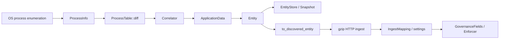
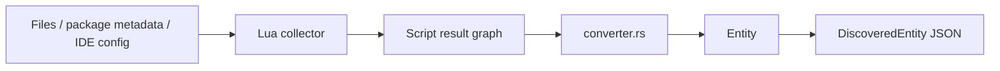
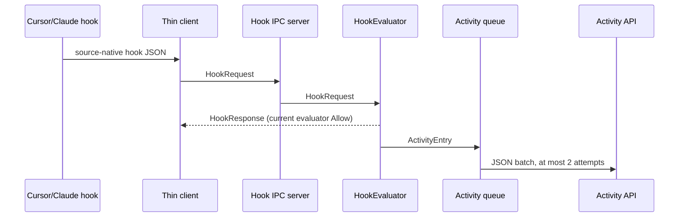
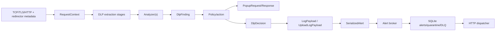
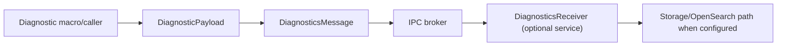
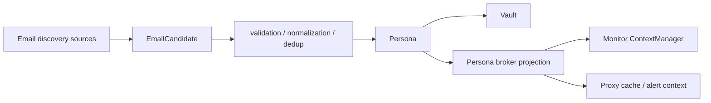

# 08 — Field Transformation and Information-Loss Lineage

## Scope

This chapter traces customer-relevant data from acquisition to the last
verified endpoint-side destination. It does not equate construction with
delivery. The row-level companion is
[field-lineage.csv](../../../matrices/sensor-intelligence/endpoint-sensor/field-lineage.csv).

The endpoint currently has four materially different output paths:

1. discovery state → gzip HTTP ingest;
2. hook activity → bounded memory → JSON HTTP batch;
3. proxy finding/upload evidence → broker → SQLite → HTTP dispatcher;
4. diagnostics → broker → optional receiver/storage/OpenSearch path.

These paths do not share one sequence space, acknowledgement model, retry
policy, durable outbox, or loss accounting contract.

## 1. Process-to-discovery lineage

### Acquisition

- macOS and Windows enumerators populate PID, names, executable path, PPID,
  start time, OS user and command line when those APIs return values.
- `normalize_name` changes process identity presentation. On Windows it
  lowercases and removes a terminal `.exe`.
- Permission failures and missing OS metadata commonly become `None` or empty
  vectors; they do not make the whole sample invalid.

### Correlation and entity creation

- `ProcessTable::diff` identifies starts/exits from snapshots. PID plus start
  data exists at this layer, but the entity identifier does not preserve a
  process-instance key.
- The correlator maps configured process names to application definitions.
- Application entity creation retains name, raw process name, PID, executable,
  command line and selected application metadata.
- **Information loss:** PPID, OS process start time and OS user are not fields
  in `ApplicationData`; process-exit handling does not produce a current
  backend tombstone and does not deactivate the Application.

### Store and current HTTP wire

- Entity IDs are deterministic per type-specific helper, but several
  user-scoped kinds use insufficient namespace input. MCP IDs omit parent
  application and transport.
- Rediscovery updates only envelope `name` and `last_seen_at`; existing
  kind-specific fields and governance remain. A changed executable path,
  command line, package version or MCP configuration can therefore remain
  stale.
- `to_discovered_entity` converts enums/times to strings, truncates overlong
  names, serializes kind-specific context to arbitrary JSON, and omits local
  fields such as `synced_to_backend` and `backend_sync_at`.
- A successful HTTP response is followed by mapping/governance application;
  current evidence proves response processing, not a durable per-record
  acknowledgement protocol.

## 2. Lua/package discovery lineage

- Scripts can inspect application support files, MCP configuration, hook
  definitions, skill Markdown paths, plugins, model declarations, repositories
  and package-manager results.
- The script result contains more graph structure than the entity store/wire
  can express.
- **Verified information loss:** converter logic drops or flattens raw graph
  relationships, script events, script error detail and parts of risk/source
  metadata. It also truncates selected strings and defaults missing values.
- Unknown/invalid script output is skipped or logged. A skipped node is not
  represented as a negative discovery assertion.
- Package scans produce Application entities. The current model represents
  installation observations, not a complete installed-software asset model
  with uninstall tombstones and per-package authoritative identifiers.

## 3. Hook request-to-activity lineage

- `HookRequest` carries source IDE/event names, session ID, working directory,
  tool name/input, command, file path, prompt and source timestamp. It has no
  per-request/event identifier.
- The evaluator creates `TurnState`/activity context and returns a decision.
  **Current implementation:** the production evaluator returns `Allow` and no
  detections.
- **Information loss:** activity output does not preserve `tool_input`,
  `command`, `session_id`, or the source-provided timestamp. It stamps local
  activity time, has no event/turn ID, and leaves skills, MCP servers, model
  and version empty in the current path.
- The queue holds 1,000 entries. Full-queue entries are dropped.
- Batches contain at most 100 entries and flush every 30 seconds. Two failed
  POST attempts drop the whole batch. There is no local WAL, replay cursor or
  per-entry acknowledgement.
- Thin-client parse/IPC failures generally fail open. That response proves only
  the hook was allowed to continue, not that the originating tool action
  executed or succeeded.

## 4. Proxy request/DLP lineage

### Request context

- Host selection priority is SNI → URI host → `Host` header → empty.
- Query parameters are URL decoded; repeated keys become arrays. Pairs lacking
  `=` are ignored.
- Headers are collapsed into a JSON object. Non-UTF-8 values become Rust debug
  strings; repeated header-name behavior is lossy because an object has one
  value per key.
- Persona fields are copied from an IPC cache. Before availability, user ID,
  email and tenant are literal `_pending_ipc_` placeholders.
- Process attribution can add PID/name; macOS extension state also has path and
  audit token, but `set_source_app` retains only PID and optional name.
- Body capture can retain a capped preview, full in-memory bytes or a temporary
  file. Error/60-second timeout returns an empty body/meta fallback.

### Extraction and detection

- DLP source can be body, query or header.
- Ordered transforms can URL-decode, parse/unescape/join JSON, strip HTML,
  decode claims/base64/UTF-8/plain text and feature-gated PDF/Office/OCR.
- **Potential issue:** an unknown transform warns and is converted to
  `JsonParse`; it is not a true no-op despite the nearby comment describing a
  default that does nothing.
- Selectors are JSONPath or regex capture. Invalid regex rejects configuration.
- Raw matched entities and optional snippets can traverse local UI and alert
  paths. They are highly sensitive content rather than harmless labels.

### Decision and effect semantics

- `DlpFinding.sensitive` and detections are detector results.
- `DlpDecision.verdict` is a request-level result, not an independently
  observed network effect.
- `mode`, `action_name`, `action_taken`, `outcome` and `prompt_changed` describe
  the selected or produced path. None by itself proves the remote destination
  did or did not receive data.
- The proxy forwards traffic inline, so the response path is evidence of proxy
  execution; a separate canonical `enforcement.effect_observed` event does not
  exist.

### Alert delivery

- DLP and upload builders can include Persona, device, process, URL, original
  and final prompt, justification, detections/snippets, filenames and file
  metadata.
- Prompt/detection fields may be reduced to fit the IPC frame budget;
  `payload_truncated` records that reduction for DLP payloads.
- Upload fields `path`, `lastModified`, `label` and `file_kind` are explicit
  placeholders in the current constructor unless later helpers populate them.
- Serialization failure becomes `{}` bytes rather than rejecting the alert.
- `SerializedAlert` becomes owned-string `AlertIpcPayload`, then `StoredAlert`.
  The reverse conversions leak `content_type` and `batch_family` strings to
  obtain `'static` lifetimes.
- The alert subsystem is durable in SQLite and supports retry, quarantine and
  DLQ, unlike discovery/activity. It is nevertheless alert-specific rather
  than a common sensor observation outbox.

## 5. Diagnostics and operational lineage

- Diagnostic ID/time are created at emission; component can be caller supplied
  or inferred from module path.
- Context is arbitrary JSON and can accidentally contain sensitive data.
- Event and lifecycle producers exist. No repository producer was found for
  the `Batch` diagnostics variant.
- The diagnostics receiver is not part of the active default service graph at
  the pinned revision. Producer success therefore must not be described as
  backend delivery.
- Proxy health, connection-pool, circuit-breaker and destination-resolution
  metrics are process-local snapshots or local endpoint/log outputs. They are
  not currently a Quilr telemetry contract.

## 6. Persona lineage

- Candidate source and confidence are retained during discovery.
- Persona validation/normalization selects identity data and persists the
  authenticated state in the vault path.
- Access and refresh tokens remain in Persona/vault workflows but are excluded
  from monitor `SyncUserContext` and proxy user-detail projections.
- Backend `fetch-user-details` data supplies account, groups, department and
  tenant/device kill switches. Missing kill-switch booleans default enabled.

## 7. Control/governance return lineage

- Ingest and delta HTTP responses map backend app IDs and settings back to
  `GovernanceFields`.
- `approval_status`, `criticality`, `execution_policy`, owner/category/domain
  and new-entity state are then consumed by store/enforcement paths.
- The entity envelope preserves governance during rediscovery.
- There is no version, ETag, command ID or source sequence on
  `GovernanceFields`; conflict/ordering semantics are therefore unresolved.
- A control decision is not the same as effect. The monitor can terminate
  matched processes, while hook evaluation currently allows. Proxy paths can
  block/transform inline. Each needs its own result semantics in a future
  adapter.

## Captured-but-not-emitted and emitted-but-not-durable summary

| Datum | Current fate | Platform consequence |
| --- | --- | --- |
| process PPID/start/user | captured in `ProcessInfo`, lost before entity | requires instrumentation for process-instance graph |
| process exit | observed internally, no backend tombstone/activity event | cannot prove application uninstall/inactivity |
| raw Lua relationships/events/errors | parsed, flattened/dropped | requires richer observation schema |
| hook tool input/command/source time | captured, omitted from activity | activity semantics incomplete |
| macOS audit token/process path | captured in attribution, omitted from request source app | strong attribution is lost |
| request/response headers | retained in dynamic context, not necessarily alert output | raw-only and privacy-sensitive |
| prompt/detection content | alert output with possible budget reduction | evidence needs truncation/provenance metadata |
| traffic `LogEvent` | local ring/file only | no central activity metric |
| proxy health counters | local endpoint/log only | adapter can scrape only with a new supported boundary |
| diagnostic events | broker-produced, receiver not default | delivery is unresolved in default deployment |
| discovery/activity | HTTP but not common durable outbox | loss/replay cannot be centrally reconciled |

## Adapter lineage requirements

`Proposed:` every adapter record should preserve:

- source record type and schema version;
- sensor version and pinned/source revision;
- source event/observation time plus adapter ingestion time;
- source-native ID and a deterministic idempotency key;
- capture point and platform;
- original identity namespace;
- transformation list and fields dropped/redacted;
- truncation/sampling flags;
- delivery attempt and acknowledgement state;
- coverage context showing which collectors were enabled and healthy.

No current endpoint record supplies all of these fields.
