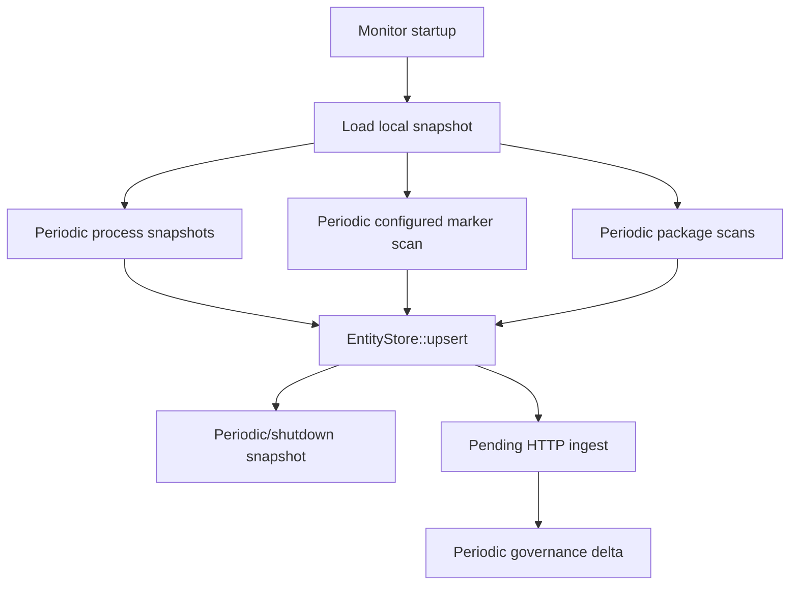

# 09 — Discovery and Inventory Contributions

## Verified discovery model

The endpoint contributes device-local observations from four mechanisms:

1. periodic macOS/Windows process snapshots and configured correlation;
2. selected marker-triggered Lua collectors;
3. npm, Cargo and Go package scans;
4. Persona/backend context supplied to the local agent.

It does **not** implement an exhaustive host, cloud, repository, runtime or
agent estate crawler. “Found in a local config or running process” must remain
distinct from “registered”, “deployed”, “active”, “owned” or “authoritative”.

The machine disposition is
[inventory-entities.csv](../../../matrices/sensor-intelligence/endpoint-sensor/inventory-entities.csv).

## Current native inventory families

| Native family | Direct observation | Lifecycle | Important limitation |
| --- | --- | --- | --- |
| Application | process correlation, Lua or package scan | first/last seen; rediscovery | process exit does not remove/deactivate it |
| MCP server | local config parsed by selected scripts | scan rediscovery only | ID omits parent app and transport; no connection health |
| Hook | selected local hook configuration | scan rediscovery and file integrity | installed/configured does not prove invocation |
| Skill | selected skill/config/Markdown metadata | scan rediscovery only | does not recursively inventory arbitrary Markdown |
| Agent | selected local config/script result | scan rediscovery only | usually a definition/config candidate, not runtime/run |
| Model | selected config/script declaration | scan rediscovery only | declaration is not an invocation or deployed model |
| Controlled repository | selected script output | scan rediscovery only | no GitHub API enumeration or file tree |
| Permission | selected config/script output | scan rediscovery only | not an authoritative OS/cloud permission graph |
| Plugin | selected config/script output | scan rediscovery only | installed/configured state depends collector |

## Canonical-estate disposition

### Directly supportable now

- `Device`: device/hostname/OS/architecture context is available, but the
  strongest ID varies by subsystem and live registration semantics are
  unresolved.
- `Application Installation` candidate: `ApplicationData` has install path,
  executable, version/vendor/bundle/package data when the source supplies it.
- `Process` observation: PID/name/path/PPID/start/user/command are observed
  transiently; only a subset survives current emission.
- `MCP Server` configuration candidate.
- `Tool/Hook`, `Skill`, `Agent Definition`, `Model declaration`,
  `Repository candidate`, `Permission declaration`, and `Plugin installation`
  candidates from source-specific Lua output.
- `Human`/`Directory Account` candidate from Persona/backend identity, with
  backend user ID and email.
- `Group` and `Department` membership claims from `fetch-user-details`.
- `Sensor` and `Enforcement Point` from installed agent/proxy/monitor version
  and service configuration, although there is no current canonical sensor
  registration observation.

### Centrally derivable with qualification

- `AI Product` or `Application Surface` can be mapped from recognized
  Application/MCP/Agent/Model names and backend canonical app IDs. This is a
  catalog mapping, not something the endpoint proves by name alone.
- `Application Account` can be suggested from Persona/request email plus
  destination application, but the endpoint does not prove the remote SaaS
  account ID or authenticated session.
- `Binary` can be candidate-materialized from executable path and optional
  digest sources. Current discovery output lacks a general code-signing/digest
  record.
- `Agent Deployment` can be inferred only when a local Agent definition is
  tied to a device/path. Runtime, session and run still require events not
  emitted today.
- `MCP Server Deployment` can be modeled as local configuration on a device;
  active connection and server health remain unknown.

### Not supportable as current direct inventory

- Cloud instances, serverless functions, Kubernetes clusters/namespaces,
  containers and CI/CD runners.
- GitHub organizations/repositories/folders/files exhaustively. A selected
  local repository may be reported; no GitHub API crawler exists.
- Browser installation/profile/extension inventory as canonical objects.
- Enterprise subscriptions, provider billing accounts and authoritative SaaS
  tenants.
- Model provider/family/version/deployment/route with authoritative identity.
- Agent runtime/session/run/step.
- MCP connection, OAuth grant, tool version/schema digest and tool-call result.
- Credential objects beyond sensitive token material and unverified metadata.
- Knowledge bases, memory stores, connector accounts and certifications.

## Discovery cadence and reconciliation

- Process discovery is periodic snapshot/diff, not an OS event stream.
- Marker/Lua and package discovery are periodic scans controlled by current
  configuration.
- The snapshot restores local current state. Version is written but not used as
  a compatibility gate on load.
- Rediscovery refreshes envelope name/last-seen, not all kind fields.
- Deletion/tombstone semantics are incomplete. `EntityStore::remove` exists and
  emits a transient change event, but ordinary process exit does not use it to
  express backend deletion.
- No source-completeness boundary or “scan finished for scope X” record is
  emitted. A missing entity cannot be interpreted as absent.
- Source outage must therefore reduce freshness/coverage; it must not delete
  canonical inventory.

## Object-specific cautions

### Application versus process

The Application entity is durable discovery state and can represent a package
or correlated application. PID is an observation attribute. It is not a
process-instance entity because the entity ID is based on application
name/install path and persists across runs.

### Agent definition versus runtime

`AgentData` contains name, type, framework, configuration path and selected
model/tool/MCP names. It is evidence of a local definition/configuration. There
is no native run/session/step identifier or outcome stream.

### Model declaration versus invocation

`ModelData` may name provider/model/configuration. The proxy can see selected AI
application traffic and DLP content, but it does not parse a general
provider/model invocation contract. Model declarations must not be counted as
model calls.

### MCP server versus connection/tool use

`McpServerData` represents discovered configuration. Hook `tool_name` activity
does not contain a stable MCP server/tool namespace, tool schema digest,
arguments in the emitted ActivityEntry, result or effect. A configured server
is not an observed connection.

### Repository candidate versus repository inventory

`ControlledRepoData` can retain a selected local repository path/name and
metadata. It does not enumerate all local Git roots or remote GitHub assets and
does not traverse folders/files into canonical assets.

## Platform availability summary

| Contribution | Availability |
| --- | --- |
| Current nine entity kinds | `Available through adapter mapping only` |
| Full-fidelity process instance | `Requires minor sensor instrumentation` |
| Application uninstall/tombstone | `Requires substantial sensor changes` |
| Device and Persona identity | `Available through adapter mapping only` |
| MCP configured deployment | `Available through adapter mapping only` |
| MCP connection/tool call/result | `Requires substantial sensor changes` |
| Local repository candidate | `Available through adapter mapping only` |
| Exhaustive GitHub/cloud/serverless/CI estate | `Requires an external authoritative source` |
| Agent definition candidate | `Available through adapter mapping only` |
| Agent runtime/session/run/step | `Requires substantial sensor changes` |
| Proxy-observed application use | `Derivable centrally from current output` only where alert/activity delivery exists |

## Required inventory adapter behavior

`Proposed:` emit observations, not canonical truth. Each observation should
include source scope, scan ID, collector ID/version, first/last observed time,
source-native key, device identity, completeness state and tombstone semantics.
The canonical platform should own entity resolution, alias merging, freshness,
staleness and source-conflict handling.

