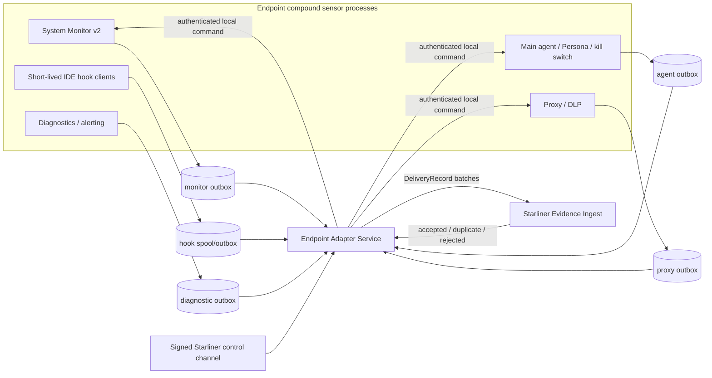

# 18 — Endpoint Adapter Architecture

## Decision

**Proposed:** implement the endpoint adapter as a compound, host-local
integration:

- a small Rust `NativeCaptureBridge` embedded in each producing process;
- component-local durable outbox partitions so capture can survive the
  producer or collector restarting;
- one native endpoint-adapter service that owns enrollment, component
  registration, mapping, delivery, acknowledgements, replay, health, and the
  signed control-channel client;
- a thin hook-client spool path because Cursor/Claude invoke short-lived
  executables before the System Monitor can accept their IPC request.

This is a combination of embedded library and native service. A central polling
adapter cannot recover dropped in-memory hook/proxy/enforcement records. A
sidecar alone cannot see the native semantic objects without either invasive
log parsing or in-process bridges.

## Current versus target

No code described in this chapter as `Proposed` exists in the pinned endpoint
repositories.

The current reusable pieces are:

- typed native records and converters in System Monitor;
- the entity snapshot writer;
- the hook framed-JSON protocol and JSONL append path;
- proxy `RequestContext`, DLP, policy, alert, and health models;
- core alert SQLite/retry implementation ideas;
- Persona/tenant/device context;
- service lifecycle/supervisor patterns;
- pinned local broker transport;
- Starliner contracts, delivery wrapper, reference SQLite outbox, ingest
  result model, batching, retry, and safe-error behavior in the separately
  inspected `project-starliner-audit`.

They do not yet compose into a production endpoint adapter.

## Authoritative Starliner contract constraint

`project-starliner-audit/docs/adr/ADR-001-starliner-abi-source-of-truth.md`
marks `starliner_contracts` as the M1 ABI source of truth. New records must not
use the legacy `starliner.contracts` models.

**Verified external contract evidence:** the current authoritative package
registers:

- `SourceObservation`;
- `ActionEvent`;
- `MetricEvent`;
- `FindingSignal`;
- `EntitySnapshot`;
- `RelationshipEvent`;
- `DecisionResult`;
- `TraceSpan`;
- `SensorHealthEvent`;
- `SensorManifest`;
- certification records.

The `DeliveryRecord` wrapper supplies tenant, record/schema type, sensor and
runtime instance, adapter/contract/certification versions, origin, evidence
quality, event time, idempotency key, body/record hashes, and a safe summary.

### Contract mismatch that must be resolved

**Contradiction:** the cross-sensor draft
`docs/quilr2-cross-sensor/schemas/source-observation.schema.json` is a
pre-resolution source statement with native identifiers, native attributes,
raw evidence reference, operation, and optional source sequence. The
authoritative `starliner_contracts.observations.SourceObservation` instead
requires a `canonical_entity`, `source_external_id`, and only bounded scalar
attributes.

The sensor mission explicitly forbids the endpoint adapter from assigning final
canonical identity. Therefore the endpoint cannot truthfully map all inventory
records to the authoritative `SourceObservation` without one of:

1. an accepted ABI extension that carries source-native entity candidates
   before resolution;
2. an ingest-side resolver that accepts a separate immutable native/evidence
   record and creates the authoritative `SourceObservation`;
3. an explicitly approved rule that source-qualified IDs are valid temporary
   `canonical_entity` references, with central reconciliation semantics.

**Unresolved / MVS blocker:** no checked artifact selects one of these three.
The adapter design preserves native identity and refuses to silently treat
`Entity.id` or backend `canonical_id` as a final Quilr canonical ID.

**Additional contract gap:** current `FindingSignal.signal_type` is a closed
list containing MCP and LLM signal names. Endpoint discovery, hook, process
enforcement, proxy-DLP, and coverage signals require approved additions before
delivery. `EntityKind` also lacks several endpoint-native kinds such as IDE
hook, skill, plugin, permission, local model installation, and MCP server
configuration as distinct types.

## Runtime topology



Every outbox and adapter edge above is `Proposed`. The source processes,
native objects, existing files, and current IPC/HTTP outputs are `Verified in
source`.

## Internal capture envelope

Before a platform ABI body exists, every bridge needs one versioned internal
record. It is not a canonical platform entity:

```text
native_record_id
tenant_id
sensor_instance_id
component
component_instance_id
component_version
native_record_type
native_schema_version
component_sequence
boot_id / scan_id / session_id when available
occurred_at
observed_at
captured_at
collection_method
collection_scope
native_identifiers
native_payload or protected evidence reference
payload_digest
privacy_labels
evidence_quality
```

`native_record_id` must be stable under retry. If the source has no event ID,
derive it with an HMAC keyed per tenant/deployment over a versioned canonical
subset plus component instance, component sequence, and event time. A raw hash
alone is insufficient because identical legitimate actions can recur.

Component sequence provides local ordering only. The adapter must not claim a
single OS-wide causal order across System Monitor, proxy, hooks, and agent
processes.

## Capture bridges

### Inventory bridge

Insertion points:

- entity constructors before `EntityStore::upsert`;
- `EntityStore` mutation results;
- `ProcessDelta`;
- complete-scan begin/end summaries;
- snapshot load/save and snapshot version;
- app-ID/governance responses as separate control/provenance records.

The bridge retains `EntityKind`, all native detail fields, Lua/native parser
origin, rule/script version, and relationship candidates. It does not wait for
the backend app-ID resolver before preserving the source observation.

### Hook bridge

Insertion points:

- the IDE-native input after parse;
- the normalized `HookRequest`;
- the `HookResponse`;
- queue/aggregation completion;
- hook install/repair/remove outcomes.

The bridge creates an event ID absent from the current protocol and retains
`session_id`. It never marks an `Allow` decision as executed or successful.
The thin executable needs a small safe local spool for requests that cannot
reach the manager; the existing JSONL may be migrated, but its schema,
permissions, rotation, and acknowledgement must be upgraded.

### Proxy bridge

Insertion points:

- request/connection attribution after `RequestContext` enrichment;
- extraction result;
- DLP detection result;
- policy request/result including timeout/fallback;
- user prompt/justification result;
- block/local-response/forward attempt;
- upstream response/error;
- final request profile;
- alert construction/delivery reference;
- circuit-breaker, extension, packet redirector, and health transitions.

High-risk content—prompts, bodies, headers, file bytes, snippets, tokens, and
credentials—must not enter the ordinary outbox body. Store only bounded safe
metadata and protected evidence references after policy-driven redaction.

### Enforcement bridge

Emit distinct records for:

```text
decision
→ requested action
→ each platform action attempt
→ each result
→ notification/audit delivery
→ final re-observation
```

The current implementation can supply the first five incompletely. Final
universal effect verification is new instrumentation.

### Health/coverage bridge

Emit component start/ready/degraded/stopping/stopped, scan coverage, hook
integrity, config freshness, outbox depth/age, delivery results, extension
heartbeat, policy freshness, privacy rejection, and version/certification
state. Do not derive readiness solely from a process being alive.

## Adapter components

The build sheet is
[adapter-components.csv](../../../matrices/sensor-intelligence/endpoint-sensor/adapter-components.csv).

Logical modules:

1. `NativeCaptureBridge`
2. `NativeRecordDecoder`
3. `ObservationMapper`
4. `IdentifierExtractor`
5. `RelationshipAssertionMapper`
6. `ActivityEventMapper`
7. `MetricMapper`
8. `FindingSignalMapper`
9. `EvidenceReferenceBuilder`
10. `PrivacyFilter`
11. `CapabilityManifestProvider`
12. `HealthReporter`
13. `OutboxWriter`
14. `BatchPublisher`
15. `AcknowledgementHandler`
16. `ReplayHandler`
17. `ControlCommandHandler`
18. `EffectReporter`

## Process and security boundaries

### Local capture authentication

The existing broker/socket transports do not prove workload identity. The
adapter service must:

- use OS peer credentials on Unix and SID/token validation on Windows where
  available;
- restrict socket/pipe ACLs to installed Quilr components;
- register each component build and expected executable identity;
- bind every record to component, deployment, tenant, and runtime instance;
- reject tenant changes after enrollment;
- record safe rejection metadata without logging raw payloads.

The current hook socket deliberately allows normal IDE users to connect. Hook
records from that socket should therefore carry lower evidence quality unless
the thin client can sign or authenticate its component identity.

### Storage

- Per-component outboxes prevent proxy traffic from starving inventory or
  control-effect records.
- SQLite WAL is acceptable as a reference/MVS candidate on a workstation only
  after crash, corruption, contention, quota, key protection, and upgrade tests.
- The inspected Starliner `LocalSensorOutbox` is explicitly reference/dev, not
  production.
- Outbox bodies and protected evidence require OS-backed encryption keys and
  tenant-scoped retention.
- Credentials and raw bearer values are never stored in ordinary telemetry.

### Control separation

Telemetry ingest responses may acknowledge telemetry only. Administrative
commands must arrive through a separately authenticated and signed channel,
validate tenant/sensor/component/command/expiry/nonce, and produce
`ControlResult` plus `ObservedEffect`. Existing governance delta and kill-switch
paths remain compatibility controls until migrated; they are not silently
reclassified as signed Starliner commands.

## Failure isolation and backpressure

| Failure | Required adapter behavior |
| --- | --- |
| Central network unavailable | keep committed outbox records; exponential backoff with jitter |
| Ingest returns duplicate | mark complete and retain evidence linkage |
| Ingest rejects record | terminal safe error; health degradation; no raw payload in logs |
| Outbox quota near full | shed lowest-priority diagnostic samples first; never silently drop control/effect or inventory tombstones |
| Outbox full | expose unhealthy coverage; configured sensor behavior decides hot-path continue/block independently of telemetry |
| Mapper bug | retain immutable native record/evidence for bounded replay; quarantine invalid derived record |
| Privacy rule rejects payload | store only safe rejection metadata and metric; do not persist forbidden content |
| Adapter service down | component outboxes continue accepting within quota; supervisor restarts service |
| Component sequence reset | new component instance/boot ID; never reuse the same idempotency namespace |
| Clock moves backward | preserve observed clock plus monotonic/component sequence; flag clock health |

## Upgrade model

Adapter, native schema, Starliner contract, capability manifest, product commit,
and certification IDs must be independently versioned. Upgrade steps:

1. stop capture or enter draining state;
2. commit/close outbox transactions;
3. install compatible binary and schema migrations;
4. start with a new runtime instance ID;
5. run self-tests;
6. publish manifest/health;
7. replay pending compatible records;
8. quarantine unsupported records without deleting them.

Rollback is safe only if the previous binary can read the migrated outbox or a
reversible migration/export exists.

## Performance budget

**Potential issue requiring measurement:** proxy and hook paths are latency
sensitive. Required tests must measure:

- serialization and privacy-filter CPU;
- SQLite/WAL commit latency and tail latency;
- contention across concurrent proxy requests;
- maximum queue growth at sustained traffic;
- batching/compression cost;
- DLP raw-evidence hashing cost;
- memory overhead when the collector is unavailable.

Telemetry capture should run after the policy decision where it cannot change a
decision, except that a configured audit-grade mode may require durable local
admission before returning. The product must state that trade-off explicitly.

## Test strategy

At minimum:

- golden native record → adapter record → authoritative Starliner body;
- every native entity kind and every `HookRequest.event_name`;
- proxy allow/block/justify/timeout/analyzer-failure paths;
- enforcement attempt/success/partial/failure;
- duplicate/replay/out-of-order/late/correction;
- multi-process sequence reset;
- outbox crash between commit/send/ack;
- network outage and 429/503/5xx;
- 400/413/rejected terminal handling;
- privacy fixtures containing bearer tokens, API keys, prompt text, file
  content, and headers;
- tenant mismatch and unauthenticated local producer;
- capability degradation and unsupported adapter/schema version;
- upgrade/rollback with pending records.

## Delivery status

**Current implementation:** absent.

**Availability:** core entity/hook/proxy/control data is `Available through
adapter mapping only`; stable source records, endpoint ABI coverage, durable
admission, final enforcement-effect verification, and production workload
identity require sensor and Starliner work.

