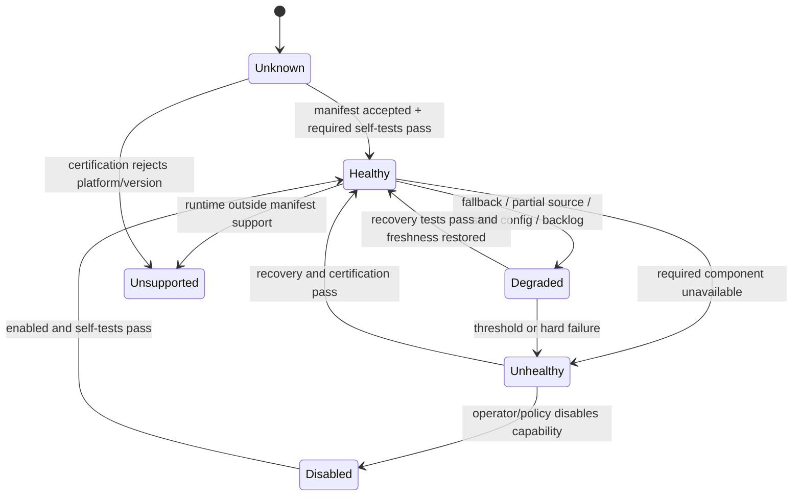

# 24 — Coverage, Capabilities, and Health

## Why coverage is part of every fact

An endpoint observation proves that one configured capture path saw something.
It does not prove that the endpoint, fleet, user, process tree, repository,
network path, or time interval was exhaustively observed. The platform must
therefore materialize positive observations separately from coverage.

The machine-readable companions are:

- [coverage.csv](../../../matrices/sensor-intelligence/endpoint-sensor/coverage.csv)
- [health-metrics.csv](../../../matrices/sensor-intelligence/endpoint-sensor/health-metrics.csv)
- [sensor-capability-manifest.yaml](../../../schemas/sensor-intelligence/endpoint-sensor/sensor-capability-manifest.yaml)
- [coverage-profile.yaml](../../../schemas/sensor-intelligence/endpoint-sensor/coverage-profile.yaml)

## Current platform support

`Verified:` active System Monitor and proxy implementation paths target macOS
and Windows. The source contains no active Linux endpoint runtime. Linux,
container, Kubernetes, cloud-control-plane, serverless and CI-runner coverage
must not be inferred from the product name.

| Environment | Current endpoint contribution | Coverage interpretation |
| --- | --- | --- |
| macOS workstation/server | process discovery, configured file/package scans, selected Persona sources, hooks, proxy and Network Extension paths | Conditional on installation, privileges, configuration, component health and source-specific scope |
| Windows workstation/server | process discovery, configured file/package scans, selected Persona sources, hooks, proxy and WinDivert paths | Same qualification; packet/process attribution has race and access limits |
| Linux host | no active endpoint implementation found | `Unsupported` |
| Cloud VM | only if it runs a supported macOS/Windows endpoint and is enrolled | Cloud instance identity/estate completeness is not captured |
| Container/Kubernetes | no container-runtime or orchestrator inventory source | `Unsupported` |
| Serverless | no invocation/runtime/control-plane source | `Unsupported` |
| CI/CD runner | possible incidental host observation on a supported installed OS | runner/job identity and ephemeral completeness are absent |
| Browser-only/mobile | no general browser/mobile sensor | `Unsupported`; browser evidence requires another sensor |

## Compound sensor model

The endpoint should register as one sensor instance with independently
reporting sub-sensors. A single `healthy=true` value would hide materially
different failure and bypass domains.

| Sub-sensor | Current mode | Supported scope | What “healthy” can mean |
| --- | --- | --- | --- |
| `system_monitor.process_discovery` | Observe | macOS/Windows process snapshots | process enumerator and polling loop completed within cadence |
| `system_monitor.config_discovery` | Observe | configured Lua roots/scripts on macOS/Windows | every expected script/root reports completion or explicit partial/error |
| `system_monitor.package_discovery` | Observe | configured package ecosystems/tools | each enabled ecosystem reports attempt, result and duration |
| `system_monitor.governance_sync` | Configure/Enforce | current dashboard delta and application process action | configuration fresh; action health must be separate from sync health |
| `ide_hooks` | Observe only | supported Cursor/Claude configurations when enabled | installation/integrity, IPC self-test and activity path reported separately |
| `proxy.explicit` | Observe/conditional Enforce | clients explicitly routed to HTTP/CONNECT proxy | listeners ready, request path running, policy/DLP state known |
| `proxy.transparent_macos` | Observe/conditional Enforce | Network Extension included rules and working IPC | extension active, heartbeat current and redirect/relay self-test succeeds |
| `proxy.transparent_windows` | Observe/conditional Enforce | WinDivert filter/driver paths | driver/filter active and attribution/interception self-test succeeds |
| `proxy.dlp` | Observe/conditional Enforce | captured supported content/request stages | analyzer/config mode, fallback and policy readiness known |
| `persona_identity` | Context | configured local identity sources and current Persona service | source attempt ledger and Persona freshness, not identity authority |
| `application_enforcement` | Enforce/partial verification | macOS/Windows process termination for Blocked/Quarantined applications | privileges and action path ready; success still needs final effect observation |
| `alerting` | Export | subsystem-specific alert SQLite/broker/backend | queue, retries, dead-letter and delivery state known |
| `diagnostics` | Export | instrumented diagnostic call sites | transport ready; absence of diagnostics is not component health |
| `delivery_adapter` | Not implemented | proposed all normalized endpoint records | enrollment, schema, outbox, delivery and rejection health |

`Contradiction:` the hook wire protocol can represent `Deny`, `Ask`, and
`Justify`, but the active evaluator returns `Allow` and has no active detector.
The manifest therefore declares `observe`, not `enforce`.

## Coverage record semantics

Every scan- or interception-oriented capability needs a `CoverageRecord` with:

- tenant, sensor instance, device, component and capability;
- supported OS/runtime and current operating mode;
- source name plus configured roots, profiles, ecosystems, filters, ports or
  domains where disclosure is safe;
- attempted, started and completed times;
- status: `complete`, `partial`, `failed`, `cancelled`, `unsupported`,
  `disabled`, or `unknown`;
- item/byte/action counts and source-specific error classes;
- source cursor/config/rule versions;
- freshness deadline and clock-quality state;
- explicit blind spots;
- adapter/outbox admission status for the coverage record itself.

“Complete” is always relative to the declared source and configuration. For
example, a complete Lua scan means the selected scripts and configured roots
completed; it does not mean every file or repository on the host was examined.

## Positive versus negative evidence

| Claim | Minimum evidence |
| --- | --- |
| Application/process observed | source observation; process/source provenance; event/observation time |
| Application not observed in one poll | a complete process snapshot for that poll; still not durable removal |
| Config artifact absent | complete scan of the exact expected roots/parser set and valid permissions |
| Proxy action absent | complete interception for the relevant route/protocol/process plus listener/redirector health |
| Hook activity absent | supported hook installed; integrity and IPC healthy; IDE/event type in configured scope |
| Gateway bypass possible | positive endpoint action plus healthy complete external gateway coverage and late window |
| Sensor stale | declared cadence plus missing health/coverage beyond threshold; enrollment remains active |

`Verified:` the current entity store has no trustworthy generic
deleted/expired transition for an application when its process exits. Do not
turn non-observation into inventory deletion.

## Current health surfaces

The proxy exposes `/health` and `/metrics` and maintains health-state,
request/failure, upstream, DNS, timeout, circuit-breaker and last-success
counters. It also logs pool, destination-resolution, DLP-config and traffic
drop metrics.

`Potential issue:` `failure_window_secs` is configured, but the inspected
health-state calculation uses process-lifetime cumulative request counters.
The declared time window is not reflected in that calculation.

Other components expose fragmented service states, logs, status messages,
snapshots and local queues rather than a common sensor-health contract.
`LifecycleManager` recording `Running` means its start step returned; it does
not certify downstream listener readiness, Persona freshness, hook integrity,
redirector health, policy load, scan completion or export.

## Required self-tests

| Capability | Proposed self-test | Failure classification |
| --- | --- | --- |
| Process discovery | enumerate current process and return source/capability/version | capture unavailable or insufficient privilege |
| Lua/file discovery | run a non-sensitive canary fixture through each enabled parser/root policy | parser/root unavailable, partial or version mismatch |
| Package discovery | query each enabled ecosystem/tool and parse a known-safe version result | tool missing, permission denied, parse failed |
| Hook installation | semantic expected/actual config comparison plus hook-client executable digest | unsupported IDE, missing, modified or repair failed |
| Hook pipeline | local synthetic request with a reserved self-test marker and no user content | client, IPC, queue or evaluator failure |
| Explicit proxy | loopback HTTP/CONNECT readiness probe outside user traffic | bind/listener/TLS path failure |
| macOS transparent path | extension heartbeat and synthetic flow/metadata round trip | extension, IPC, rules or attribution failure |
| Windows transparent path | driver/filter state and synthetic tuple attribution | driver, filter, receive/inject or attribution failure |
| DLP | safe canary per active analyzer plus config/rule version | unavailable, fallback, stale config or detector mismatch |
| Policy | safe deterministic test policy evaluation | not ready, timeout or semantic mismatch |
| Enforcement | privilege/preflight test; effect tests only in controlled certification | unavailable privilege or unsupported platform |
| Outbox/delivery | local append/read/ack/recovery and signed ingest canary | disk, quota, schema, auth, network or admission failure |
| Clock | compare trusted time source or platform-delivery clock bounds | skew/uncertainty above correlation threshold |

Self-tests must be labeled and excluded from customer activity/findings.

## Health state model

`Inference:` this is the proposed common platform state model. Current endpoint
components do not share it.

## Outbox and delivery health

The proposed adapter must emit at least:

- records appended, admitted, acknowledged, retryable and terminally rejected;
- oldest unacknowledged age and records/bytes by partition;
- quota utilization, eviction/drop count and corruption recovery;
- authentication/certificate and schema/contract failures;
- retry count/backoff and last successful delivery;
- in-flight lease age and recovery count;
- source-to-outbox and outbox-to-ack latency;
- source coverage records waiting behind the same delivery path.

`Potential issue requiring validation:` the inspected Starliner reference
delivery path marks rows `in_flight`, while the due-record query selects
pending/retryable rows and no lease recovery was found. Production design must
prove crash recovery rather than copy that behavior blindly.

## Capability certification

At enrollment and after update/config change, the adapter should:

1. build the exact compound manifest;
2. attach sensor, adapter, contract and component versions;
3. run required local self-tests;
4. submit the manifest and certification results;
5. accept the platform's supported/degraded/unsupported decision;
6. emit a new coverage interval whenever capability or scope changes.

A capability is not inferred from an installed binary. `Installed`,
`configured`, `ready`, `observing`, `enforcing`, `effect verified`, and
`delivering` are separate states.

## Product use

Coverage belongs on Inventory, Activity, Findings, Entity Detail, Analytics and
Operator surfaces:

- Inventory shows last observation and the coverage source that could refresh
  it.
- Activity shows capture mode, source health and late/replay status.
- Findings show which sources were required, present, degraded or absent.
- Analytics suppresses or annotates rates when denominators/coverage are
  incomplete.
- Operator views show component/self-test/outbox detail and safe error data.

Coverage records are operational evidence. They are not customer activity and
should not flood the activity timeline.

## Source evidence

- `work/sentinel-endpoint-agent/system-monitor/v2/src/main.rs`
- `work/sentinel-endpoint-agent/system-monitor/v2/src/orchestrator.rs`
- `work/sentinel-endpoint-agent/system-monitor/v2/src/worker.rs`
- `work/sentinel-endpoint-agent/system-monitor/v2/src/hook_manager/**`
- `work/sentinel-endpoint-agent/agent/src/service_manager.rs`
- `work/sentinel-endpoint-agent/proxy/src/health_monitor.rs`
- `work/sentinel-endpoint-agent/proxy/src/health_endpoint.rs`
- `work/sentinel-endpoint-agent/proxy/src/metrics.rs`
- `work/sentinel-endpoint-agent/proxy/src/packet_redirector/**`
- `work/sentinel-endpoint-agent/proxy/swift/TransparentProxyExtension/Sources/TransparentProxyProvider.swift`

