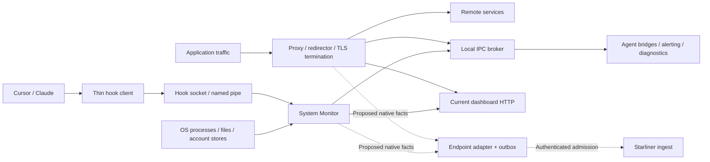

# 25 — Security, Privacy, and Retention

## Scope and evidence

This chapter treats the endpoint as a privileged sensor and enforcement point,
not as a passive telemetry library. It can enumerate processes and files, read
configured local data, discover identity hints, intercept plaintext application
traffic through TLS termination, terminate processes, modify IDE configuration,
install trust/network components, and transmit records across local and remote
boundaries.

The per-field privacy ledger is
[privacy-disposition.csv](../../../matrices/sensor-intelligence/endpoint-sensor/privacy-disposition.csv).
It contains one row for each of the 639 verified native fields. The target
classifications are conservative design dispositions, not claims that current
code already enforces those policies.

## Per-field classification result

| Proposed data class | Fields | Default handling |
| --- | ---: | --- |
| Restricted source metadata | 300 | Normalize/minimize; retain only for mapped purpose |
| Potentially sensitive metadata | 79 | Hide by default; redact/hash where raw value is unnecessary |
| Operational telemetry | 81 | Bounded labels; exclude content and credentials |
| Local path, command or resource locator metadata | 54 | Normalize; remove home/query/userinfo; gated raw evidence |
| Identity or tenant-linked metadata | 55 | Namespace and resolve; restrict raw display |
| Potentially sensitive user/application content | 36 | Derived labels/protected evidence; raw off by default |
| Network and destination metadata | 31 | Minimum attribution; strip credential-bearing URL parts |
| Secret or credential material | 3 | Discard raw; never ordinary telemetry/logging |

`Inference:` counts are produced deterministically from the verified field
dictionary using the checked-in
`tools/generate_privacy_disposition.py`. Ambiguous fields inherit the source
sensitivity and are classified restrictively. Product/security review is still
required before this becomes policy.

## Data-minimization hierarchy

For every capture point, use the least sensitive representation that answers
the accepted platform question:

1. count/status/category;
2. normalized source-native attribute;
3. tenant-scoped one-way digest;
4. redacted excerpt;
5. encrypted protected-evidence object;
6. raw content only when explicitly enabled, justified and access-controlled.

Inventory and events should not embed raw evidence. They should carry an
`EvidenceReference` with digest, type, collection reason, redaction state,
retention class and authorization requirements.

## High-risk native data

### Intercepted content

Proxy request/response bodies, headers, URIs, prompts, snippets,
justifications, extracted document text and detector context may contain
credentials, personal data, customer source, regulated records or proprietary
content. The proxy terminates TLS in selected paths and therefore handles
plaintext by design.

Current behavior varies:

- selected body paths can use memory or temporary files;
- detectors can return entity/snippet information;
- traffic logging can write timestamp, method, URI and status locally;
- alert payloads can persist in SQLite and travel to backend HTTP;
- request/context fields can reach ordinary logs;
- no repository-wide field scrubber or evidence-access service exists.

Target behavior:

- evaluate content in memory when possible;
- export categories, rule IDs and digests rather than content;
- strip credentials, cookies, authorization and URL userinfo/query secrets;
- store permitted raw evidence separately with envelope encryption and audited
  access;
- attach a retention deadline and deletion outcome;
- ensure no raw content appears in metric labels, retry errors or finding titles.

### Hook activity

Native `HookRequest` can include prompt, tool input, command, file path and
working directory. The current reduced `ActivityEntry` loses much of that
detail, while optional JSONL/debug paths may retain richer source data.

The target adapter should capture the native request before lossy aggregation,
but must not automatically export its raw prompt/tool content. It should emit:

- IDE/event/tool/action categories;
- event/session alias with source namespace;
- normalized path/repository candidate where needed;
- content digest and policy labels;
- protected evidence only under tenant opt-in.

The current hook IPC peer is not authenticated in checked code. Data from that
boundary must carry reduced provenance/confidence until local peer verification
is implemented.

### File, repository and process data

Paths, commands, arguments, environment names/values, package metadata,
workspace roots, process names and executable paths can identify people,
projects, secrets and proprietary software.

- Environment-variable *names* can be useful without their values.
- Raw environment-variable values should not be ordinary telemetry.
- User-home prefixes should be normalized or pseudonymized when the exact path
  is not necessary.
- Commands/arguments require secret scanning and tokenization before export.
- File content should be represented by typed parser result plus digest unless
  protected evidence collection is separately approved.
- PID is ephemeral evidence, not a durable global identifier; combine it with
  device/boot/start-time evidence where available.

### Identity

Persona and discovery sources can expose email, OS user, browser/mail account
hints, groups, roles, tenant/subscriber and device identifiers. These are
identifier candidates, not automatically authoritative identities.

Required handling:

- preserve namespace and issuer/source;
- never link across tenants by raw email/digest;
- use tenant-scoped pseudonyms for display/correlation when possible;
- keep raw aliases behind role authorization;
- record match method/confidence and conflict history;
- do not treat access/refresh tokens as identity attributes.

## Secrets and credentials

`Verified:` access-token fields are intentionally skipped in some serialized
contexts, and current clients use tokens in headers. This is not a universal
redaction guarantee: debug types, errors, command arguments, environment,
request headers, raw broker payloads and logs remain separate paths.

Target rules:

| Secret class | Target rule |
| --- | --- |
| Access/refresh/session token | Never platform observation/evidence body; process memory/vault only |
| Authorization/cookie header | Remove before logging/export; record presence/auth scheme only if required |
| API/private key or password | Drop raw; detector category plus optional non-reversible tenant digest |
| Environment secret | Preserve variable name/risk classification, never value |
| TLS CA/private key | Installer/vault boundary only; never telemetry |
| HMAC/signing secret | Deployment secret manager only; never endpoint observation |

Metric labels, error classes, file names and evidence locators must be tested
against accidental secret inclusion.

## Trust boundaries

### Local OS to privileged component

Process/file/account sources are attacker- or user-influenced input. Lua parser
output, paths, plist/JSON/TOML/package-manager results and process metadata need
schema/length/version validation before they become platform facts.

`Verified:` the active v2 Lua scanner executes configured files without
enforcing the bundle signature path. The Lua sandbox restricts selected
libraries/capabilities, but `fs.read` can read arbitrary paths available to the
monitor process. Script directory integrity and process filesystem privilege
therefore matter.

### Hook client to hook server

Unix uses a filesystem-local socket with mode `0666`; Windows rejects remote
clients but applies a permissive DACL. No peer credential/signature binding was
found. Requests are framed JSON, and the inspected server does not enforce a
frame-size maximum before allocation.

`Potential issue requiring validation:` a local process that can connect can
fabricate hook activity. Current evaluation returns Allow, so the immediate
impact is evidence integrity rather than a newly proven policy bypass.

### Local broker IPC

Persona, kill-switch, alerting, diagnostics and template flows trust
registration/source strings under the checked IPC model. Repository evidence
does not establish cryptographically bound publisher identity. Deployment ACLs
remain `Unresolved`.

The adapter must not treat a broker source string as equivalent to a signed
component identity. Prefer in-process bridges or authenticated, least-privilege
local endpoints.

### Proxy interception

Explicit non-loopback binds can expose an unauthenticated proxy to reachable
peers. `/health` and `/metrics` are served without application authentication
on the proxy listener. On macOS, the extension control socket uses mode `0600`,
but the inspected local relay/heartbeat path has no challenge/token and trusts
caller-supplied flow/process metadata.

`Potential issue requiring validation:` a reachable/local process could
misstate relay metadata or consume proxy/health surfaces depending on actual
bind, ACL, firewall and process sandbox configuration.

### Endpoint to current backend

Current System Monitor and proxy calls use Persona-derived tenant/subscriber
context and optional bearer material, but authentication paths are not uniform.
The current dashboard also has a development mode where tenant headers are
accepted when the server HMAC secret is empty.

The proposed adapter boundary requires:

- authenticated enrollment and rotating sensor credentials;
- tenant and sensor identity cryptographically bound to admission;
- TLS with normal peer verification;
- per-record schema/admission result;
- replay/idempotency protection;
- no trust in body-supplied tenant over credential-bound tenant;
- isolated outbox partitions and tenant-safe error reporting.

## Tenant isolation

The endpoint generally runs for one active Persona/tenant context, but
tenant-safe platform integration cannot rely on that convention alone.

Required invariants:

1. tenant is derived from authenticated enrollment, not arbitrary source data;
2. each outbox partition is bound to that enrollment;
3. record IDs and digests are tenant-scoped;
4. identity resolution cannot link raw identifiers across tenants;
5. evidence encryption/access policies are tenant-bound;
6. switching Persona/tenant closes or drains the old partition before new
   records are admitted;
7. diagnostics and health contain no previous-tenant content;
8. retries cannot be delivered using a different tenant credential.

`Unresolved:` current runtime behavior during a live tenant/account switch,
including all in-memory caches, snapshots and queues.

## Authorization

The endpoint has policy inputs and local decisions, but no single source proves
that a human is authorized to approve an exception. Justification UI response
is not equivalent to authorization. The platform should:

- bind actor/approver to authoritative identity;
- evaluate roles/permissions centrally;
- version and record the policy decision;
- separate requested, authorized, attempted, succeeded and effect-observed;
- gate raw evidence access independently from finding/action permissions.

## Integrity and provenance

Every platform fact should include or be linked to:

- sensor instance/version/build and adapter/contract version;
- component/source/parser/detector/rule version;
- source event/scan identity and event time;
- transformation/redaction history;
- protected evidence digest;
- coverage and degraded/bypass state;
- durable admission receipt.

Current outbound records do not uniformly supply these fields.

## Retention and deletion

### Current verified stores

| Store | Data | Current retention/deletion evidence |
| --- | --- | --- |
| Entity snapshot JSON | entity/governance/inventory state | periodic/final overwrite behavior; deployment retention and permissions unresolved |
| Alert SQLite | payload/status/retries/dead-letter data | operational mutations exist; overall retention policy unresolved |
| Proxy traffic log | timestamp/method/URI/status and configured details | daily/local async path; writer has no visible rotation/retention control |
| Hook JSONL/debug | rich hook request/response data when enabled | append/debug behavior; quota/rotation unresolved |
| Proxy temp body files | captured body content | lifecycle paths exist; crash/orphan cleanup needs runtime verification |
| Ordinary component logs | identities, paths, URLs, errors, decisions | backend/rotation/access depends deployment; unresolved |
| In-memory caches/queues | Persona, attribution, sessions, requests, alerts | TTL/capacity varies; process restart clears most |
| Current backend databases | synced entity/activity/alert/settings state | endpoint repositories do not establish production retention/deletion policy |

No checked code establishes a single end-to-end deletion receipt covering
local files, queues, backend facts, protected evidence, indexes, backups and
derived findings.

### Target retention classes

| Class | Examples | Policy |
| --- | --- | --- |
| No raw retention | credentials, authorization/cookies, raw env secret values | discard before durable admission |
| Ephemeral processing | request bodies where only detector labels are needed | memory/temp only; immediate verified cleanup |
| Short protected evidence | approved prompt/snippet/document excerpt | encrypted, narrowly authorized, explicit deadline |
| Standard security telemetry | source observations, action stages, destinations | tenant policy and regulatory schedule |
| Identity-link history | namespaced candidate and resolution decision | retain only while necessary for audit/reconciliation |
| Operational health | bounded metrics, safe errors, coverage | shorter operator schedule; no customer content |
| Control/audit evidence | decisions, attempts, effect observations | immutable/auditable retention appropriate to policy |

Exact durations are `Unresolved`; the repositories do not provide a complete
legal/product retention schedule. The adapter must accept policy values rather
than hard-code invented durations.

## Failure behavior and privacy

Fallback paths cannot relax privacy:

- analyzer failure must not dump raw content into logs;
- schema rejection must not include record bodies in safe errors;
- outbox corruption recovery must preserve encryption and deletion semantics;
- policy timeout/fail-open still emits a content-safe degraded event;
- unsupported version quarantines metadata safely rather than copying raw
  payloads to a general dead-letter log;
- debug mode must be explicit, time-bounded and audited.

## Required privacy tests

- known token/cookie/password fixtures never appear in serialized observation,
  event, metric, error or log output;
- prompt/body/path/email fixtures follow tenant-selected redaction;
- tenant A identifiers/digests never correlate with tenant B;
- evidence access is denied without the evidence-specific permission;
- local temp/evidence files use restrictive permissions and are deleted on
  success, error, cancellation and restart recovery;
- queue/outbox/DLQ inspection never exposes raw content by default;
- product list/timeline/search exports honor the same redaction as detail views;
- self-test records contain no real user/customer content.

## Evidence and unresolved dependencies

Detailed code-level controls are also documented in
[repository-analysis/12-security-model.md](../../../repository-analysis/12-security-model.md).

`Unresolved:` production OS ACLs, deployed bind addresses, certificate/private
key storage, endpoint log configuration, backend authorization roles,
encryption-at-rest keys, evidence service, retention durations, deletion
workflows, backup handling and actual tenant-switch behavior require deployment
or live-system evidence not present in the repositories.
