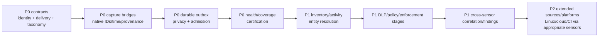

# 27 — Gap and Sensor Change Plan

## Purpose

This plan separates changes required in the endpoint, the proposed host-local
adapter, and the platform. The complete backlog is
[gaps.csv](../../../matrices/sensor-intelligence/endpoint-sensor/gaps.csv).

Counts in this chapter describe the analysis backlog, not delivery estimates.

## Admission blockers

### 1. SourceObservation identity contract

`Contradiction:` the cross-sensor design permits an unresolved source
observation carrying native identifiers/attributes/evidence, while the
authoritative inspected `starliner_contracts::SourceObservation` requires a
`canonical_entity`. The endpoint adapter is also forbidden from assigning the
final canonical identity.

One of these must become authoritative before MVS:

1. extend `SourceObservation` to carry unresolved identifier candidates and
   permit absent canonical identity;
2. create an ingest-resolution operation that accepts a dedicated
   pre-resolution record;
3. define an explicit temporary-entity contract and centrally audited
   replacement/merge semantics.

The adapter must not invent canonical IDs locally to bridge the mismatch.

### 2. Delivery envelope/outbox contract

The inspected ingest/contracts tree supports a `DeliveryRecord` containing
`envelope` and `body`, while the reference delivery validator operates on
top-level canonical bodies and no `build_delivery_record` use was found in the
outbox path.

Before implementation, certify:

- exact admitted HTTP/gRPC body shape;
- canonical body type/version registry;
- per-record result schema;
- idempotency and duplicate semantics;
- retryable versus terminal error classes;
- batch limits and compression;
- signature/credential binding.

### 3. In-flight crash recovery

`Potential issue requiring validation:` reference delivery marks a row
`in_flight`; due-record selection appears to choose pending/retryable rows, and
no lease reclamation was found. Production outbox design needs a durable lease
deadline/recovery transition plus crash tests.

### 4. Endpoint event/finding taxonomy

The current `FindingSignal.signal_type` vocabulary is closed around MCP/LLM
signals and current `EntityKind` does not contain several endpoint-native
entities. Do not overload unrelated values. Extend/version the contract before
using those types.

## Endpoint-native changes

### Capture before loss

Instrument the earliest stable typed seam:

- process discovery candidate/diff before only current-state synchronization;
- raw Lua emitted entities, relationships, risk and provenance before
  lossy `Entity` conversion;
- package candidate plus ecosystem/tool/scan coverage;
- native hook request and separate decision/effect before prompt-turn
  aggregation;
- proxy request, detector, policy, UI and transport-effect stages;
- enforcement decision, each platform action step and final re-observation;
- component lifecycle, configuration freshness, self-test and source scan
  completion.

The bridge writes a small local record to the outbox or an authenticated
component-local partition. It must not synchronously wait for platform
delivery on a hook, proxy or enforcement hot path.

### Stable identity and time

Add:

- sensor instance, boot/runtime instance and component instance IDs;
- process start/boot evidence in addition to PID;
- native request/event/action IDs generated at capture;
- source event time, observed time and append time;
- tenant-scoped namespaced identifiers;
- detector/parser/config/policy versions;
- explicit late/replayed/self-test flags.

Current MCP and user-scoped UUID recipes need versioned migration:

- MCP `{tenant}:{name}` omits parent/transport/user context;
- user-scoped `{tenant}:{email}:{name}` omits entity kind and can collide
  across kinds.

### Health and coverage

Emit structured per-source `CoverageRecord` and component `SensorHealth` rather
than deriving health from logs or framework `Running`. Include scan roots/
profiles/ecosystems/filters, complete/partial/error/unsupported state, last
success, freshness, clock quality, attribution rate and blind spots.

### Effect verification

Add a final process-tree observation after enforcement. Separate:

- command received;
- policy authorized;
- action attempted;
- platform call succeeded;
- expected effect observed;
- audit delivered.

Proxy/hook controls need the equivalent request/detection/decision/local effect/
upstream effect stages. Do not call a redaction action successful until the
forwarded content/effect is verified.

## Adapter changes

The recommended adapter is one host-local service with small in-process capture
bridges. It owns:

- enrollment and rotating sensor credentials;
- compound capability manifest/certification;
- source-native validation and version negotiation;
- deterministic IDs and tenant-scoped aliases;
- privacy filter and protected-evidence writer;
- record mapping without canonical identity invention;
- durable partitioned outbox, quotas, leases and crash recovery;
- delivery, per-record acknowledgement, retry and terminal quarantine;
- replay/backfill and ordering metadata;
- health/coverage aggregation;
- authenticated control-command dispatch and results;
- safe operator diagnostics.

It does not own entity resolution, cross-sensor finding materialization,
authoritative policy, long-term evidence authorization or analytics.

## Platform changes

The platform must provide:

- an accepted pre-resolution ingest contract;
- expanded/versioned entity, action, relationship and finding-signal
  taxonomies;
- sensor enrollment/certification and capability registry;
- tenant-bound credentials and admission;
- source alias/entity resolution with merge/split history;
- record-level acceptance/rejection;
- coverage-aware correlation and finding rules;
- protected evidence storage/access/deletion;
- control authorization and auditable command/result state;
- retention and privacy policy distribution;
- product materialization for Inventory, Activity, Relationships, Findings,
  Analytics, Coverage and Operator views.

## Priority sequence

## Do not solve in the endpoint

- authoritative cloud/serverless/CI inventory;
- GitHub organization/repository authority;
- provider account ownership;
- IdP/HRIS identity authority;
- final canonical entity identity;
- cross-sensor absence/bypass decision;
- enterprise authorization/exception workflow;
- long-term analytics denominators;
- universal MCP/LLM runtime success/token/cost telemetry.

These require other sources or central services. Adding more local filesystem
parsers cannot make endpoint discovery exhaustive across those environments.

## Migration and compatibility

1. Ship capture bridges dark, writing only local test partitions.
2. Validate fixture/native parity and redaction.
3. Enroll adapter in `observe-only`, manifest uncertified.
4. Admit coverage/health first.
5. Admit positive source observations and events with compatibility version.
6. Compare current dashboard sync and new platform materialization.
7. Enable findings only after entity resolution and coverage rules pass.
8. Enable commands only after authorization/idempotency/effect tests.
9. Retire current duplicated paths only after replay/rollback evidence.

Every stage keeps source-native IDs so current and new records can be
reconciled.

## Definition of done per gap

A gap is not closed by merged source alone. Closure requires:

- accepted contract/schema and version;
- implementation at correct ownership layer;
- normal, invalid, duplicate, late, replay and failure fixtures;
- platform/OS integration tests where applicable;
- health and coverage behavior;
- privacy/retention/security review;
- rollback and compatibility behavior;
- product surface and operator diagnostics;
- documentation and support/certification update.

