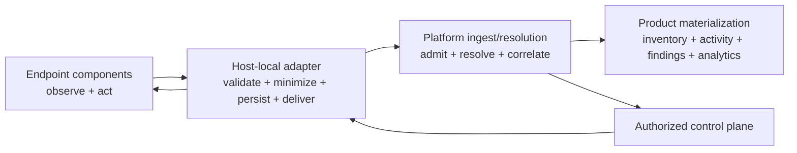

# 28 — Sensor Versus Platform Responsibilities

## Decision rule

The endpoint owns facts it can observe or effects it can perform locally. The
adapter owns safe, durable, tenant-bound transport and source normalization.
The platform owns cross-source resolution, policy authority, product
materialization and long-lived governance.

## Responsibility matrix

| Concern | Endpoint component | Host-local adapter | Platform | Explicit non-responsibility |
| --- | --- | --- | --- | --- |
| OS process/file/package capture | Capture exact native facts and source errors | Validate/version and durably append | Store/materialize resolved facts | Platform does not re-enumerate host |
| Hook capture | Normalize source hook event; preserve source semantics | Privacy filter, ID, outbox, health | Correlate activity and policy | Hook does not infer global agent run |
| Proxy capture | Emit request/detection/decision/effect stages | Protect content; order/replay/deliver | Correlate gateway/browser/provider evidence | Destination alone does not prove user intent |
| Enforcement | Attempt platform action and re-observe effect | Correlate command/result and persist | Authorize, issue and audit command | Adapter does not decide enterprise policy |
| Native identity | Emit namespaced candidates and match evidence | Preserve aliases; never invent canonical ID | Resolve/merge/split with authority/history | Endpoint email/name is not identity authority |
| Canonical identity | None | None beyond temporary source aliases | Own final identity and merge/split history | Sensor cannot assign canonical entity |
| Coverage | Report exact configured source scope/completion | Aggregate without hiding sub-sensor states | Use in absence/correlation/analytics | Positive fact does not imply complete coverage |
| Capability | Report build/config/self-tests | Build/sign/register compound manifest | Certify accepted/degraded/unsupported | Installed binary is not a capability claim |
| Privacy minimization | Avoid unnecessary raw capture/export | Enforce field policy and protected evidence | Distribute policy and authorize evidence | Metrics/errors must never become content side channels |
| Retention | Clean local ephemeral/stores under policy | Enforce local outbox/evidence TTL/deletion | Own central retention/deletion/audit | Repository does not establish legal durations |
| Delivery | Nonblocking bridge into local durable boundary | Own append/lease/retry/ack/replay/quota | Return record-level admission results | HTTP 2xx alone is not record acceptance |
| Findings | Emit detector and control facts | Preserve evidence quality | Group/deduplicate/score/resolve/reopen | Endpoint detector match is not automatically a finding |
| Cross-sensor correlation | Propagate IDs/digests/times when available | Preserve correlation candidates | Join sources with confidence/late/coverage rules | Endpoint cannot declare gateway absence alone |
| Policy | Execute locally supplied versioned decision rules | Cache/distribute safely and report freshness | Authoritative policy, roles, precedence and exceptions | Justification response is not authorization |
| Configuration | Consume local/current config and report effective values | Normalize manifest/health; safe secrets access | Version/distribute target policy/config | Platform must not infer effective config from desired config |
| Product surfaces | None beyond local UI needed for control | Safe operator status only | Inventory/Activity/Findings/Analytics/Coverage | Endpoint should not embed platform UI semantics in wire records |
| Logs/metrics | Produce component-local operational evidence | Bound/redact/export safe health | Retain/query/operator alerts | Logs are not a stable event API |
| Security identity | Use OS/service identities and local privilege | Enrollment credentials and tenant binding | Credential authority/revocation/certification | Broker source string alone is not cryptographic identity |
| SCM authority | Observe local checkout/path/digest candidates | Map source aliases | Connector owns org/repo/commit/tree authority | Local scan cannot prove remote repository inventory |
| Cloud/CI authority | Incidental supported-host evidence only | Mark scope explicitly | Cloud/CI sensors own workload/job estate | Endpoint is not exhaustive cloud/serverless/CI discovery |

## Endpoint responsibilities in detail

The endpoint must:

- assign a native record/action ID at the earliest capture point;
- record event and observation time plus source/component/version;
- preserve exact source fields before lossy current conversions;
- report source completion, partial failure and unsupported scope;
- distinguish configured, installed, observed, used, governed, action attempted
  and effect observed;
- avoid blocking user request/IDE/enforcement hot paths on remote admission;
- re-observe local effects when it claims enforcement;
- expose self-tests that do not use customer content;
- never emit credentials as ordinary facts.

It may classify with a local detector or policy rule, but must attach
rule/version/mode/fallback and must not assign final customer severity or
canonical identity.

## Adapter responsibilities in detail

The adapter is a transport and source-contract boundary, not a second endpoint
scanner. It must:

- authenticate/enroll one sensor instance;
- register/certify sub-sensor capabilities;
- validate native schemas and isolate unsupported versions;
- apply deterministic tenant-scoped IDs and privacy transformations;
- write a durable outbox before asynchronous delivery acknowledgement;
- recover in-flight records after crash;
- preserve late, replay, duplicate and source-order metadata;
- require record-level admission result;
- expose source-to-append and append-to-ack health;
- route authorized commands to the correct component;
- preserve component-native results without translating “attempt” to “success.”

The adapter must not:

- invent a Starliner canonical entity;
- transform a source display name into an authoritative identity;
- aggregate away evidence needed for later reprocessing;
- make enterprise exception/role decisions;
- treat a dropped/terminally rejected record as delivered.

## Platform responsibilities in detail

The platform must:

- own accepted schemas and compatibility;
- cryptographically bind tenant/sensor admission;
- resolve namespaced candidates and preserve merge/split audit;
- materialize inventory, relationships, actions, decisions and effects;
- compute findings only with declared rules, coverage and evidence;
- own cross-sensor late windows, clock/confidence and conflict rules;
- distribute policy/config/retention and show effective versus desired state;
- authorize commands, approvals and protected evidence;
- return granular admission and command results;
- retain deletion/audit history.

## Shared contracts

Ownership is shared only through explicit versioned contracts:

- `SensorCapabilityManifest`;
- `SensorHealth` / `SensorHealthEvent`;
- `CoverageRecord`;
- unresolved source observation/identifier candidates;
- relationship assertions;
- action/decision/effect events;
- metric events with bounded labels;
- evidence references;
- control command/result;
- delivery envelope/result.

The current dormant endpoint gRPC service is not one of these accepted
contracts. Transport choice follows the delivery/control requirements; gRPC
is not a substitute for the missing identity, schema, durability and effect
semantics.

## Escalation rule

When an endpoint fact requires external authority—account ownership,
repository truth, cloud workload identity, provider result, gateway coverage,
human employment or final policy—the sensor emits a candidate and names the
missing authority. It does not fill the gap with inference disguised as fact.

