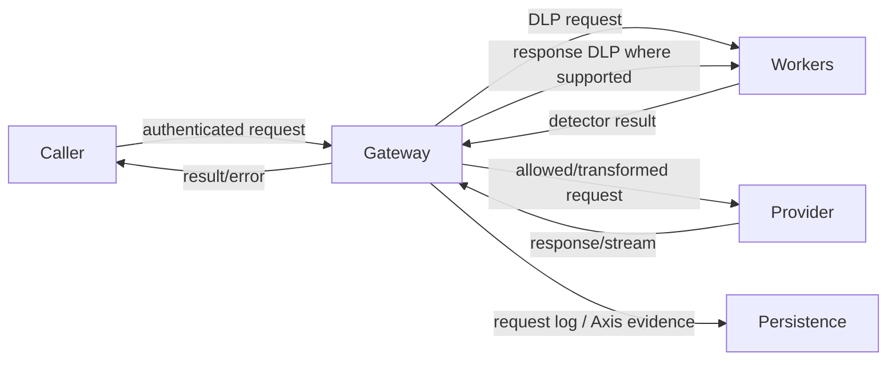

# Sensor role and boundaries

`Verified in source:` The LLM Gateway is an inline BlackSheep HTTP/WebSocket
gateway. It authenticates callers, resolves application/provider/model
configuration, optionally classifies request and response content, applies
monitor/redact/block controls, calls supported LLM-provider protocols, and
records request, guardrail, usage, error and health evidence. Detection and
persistence workers run asynchronously through NATS/JetStream and ClickHouse.

| Attribute | Verified answer | Evidence | Confidence |
| --- | --- | --- | --- |
| Runs | Gateway server plus optional worker/health processes | `DataClassifier/blacksheep_app.py`, `WORKERS/`, `deploy/` | Verified |
| Trust boundary | Inline between authorized caller and provider for routed traffic only | provider handlers and routes | Verified |
| Passive/active | Both: observes and can redact/block/rate-limit | guardrail handlers | Verified |
| Offline | Some local SQLite/NATS durability exists; no Quilr 2.0 outbox/ack contract | database/db writer code | Verified limitation |
| Policies/commands | Reads local/configured policy; administration APIs mutate it | config/policy handlers | Verified |
| Unique visibility | Exact gateway-routed request, resolved route, provider result, latency, token and guardrail outcome | performance/provider handlers | Verified |
| Does not know | Bypass traffic, authoritative human/device identity, provider-side effects after the observable response, enterprise canonical identity | absence plus trust boundary | Verified boundary |

## Modes

Observe/log, monitor, redact/transform and block are implemented on supported
paths. Rate/model/source controls are implemented. Approval exists for
configuration change requests, not as a generic per-model-call approval mode.
`Unresolved:` protocol-by-protocol parity and effective production settings.
No quarantine or terminate capability was found for model calls.

