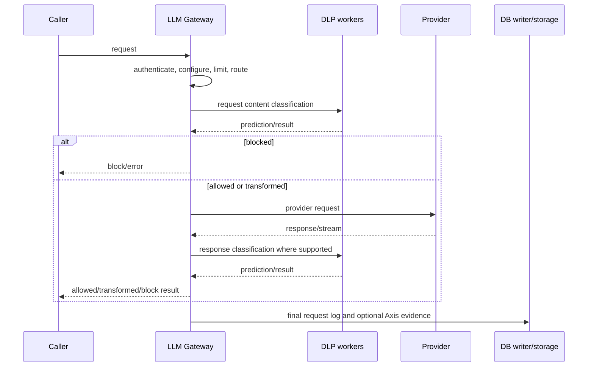

# Runtime lifecycle

`Verified in source:` BlackSheep startup initializes shared resources and
background retry state; routes then accept requests. A request validates
identity/key/configuration, applies limits and request guardrails, resolves a
provider/model, performs the upstream operation, applies response guardrails
where implemented, finalizes telemetry, and returns/streams. Shutdown closes
HTTP/provider clients, database state and configured resources.

Existing durable state includes SQLite WAL, JetStream and ClickHouse paths.
`Unresolved:` production topology, exact replay retention and end-to-end Axis
acknowledgement. `Proposed:` Starliner adds an authenticated local outbox with
sequence/ack/replay; it is not current behavior.
