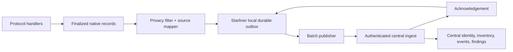

# Adapter architecture

| adapter_component | responsibility | existing_code_reusable | new_code | inputs | outputs | tests |
| --- | --- | --- | --- | --- | --- | --- |
| NativeCaptureBridge | Receive finalized request log and Axis/DLP evidence | PerformanceLoggerAsync; axis_log_queue_async | stable callback/envelope | log_entry/axis_payload | immutable native records | Unit mapping + schema conformance + outage/replay/idempotency |
| NativeRecordDecoder | Validate source-native record/version | dict schemas and db writer parsers | explicit version validators | native records | typed decoded record | Unit mapping + schema conformance + outage/replay/idempotency |
| ObservationMapper | Map request outcome to SourceObservation | request_metadata/observability helpers | new source-profile mapper | api_request_log | SourceObservation | Unit mapping + schema conformance + outage/replay/idempotency |
| IdentifierExtractor | Preserve request, tenant, key, user, trace/provider IDs | observability_metadata | namespace/strength table | native fields | IdentifierCandidate | Unit mapping + schema conformance + outage/replay/idempotency |
| RelationshipAssertionMapper | Emit request-account-route-model/gateway links | existing keys | new mapper | observation | RelationshipAssertion | Unit mapping + schema conformance + outage/replay/idempotency |
| ActivityEventMapper | Separate observed/requested/decided/executed/result stages | handler timing/outcome fields | minor instrumentation for standalone stage events | native records | CanonicalEventCandidate | Unit mapping + schema conformance + outage/replay/idempotency |
| EvidenceReferenceBuilder | Hash/link sensitive raw evidence | request/context IDs | digest/reference implementation | Axis/native raw | EvidenceReference | Unit mapping + schema conformance + outage/replay/idempotency |
| PrivacyFilter | Apply metadata/content policy before outbox | redaction utilities | adapter-specific field policy | record | filtered record | Unit mapping + schema conformance + outage/replay/idempotency |
| CapabilityManifestProvider | Report versioned route/field/control coverage | source constants/config | manifest runtime implementation | build/runtime state | SensorCapabilityManifest | Unit mapping + schema conformance + outage/replay/idempotency |
| HealthReporter | Report hook/config/outbox/delivery readiness | health/probe utilities | adapter/outbox checks | runtime health | SensorHealth/CoverageRecord | Unit mapping + schema conformance + outage/replay/idempotency |
| OutboxWriter | Durably commit records before async publish | SQLite WAL patterns only | new Starliner outbox | immutable record | durable sequence | Unit mapping + schema conformance + outage/replay/idempotency |
| BatchPublisher | Authenticated batched delivery | db writer batching patterns | Starliner transport | outbox batch | ingest batch | Unit mapping + schema conformance + outage/replay/idempotency |
| AcknowledgementHandler | Mark central acknowledgement | No Quilr 2.0 equivalent | new Starliner logic | ack | outbox state | Unit mapping + schema conformance + outage/replay/idempotency |
| ReplayHandler | Retry/replay retained unacked records | JetStream redelivery patterns | new local replay policy | outbox | redelivered batch | Unit mapping + schema conformance + outage/replay/idempotency |
| ControlCommandHandler | Receive signed commands | admin APIs are not a signed control channel | substantial new channel | ControlCommand | execution request | Unit mapping + schema conformance + outage/replay/idempotency |
| EffectReporter | Report gateway-observed result/effect | HTTP outcome and audit logs | explicit effect envelope | execution outcome | ControlResult/ObservedEffect | Unit mapping + schema conformance + outage/replay/idempotency |

Recommended placement is an in-process module for the finalized request/Axis
callbacks plus a Starliner-owned local publisher/outbox component. This
preserves inline fidelity without placing central canonical logic in the
gateway.
