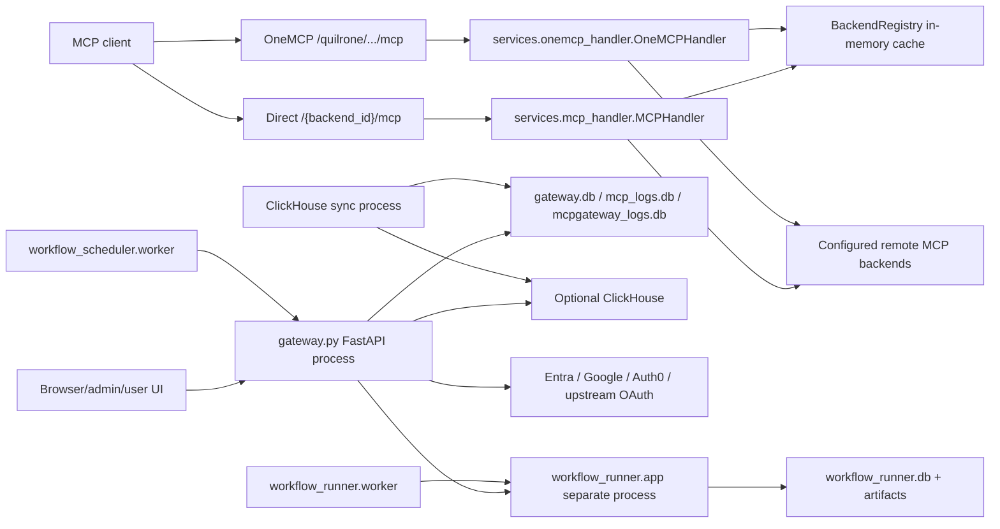
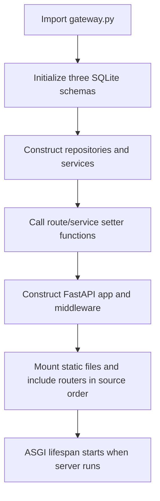
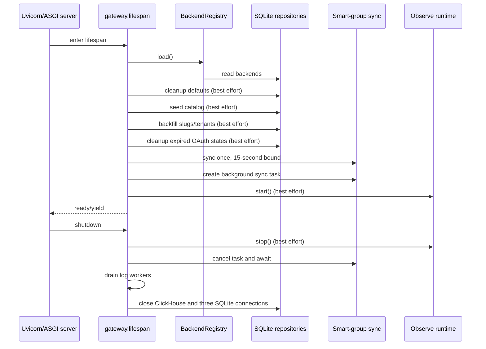
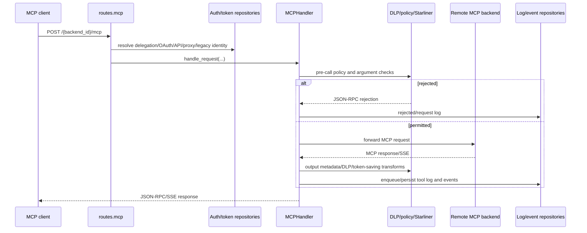
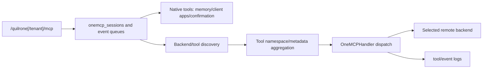
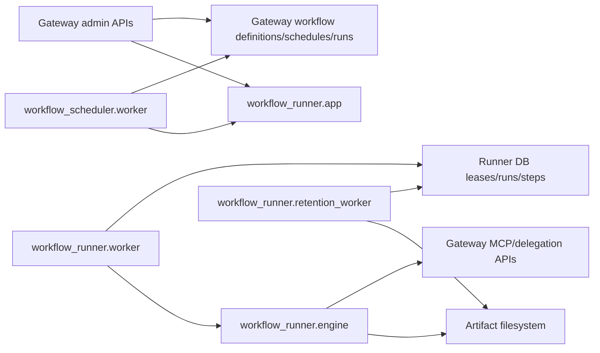

# Architecture

## Component map

Every solid edge above is a checked-in call, HTTP request, database access, or route composition. The diagram does not imply that the separately started processes are deployed by the scoped Dockerfile.

## Main-process composition

`gateway.py` imports repository modules, executes `init_database`, `init_log_database`, and `init_event_log_database`, constructs repositories/services/handlers, calls module setter functions, mounts `static/`, and includes routers in this order:

`auth → backends → quilrone → starliner → oauth → mcp → logs → log export → clients → admin dashboard → admin memories → admin audit → user memories → workflow agents → workflow run admin → Entra → Google → Auth0 → store v1 → store v2`.

`Verified:` Router order is source-significant because Starlette/FastAPI match in registration order. No dependency-injection framework is present; setter wiring and module globals are the dependency mechanism.

## Startup and shutdown sequence

`Verified:` `registry.load()` is not caught and is startup-fatal. The later maintenance actions are caught and logged. Database schema creation occurs earlier, at import, and is also fatal if it raises.

## Major MCP request flow

Authentication has multiple branches rather than one universal token parser. Exact route evidence is in [API reference](10-api-and-interface-reference.md); security consequences are in [security model](12-security-model.md).

## OneMCP aggregation

`Verified:` OneMCP has separate session, route, OAuth, confirmation, client-app, discovery, and handler modules. Native tools can be handled without a remote backend. Confirmation state is process-local.

## Workflow topology

`Verified:` the scheduler claims due schedules, requests runs through runner HTTP, and updates gateway control-plane records. The runner engine executes workflow nodes, records steps/chat/artifacts, and uses delegated gateway access. `Unresolved:` production orchestration and network policy for these processes are not present in the scoped tree.

## Trust boundaries

- Incoming browser and MCP traffic crosses into FastAPI/Axum/FastMCP validation.
- Gateway tokens, external IdP JWTs, API tokens, OAuth credentials, delegation tokens, and internal runner tokens cross authentication boundaries.
- Backend endpoints and the admin-supplied ZIA URL cause outbound network activity.
- SQLite/ClickHouse and artifact paths cross filesystem/database boundaries.
- Remote tool input/output crosses DLP/policy/logging boundaries.
- Static admin/user HTML and JavaScript consume JSON APIs using browser-held credentials.

No diagram edge should be read as an authorization guarantee; enforcement is documented by location in [12-security-model.md](12-security-model.md).
