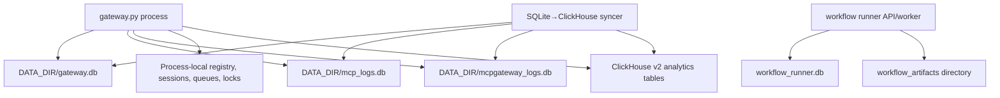
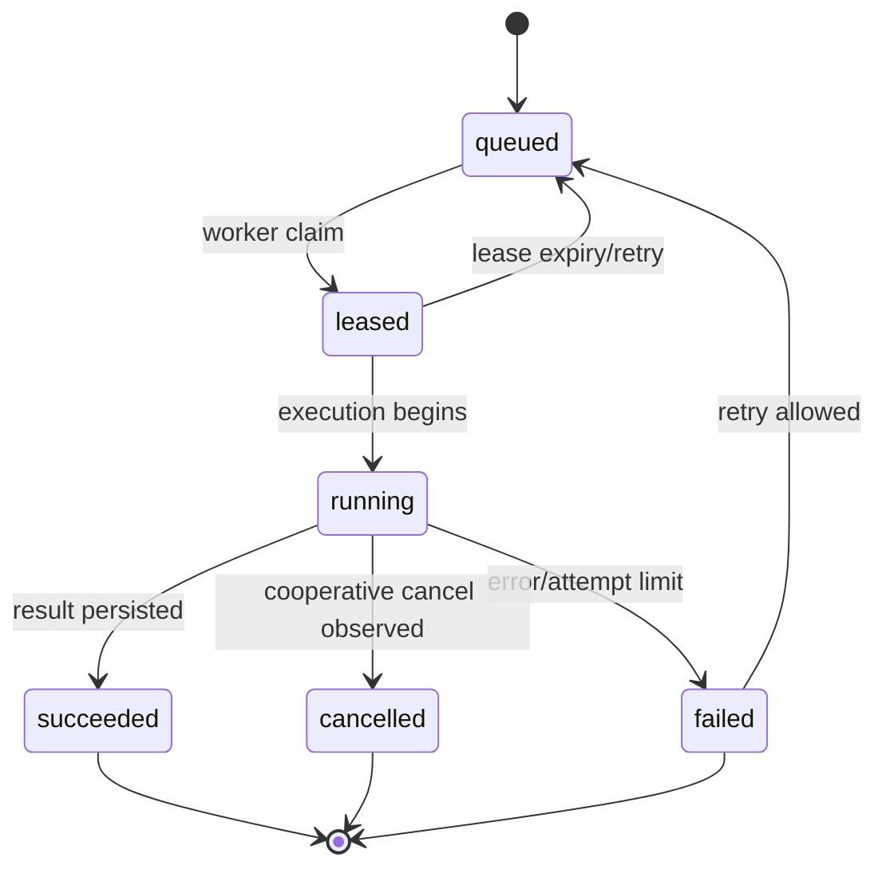

# Data models and storage

## Storage topology

All SQLite initializers enable WAL and a 5,000 ms busy timeout. Main repositories usually share a lazy process-local `aiosqlite.Connection`; selected transactions open caller-owned short-lived connections. There is no ORM or external migration framework: schema creation and additive migrations are imperative SQL in source.

## Core `gateway.db`

| Table/group | Owner and purpose | Principal writers/readers | Lifecycle/constraints |
| --- | --- | --- | --- |
| `backends` | Remote MCP definitions, settings, capability cache, OAuth flags, slug/tenant/catalog links | `BackendRepository`, `BackendRegistry`, store/backends routes | Created/migrated by `db.connection.init_database`; PK `id`; indexed user/slug/tenant fields |
| `users`, `mcp_users` | Admin/login users and MCP end-user identities | auth/user repositories and dependencies | Usernames and identity keys indexed/unique as declared in DDL |
| `companies`, `company_admins`, `company_domain_aliases` | Tenant/company ownership and approved domains | company/admin/domain repositories | Startup seeds historical/admin-derived aliases; normalization rules apply |
| `entra_auth_states` | External platform login state | `EntraAuthStateRepository`, Entra/Google/Auth0 routes | Expiring transient auth state |
| `oauth_clients`, `oauth_user_clients` | DCR client credentials per backend or user/backend | OAuth proxy/service repositories | Upserted/reused; secrets stored as text |
| `oauth_states` | OAuth callback/PKCE/redirect correlation | `OAuthStateRepository` | Has expiry; startup cleanup |
| `oauth_tokens`, `proxy_tokens` | Upstream tokens and gateway proxy tokens | OAuth repositories and MCP auth branches | Sensitive; “encrypted” token column naming does not correspond to encryption behavior |
| `api_tokens` | API-token identity lookup | `ApiTokenRepository` | Created/revoked by admin flows; sensitive lookup material |
| `backend_upstream_auth`, `user_upstream_auth` | Static API-key/header/query credentials | upstream-auth repositories/service | Credential payload encrypted with Fernet; backend or user scope |
| `user_mcp_preferences`, `user_smart_mode`, `tenant_smart_mode_policies` | Per-user connection and smart-mode choices plus tenant policy | OneMCP/preferences/policy repositories | Upsert/delete with tenant/user checks |
| `backend_scoped_settings` | JSON tool/DLP/token-saving overrides | scoped-settings repository/resolver | Scope keys and precedence resolved at request time |
| `custom_agents` | User/admin custom client agents | client routes/repository | CRUD and keyword lookup |
| `mcp_catalog`, `mcp_catalog_fts` | Installable MCP catalog and FTS index | seed/store service and catalog repository | Seeded at startup; FTS maintained by source logic/triggers in DDL |
| `memories`, `tenant_memory_settings` | Native memory records and tenant feature controls | memory repository/service/routes | Tenant/user isolation; plaintext content; CRUD/limits |
| `workflow_agents`, `workflow_agent_versions`, `workflow_agent_bindings`, `workflow_agent_tool_allowlist` | Versioned workflow definitions and scope/tool policy | workflow service/repository | Draft→published/archive lifecycle; published version snapshots |
| `workflow_agent_run_requests` | Gateway control-plane run requests | workflow routes/service/scheduler | Manual/scheduled/rerun correlation |
| `workflow_agent_schedules`, `workflow_agent_schedule_events` | Interval schedules, claims, results/audit | scheduler and workflow repository | Status, due time, lease/claim and catch-up policy |
| `workflow_agent_chat_sessions` | Gateway-side chat session control metadata | workflow routes/service | Active/archive/delete status |
| `workflow_agent_quota_policies` | Entitlement/hard-cap rules | quota resolver/service | Tenant/group/user specificity |
| `clickhouse_settings` | Runtime ClickHouse connection settings | settings repository/UI/syncer | Password field is application-encrypted/obfuscated with a source passphrase |
| `smart_group_snapshot`, `smart_group_snapshot_meta` | Last known group membership and sync metadata | smart-group sync/service | Replaced on successful sync; read when ClickHouse unavailable |
| `starliner_outbox`, `starliner_terminal_delivery` | Observe export queue, retry/idempotency, terminal outcomes | Starliner runtime/repository | Bounded queue with leases/retries/terminal record indexes |
| `admin_audit_logs` | Administrative mutations and rollback metadata | `AdminAuditService`/repository | Sensitive keys redacted before audit payload storage |

The [DDL ledger](evidence/ddl-statements.md) is the authoritative column/index listing. Many relationships are application-enforced rather than SQLite `FOREIGN KEY` constraints.

## `mcp_logs.db`

`tool_call_logs` is initialized by `db/log_database.py`. It stores tool invocation identity, backend/tool/request context, request/response payload or summaries, timings, success/error, DLP/token-saving metadata, and values used by admin/detail/export analytics.

Writers are `ToolCallLoggingService`, background logging workers, and related handler hooks. Readers include log routes, admin dashboard, log export, diagnostics, and the ClickHouse syncer. The shared async connection runs in WAL mode; read-only helpers open separate connections to avoid blocking live writes.

`Potential issue:` records are security-sensitive because they can contain user identity, tool arguments, response content, and authorization-related context. Retention/deletion policy for this database is not enforced by a general background job in the scoped tree.

## `mcpgateway_logs.db`

`events` and `mcp_rejected_requests` are initialized by `db/event_log_database.py`. `EventLoggingService`, rejected-request paths, auth/connection diagnostics, and Starliner hooks write them. Detailed-log APIs, diagnostic scripts, and ClickHouse sync read them.

Read-only connections are separate from the process-wide write connection. The code explicitly aims to prevent analytics reads from queuing behind request writes.

## Workflow runner DB and artifact store

`workflow_runner/db.py::init_runner_database` owns:

- `workflow_runs`: queue/lease/attempt/status/input/output/error/runtime limits/cancellation/retention;
- `workflow_run_steps`: ordered execution records, unique by `(run_id, step_index)`;
- `workflow_artifacts`: run or chat artifacts, with a `CHECK` requiring exactly one valid run versus chat context;
- `workflow_chat_sessions`, `workflow_chat_turns`, `workflow_chat_messages`, `workflow_chat_steps`.

The initializer performs additive column migrations, can rebuild the artifacts table to add context constraints, and scrubs existing `start_payload` values to an allowlist. `ArtifactStore` writes files below the configured root and persists size/hash/path metadata. Retention marks/deletes expired records and files in batches.

`Inference:` the diagram abstracts status transitions across repository/engine methods; exact stored strings and guarded updates are in `workflow_runner/repository.py`. It does not assert an exactly-once guarantee. Leases prevent ordinary simultaneous claims, but external tool side effects can occur before a worker failure is persisted.

## ClickHouse

`clickhouse_sync_utils/syncer.py` defines:

- `mcp_tool_calls_v2`;
- `mcp_events_v2`;
- `mcp_rejected_requests_v2`;
- reads `llmgateway_smart_groups`.

The synchronizer reads SQLite rows, normalizes timestamps/JSON/identity/backend fields, enriches with smart groups and gateway metadata, and inserts destination rows. Source DB/table/ID columns support deduplication/traceability in code. The exact wide schemas and order keys are in the DDL ledger and `TOOL_COLUMNS`/event/rejection column constants.

`Unresolved:` operational retention, replication, cluster topology, and consistency settings are not present. No transaction spans SQLite and ClickHouse; a crash can produce partial synchronization and relies on source-key/idempotency logic on subsequent runs.

## Process-local/transient state

| State | Owner | Concurrency/lifetime |
| --- | --- | --- |
| Backend cache | `BackendRegistry.backends` | Process lifetime; loaded at startup and updated through registry methods |
| OneMCP sessions/client sessions | `onemcp_sessions`, `onemcp_session_notifications` | Process-local async state; lost at restart |
| SSE event channels/replay buffers | `OneMCPEventStore` | Locks/queues per process; bounded by implementation constants |
| Pending confirmations | `ToolConfirmationStore`/OneMCP confirmation helpers | Process-local with expiration/cleanup |
| In-flight OneMCP requests | `OneMCPInflightRequestRegistry` | Process-local, used for cancellation/routing |
| OAuth refresh locks | OAuth service/module locks | Per-process; do not serialize refresh across replicas |
| Background log queues | `BackgroundLogWorker` instances | Bounded queues; can drop on saturation |
| Shared DB connections | `db.connection`, log/event DB modules, runner DB | One lazy connection per process guarded during initialization |
| Smart groups | service cache plus SQLite snapshot | Process-local current view with persistent fallback |

This state model is consistent with the checked-in recommendation to run one gateway replica. Multi-replica correctness for sessions, confirmations, refresh locks, and queues is `Unresolved`.

## Files and committed data

- `testdata/remote_mcp_servers.json`: probe input catalog.
- `testdata/remote_mcp_probe_results.json`: generated probe output; metadata identifies its generator/time.
- `backup_mcps.json`: large timestamped catalog snapshot; no scoped runtime reader or generator was found.
- `public.key`: committed public verification key, not a private key.
- `static/`: application HTML/JS/CSS/assets and vendored bundles/fonts.
- Runner artifact files: runtime-generated, not tracked, stored below a configurable directory.

No SQL migration files, Alembic setup, object-store adapter, message broker, distributed cache, or dead-letter queue is present in scope.
