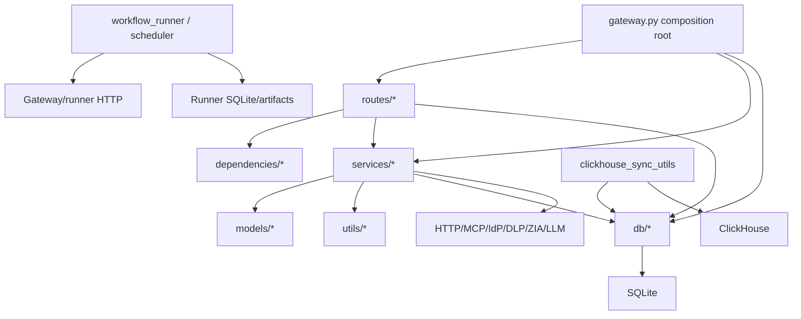

# Dependency and call graph

## Package dependencies

### Python

The 22 main requirement lines cover:

- web/protocol: FastAPI, FastMCP, Uvicorn, Pydantic, email/form parsing, HTTPX, HTTPX-SSE, SSE-Starlette;
- identity/security: PyJWT, bcrypt, cryptography;
- state/integration: aiosqlite, diskcache, ClickHouse Connect, dotenv;
- embeddings/transforms: fdclient, NumPy, BeautifulSoup, markdown-it-py, tiktoken, json-toon.

`requests` is imported directly by `services/axis_logging.py` but is not a direct requirement; it was available transitively in the observed environment. `pytest` and `pytest-asyncio` are test imports but are not declared in a test/development requirements file.

`bcrypt` has no scoped Python import. `email-validator` and `python-multipart` are used indirectly by Pydantic `EmailStr` and FastAPI `Form`. SSE/HTTPX-SSE can be framework/transport dependencies without direct imports.

The private `starliner_contracts` and legacy `starliner.adapters` APIs are imported conditionally or directly by Starliner modules/tests but are not installed by `requirements.txt`. Docker optionally installs the private SDK. `mcp_secrets` is an out-of-scope parent-repository module for Google Workspace.

### Rust

Sixteen direct Cargo dependencies support Axum HTTP, Tokio async, SQLx SQLite, JWT/SHA/hex, Serde, time/UUID, errors, CORS/static/trace, and logging. `Cargo.lock` records the transitive graph.

### Browser

Vendored browser assets include Font Awesome Free 6.5.1 JavaScript/fonts and Chart.js 4.4.1. A minified Tailwind browser bundle is vendored; its exact upstream version is not declared in a verified header. Static application JavaScript has no npm manifest/build pipeline in scope.

## Module dependency direction

The [static import ledger](evidence/static-imports.md) and [tracked path references](06-file-reference/README.md) are the exhaustive edge listings.

## Major direct MCP call graph

`POST /{backend_id}/mcp`
→ `routes.mcp.mcp_proxy`
→ backend/slug resolution helpers and `BackendRegistry`
→ workflow delegation or OAuth/API/proxy/legacy identity helpers
→ `MCPHandler.handle_request`
→ protocol mixin/dispatch
→ scoped settings/tool policy
→ optional confirmation/DLP/Starliner pre-tool
→ upstream MCP client/transport
→ output DLP/token-saving/client metadata
→ `ToolCallLoggingService` and `EventLoggingService`
→ JSON-RPC/stream response.

Exact method-level callees and caller candidates are in each symbol entry and [complete call-site ledger](evidence/complete-call-site-ledger.md).

## OneMCP call graph

`/quilrone[/tenant]/mcp`
→ tenantless/tenant route wrapper in `quilrone_mcp_routes`
→ request/auth/session construction in `routes.quilrone`
→ `OneMCPHandler`
→ protocol/capability/tool-call mixins
→ `OneMCPCapabilityAggregator`/discovery/session manager
→ native tool handler **or** namespaced remote backend dispatch
→ connection/elicitation/confirmation/client-app shaping
→ event store and log services
→ JSON-RPC/SSE response.

Module-global `EXPORTED_ENDPOINTS` tuples and inclusion from `routes.quilrone.router` are registration-based edges; they are not ordinary direct calls.

## OAuth graph

OAuth metadata/authorize route
→ backend ownership/slug lookup
→ `OAuthProxyService` metadata strategies (known provider, RFC 8414, RFC 9728, challenge fallback)
→ client repository/DCR registration
→ `OAuthStateRepository` state/PKCE snapshot
→ external provider authorization
→ callback validates state/user/backend
→ code/token exchange
→ `OAuthTokenRepository` and stable proxy token
→ client redirect/token response.

Token refresh uses repository lookup and a per-process refresh lock. Invalid-client conditions can trigger credential cleanup/re-registration in selected paths.

## Workflow graph

Admin/user workflow request
→ `routes.workflow_agents`
→ `WorkflowAgentService` and `WorkflowAgentRepository`
→ quota/readiness/access resolution
→ runner HTTP `start`/chat operation
→ runner repository queues row
→ worker claims lease
→ `WorkflowEngine`
→ LLM gateway and delegated MCP tool calls
→ steps/messages/artifacts
→ terminal status.

Scheduled flow:

`workflow_scheduler.worker`
→ `WorkflowAgentRepository.claim_due_schedules`
→ bounded concurrent dispatch to runner
→ control-plane run request/schedule event update
→ release/update next due time.

## Logging/analytics graph

Tool lifecycle
→ nonblocking `BackgroundLogWorker.enqueue`
→ `ToolCallLoggingService`
→ `LogRepository` (`mcp_logs.db`) and optional Axis HTTP
→ admin/user log APIs/export.

Security/connection lifecycle
→ `EventLoggingService`
→ `EventLogRepository`/rejection repository (`mcpgateway_logs.db`)
→ detailed diagnostics.

Standalone syncer
→ read-only SQLite queries
→ normalization/enrichment
→ ClickHouse v2 inserts and smart-group snapshot.

## Dynamic and registration-based relationships

- FastAPI decorators and `include_router`;
- FastMCP decorators registering tools/resources;
- Axum `.route` and `.merge`;
- setter functions that assign route-module globals;
- `asyncio.create_task` background sync/log/delivery/heartbeat work;
- string-based MCP method dispatch;
- backend transport/agent lookup by stored IDs/slugs/names;
- optional imports for Starliner;
- `sys.path` insertion in Google Workspace and sync utility;
- Uvicorn module strings in Docker/shell.

These edges were searched separately. `Unresolved:` third-party framework callbacks and remote protocol behavior cannot be fully resolved statically.
