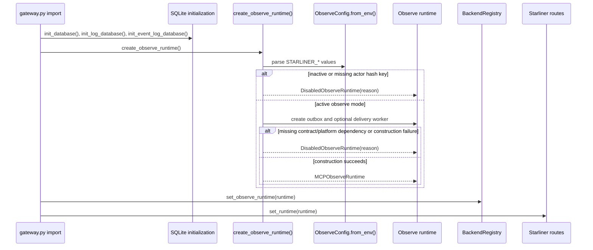
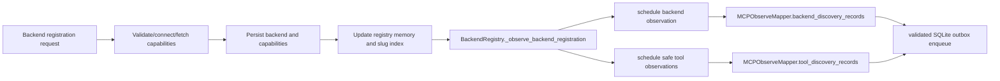
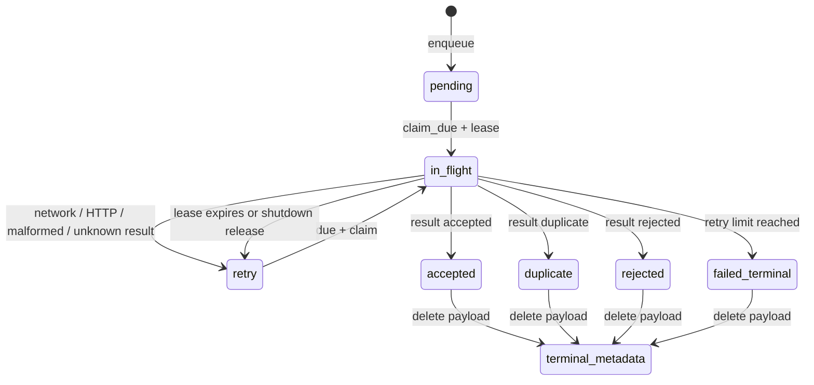

# Runtime lifecycle

## Initialization sequence

`Verified in source:` runtime construction occurs at module import after the
three gateway database initialization calls. Configuration errors raised before
the factory’s internal `try`—for example invalid ingest URL or forbidden
non-loopback unauthenticated delivery—propagate from `ObserveConfig.from_env`
and can prevent gateway import. Optional-package import failures inside the
factory return a disabled runtime instead.

## FastAPI startup

`gateway.py::lifespan` executes, in order relevant to this subsystem:

1. load persisted backends into registry memory;
2. run backend cleanup, catalog seeding, slug/tenant backfill, OAuth-state
   cleanup, and initial smart-group synchronization;
3. start the smart-group loop;
4. call `starliner_runtime.start()` inside a catch-all warning boundary;
5. yield to serve requests.

`Verified in source:` `MCPObserveRuntime.start()` starts only the optional
delivery worker. It does not replay registry inventory or emit an explicit
startup/health record. A disabled runtime start is a no-op.

## Backend registration lifecycle

The observation is post-persistence. A registration failure before the hook
emits nothing. Scheduler, mapping, and enqueue failures are logged and suppressed
with respect to registration success.

## Tool discovery lifecycle

Tool observations are scheduled after:

- `BackendRegistry.update_capabilities_tools()` has persisted processed tools
  and optional raw capabilities; and
- `BackendRegistry.refresh_all_capabilities()` has refreshed and persisted the
  combined capabilities.

Each source tool is reduced to its name. Invalid/missing/blank names are
ignored. No snapshot-complete marker or delete/tombstone record is emitted.

## Direct tool-call lifecycle

```mermaid
flowchart LR
    A["Direct MCP tools/call"] --> B["Create per-dispatch observation_id; start timer"]
    B --> C["Tool enabled check"]
    C --> D["Optional confirmation flow"]
    D --> E["Native input DLP"]
    E --> F["Web-search policy mutation / ZIA input"]
    F --> G["Legacy Starliner shadow/enforce evaluation"]
    G --> H{"Proceed upstream?"}
    H -->|No| I["Return policy error ToolCallResult"]
    H -->|Yes| J["Call upstream MCP tool"]
    J --> K["ZIA output + native output DLP + token saving"]
    K --> L["Return ToolCallResult"]
    I --> M["Schedule post-result observe task"]
    L --> M
    M --> N["Reduce to IDs, labels, outcomes, flags, latency"]
    N --> O["Map 3–5 delivery records"]
    O --> P["Transactional outbox enqueue"]
```

`Verified in source:` the usual mapper cardinality is:

- three records when latency is absent and neither side was blocked;
- four records when latency is present and neither side was blocked;
- four records when blocked without latency; or
- five records when blocked with latency.

Those records are source observation, action event, call-count metric, optional
latency metric, and optional block signal.

`Potential issue:` exceptions from `_handle_tools_call()` are converted to
`ToolCallResult` by outer handlers after control has left the inner scheduling
block. No post-result observe task is scheduled for that path.

## Async scheduling and backpressure

1. Handler/registry code creates the observation coroutine.
2. `MCPObserveRuntime.schedule()` checks `config.active`.
3. If inactive, it closes the coroutine.
4. If the pending-task set has reached `max_pending_tasks`, it closes the
   coroutine, increments `background.dropped`, and logs a warning.
5. Otherwise it creates a named `asyncio.Task` and adds a completion callback.
6. The callback removes the task. Cancelled tasks are ignored; other exceptions
   increment `background.failed` and log the exception class only.

The task queue is memory-only. Dropped or unscheduled observations are not
reconstructed later.

## Mapping and durable enqueue

1. Runtime substitutes tenant `"unknown"` when the capture seam supplies no
   tenant.
2. Mapper normalizes identifiers, HMAC-pseudonymizes an optional user email,
   and extracts bounded labels.
3. Mapper constructs pinned canonical models.
4. External `build_delivery_record` creates an envelope, hashes, and wrapper.
5. Runtime calls `outbox.enqueue_many(records)`.
6. Repository validates every record before opening the write transaction.
7. Repository opens `BEGIN IMMEDIATE`, checks active and terminal idempotency
   scopes, checks bounded capacity, and inserts new records.
8. Transaction commits atomically for the supplied batch.
9. Runtime increments inserted and duplicate counters. Any exception increments
   enqueue-failure counters and is suppressed.

## Delivery lifecycle

`Verified in source:` the delivery transport sends batches by HTTP POST and
expects a JSON object with a `results` list. Each result is matched by list
position, not by idempotency key. Missing result positions are treated as
unknown and retried.

Backoff is `min(retry_max, retry_base * 2^(attempt-1))` plus uniform jitter from
zero through 20% of that delay. All non-2xx statuses are retryable locally.
Explicit per-record `rejected` on a 2xx response is terminal.

## Shutdown

1. FastAPI lifespan calls `starliner_runtime.stop()` inside a warning boundary.
2. Runtime waits up to `shutdown_drain_seconds` for scheduled observe tasks.
3. Remaining observe tasks are cancelled and counted.
4. Runtime calls delivery worker stop.
5. Worker sets its stop event and waits up to the same configured drain window.
6. On timeout it increments `delivery.shutdown_timeout`, cancels the worker, and
   gathers the task.
7. A delivery cancellation releases claims with
   `error_code=shutdown_cancelled`, or falls back to retrying every claimed
   record.
8. The gateway then stops other log workers and closes its database clients.

`Unresolved:` process-crash behavior between remote acceptance and local
terminalization is not dynamically tested against a real ingest. The local
design is at-least-once and relies on idempotency to tolerate replay.

## Degraded states

| Condition | Runtime result | Observable signal |
| --- | --- | --- |
| Starliner off or mode not observe | disabled runtime | manifest `runtime_status=disabled`, reason `mode_not_observe` |
| Observe enabled but no actor hash key | disabled runtime | reason `missing_actor_hash_key` |
| Contract/platform package unavailable | disabled runtime | reason `platform_dependency_unavailable`; startup log |
| Other runtime construction error | disabled runtime | reason `runtime_unavailable`; startup log |
| Ingest URL absent | active mapping/outbox, no worker | manifest degraded mode/capability deferred |
| Ingest URL present but authentication absent | active mapping/outbox, no worker | warning; `deferred_authentication` |
| Outbox full | records dropped from observe path | `outbox_dropped`, enqueue-failed counter, warning |
| Async task limit reached | observation dropped before mapping | `background.dropped`, warning |
| Delivery unavailable | retries then metadata-only terminal failure | worker metrics and delivery-health aggregate |

No `SensorHealthEvent` is emitted for these states. Health is exposed only by
manifest/metrics route JSON and process logs.

