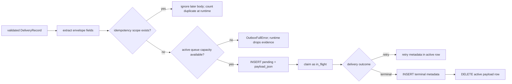

# Field transformation lineage

This document traces current source-native values through mapping, wrapper,
storage, and delivery. It does not yet assign proposed Quilr 2.0 platform
fields.

## Identity and correlation lineage

| Source | Transformation | Canonical/body destination | Envelope/storage destination | Loss or ambiguity |
| --- | --- | --- | --- | --- |
| route `tenant_id` | null → `"unknown"` | every body `tenant_id` | envelope and both SQLite tables | missing tenant becomes a shared literal scope |
| JSON-RPC request ID | fallback correlation seed only | none directly | none directly | client-session scope lost when observation ID exists |
| gateway UUID `observation_id` | SHA-256 stable ID with tenant and distinct prefix | action `request_id`, `flow_id`, `span_id`; tool observation ID includes derived request | action-envelope correlation copied | UUID cannot be recovered from hashes |
| backend ID | normalize unsafe chars; opacity-hash token-shaped value; max 160 | source external ID, resource ID/backend ID, metric dimension | body hash/payload | original spelling lost if normalized or opaque |
| tool name | same | observed name/external ID/resource/tool metric/signal identity | body hash/payload | original spelling lost if normalized or opaque |
| user email | trim/lowercase; HMAC-SHA256 keyed with tenant; first 32 hex | `actor.human_user_id` | wrapped body/payload | raw identity intentionally unrecoverable; key rotation changes pseudonym |
| config sensor ID | no mapper normalization | source sensor ID/action sensor ID | envelope sensor ID and SQLite scope | validity requires non-empty envelope value |

## Backend discovery lineage

```text
BackendInfo.tenant_id ───────────────► runtime tenant or "unknown"
BackendInfo.id ─► safe_identifier ──► source_external_id
                                      ├► canonical_entity.id component
                                      └► discovery idempotency component
BackendInfo.transport_type
             ─► safe_identifier ────► attributes.transport_type
BackendInfo.name ─► runtime discard ─┴► no retained field
```

The observation ID is
`stable_id("observation", tenant_id, "backend", original backend_id)`, while
the source external ID uses the safe backend ID. Consequently, changing only
characters that normalize to the same safe form can produce the same visible
source external ID but a different observation ID.

## Tool discovery lineage

```text
capability tool object
  └► _safe_observe_tools
       └► {"name": string}
            └► mapper validates nonblank
                 └► safe_identifier
                      ├► observed_name
                      ├► source_external_id = safe_backend + ":" + safe_tool
                      ├► canonical_entity.id component
                      └► observation/idempotency components
```

Descriptions, schemas, annotations, and unknown tool object fields are dropped
before the mapper.

## Direct tool-call outcome lineage

| Native input | Transformation | Action event | Metric/signal | Safe summary |
| --- | --- | --- | --- | --- |
| input predictions | select `id`/`name`/`label`; regex, secret check, sort/dedupe | `data.input_labels` | none directly | `data_labels` union |
| output predictions | same | `data.output_labels` | none directly | `data_labels` union |
| input DLP outcome | exclude `allowed`/`safe`, then safe-label filter in summary | no explicit field | block reason depends on separate bool | `risk_labels`; error class if blocked |
| output DLP outcome | same | no explicit field | same | same |
| input/output blocked | boolean OR | `execution.status=blocked` | signal created; side-specific reasons/attributes | `native_dlp_block` |
| response error | applied only when not blocked | `execution.status=error` | status dimension | `upstream_error` |
| no block/error | default branch | `execution.status=success` | status dimension | no error class |
| upstream called | bool coercion | `execution.upstream_called`; action boundary | no direct field | none |
| full handler latency | integer | `execution.latency_ms` | latency sample if non-null | none |

Block status takes precedence over response error. A post-upstream output block
therefore has action boundary `post_execution`, execution status `blocked`, and
`upstream_called=true`.

## Entity-ID lineage

Current backend entity ID:

```text
"mcp_backend:" + safe_identifier(tenant_id) + ":" + safe_identifier(backend_id)
```

Current tool entity ID:

```text
"mcp_tool:" + safe_identifier(tenant_id) + ":" +
safe_identifier(backend_id) + ":" + safe_identifier(tool_name)
```

`Contradiction:` these are locally minted canonical references. The target
cross-sensor source profile requires source IDs/observations to be resolved
centrally instead.

## Idempotency lineage

Mapper keys use:

```text
stable_id("idem", tenant_id, configured_sensor_id, lifecycle-specific parts...)
```

| Record | Lifecycle-specific parts |
| --- | --- |
| backend discovery | `"backend_discovery"`, safe backend ID |
| tool discovery | `"tool_discovery"`, safe backend ID, safe tool name |
| call-time tool observation | derived request ID, `"tool_observation"` |
| action event | derived request ID, `"action_event"` |
| call counter | derived request ID, `"mcp_tool_calls"` |
| latency sample | derived request ID, `"mcp_tool_latency"` |
| block signal | derived request ID, `"mcp_tool_blocked"` |

The outbox uniqueness scope adds envelope tenant, sensor, and record type.
Repeated discovery of the same backend/tool under the same tenant/sensor is
deduplicated indefinitely while either active or terminal metadata is retained.

`Unresolved:` there is no deletion/expiration for terminal idempotency metadata
in this repository, so discovery re-observation after a legitimate lifecycle
reset may continue to be suppressed.

## Wrapper and integrity lineage

1. Canonical model serializes to JSON with the `schema` alias and excludes null
   values.
2. Pinned validator validates schema shape and payload safety.
3. `body_hash` is SHA-256 over sorted, compact, UTF-8 canonical JSON.
4. Envelope copies tenant, body schema, producer configuration, mapping time,
   optional body correlation, and safe summary.
5. Mapper supplies a deterministic idempotency key; otherwise the contract
   builder could generate one from sensor/type/tenant/body hash.
6. `record_hash` is SHA-256 over canonical envelope without `record_hash`
   concatenated with canonical body.
7. The complete wrapper is revalidated, including tenant, type/schema,
   correlation, safety, and both hashes.

## Persistence lineage



Only the active table contains the canonical body and safe envelope. After a
terminal transition, reconstruction from local storage is impossible; only
identity, hashes, outcome, bounded error/evidence metadata, and times remain.

## Delivery response lineage

| Remote result | Local transition | Retained remote field |
| --- | --- | --- |
| `status=accepted` | terminal accepted | optional safe `evidence_id` |
| `status=duplicate` | terminal duplicate | optional safe `evidence_id` |
| `status=rejected` | terminal rejected/dead-letter | direct `error_code`, else first `errors[0].code`, else `record_rejected`; normalized by repository |
| missing/unknown status | retry | `unknown_record_result` |
| 429/5xx | retry all | `http_<status>` |
| other non-2xx | retry all | `http_<status>` |
| timeout/network/malformed | retry all | fixed safe error code |

The remote response body is not retained. Only bounded codes and evidence IDs
survive.

## Operational health lineage

SQLite active/terminal aggregates feed repository `delivery_health()`, then
`_safe_delivery_health` applies a field/type whitelist and non-negative clamp.
The result is returned by the routes and cached in the runtime. It is not
converted to a `SensorHealthEvent`.

Process counters originate from scheduler, mapping/enqueue, and delivery
branches. They reset on process restart and have no tenant dimension.

## Intentional data-loss boundaries

- raw arguments and results never enter the observe mapper;
- raw user email is replaced by keyed pseudonym;
- prediction structures are reduced to labels;
- backend display names, tool descriptions/schemas, confirmation metadata,
  ZIA results, policy decision details, and failure diagnostics are omitted;
- terminalization deletes delivery payloads locally;
- no inverse map exists for normalized/opaque identifiers or stable hashes.

