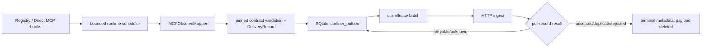

# Starliner and durable outbox integration

## Current architecture



## Current Starliner responsibilities

- contract body/wrapper models and validation;
- body/schema/record-type/correlation consistency;
- payload-safety validation;
- deterministic canonical JSON and hashes;
- adapter certification/golden trace types;
- capability manifest model.

## Current sensor-specific responsibilities

- choose lifecycle hooks and safe inputs;
- normalize source IDs and pseudonymize actor;
- map native outcomes into canonical bodies;
- choose idempotency keys;
- configure sensor/runtime/certification identity;
- store, lease, retry, terminalize, and report local delivery health;
- start/stop the worker with gateway lifecycle.

## Outbox transaction behavior

1. validate every record before opening a write transaction;
2. ensure/migrate schema in `BEGIN IMMEDIATE`;
3. begin enqueue transaction;
4. load existing active and terminal idempotency scopes in chunks of 200;
5. silently skip later records in an existing scope;
6. check active-row capacity for new records;
7. insert all new rows or roll back;
8. commit and return inserted count.

`Verified by test:` invalid records do not partially persist, first body wins for
duplicate scope, tenant/sensor/type scope is respected, legacy rows migrate only
when wrappers are valid, terminal payload is deleted, and expired leases recover.

## Semantics

| Property | Current result |
| --- | --- |
| local persistence | SQLite WAL, busy timeout 5 seconds |
| enqueue atomicity | batch transaction for validated new records |
| delivery guarantee | at-least-once after enqueue |
| pre-enqueue guarantee | best effort; async task may drop/fail |
| ordering | claim ordered by local outbox ID; no source sequence in envelope |
| idempotency | tenant + sensor + record type + mapper key |
| same key/same body | duplicate suppressed |
| same key/different body | also suppressed; conflict not surfaced |
| backpressure | max active rows; mapping batch dropped on full |
| lease | 30-second implementation lease; expired in-flight becomes retry |
| terminal payload | deleted; metadata retained |
| terminal retention | no expiry/cleanup found |
| retry | exponential capped plus ≤20% jitter |
| dead letter | terminal metadata status, no replay API |
| remote receipt | optional `evidence_id`, no signature validation |

## Migration safety

The repository checks required columns and exact unique-index column order. A
legacy active table without `sensor_id` is renamed inside a transaction.
Every retained payload is JSON-decoded and contract-validated; its envelope must
match stored tenant/type/idempotency/hashes. Sensor ID is backfilled from the
validated envelope. Any mismatch rolls back.

Existing terminal-status rows in the active table are copied to the metadata
table with `INSERT OR IGNORE` and then deleted.

## Delivery protocol

Request:

```json
{"api_version":"v1","records":[{"envelope":{},"body":{}}]}
```

The example shows only verified top-level framing; empty objects are not valid
records.

Response requirements:

```text
HTTP 2xx
body.results: array<object>
item.status: accepted | duplicate | rejected | other
item.evidence_id: optional
item.error_code or item.errors[0].code: optional rejection code
```

Result matching is positional. A shorter result list causes unmatched records
to retry.

## Telemetry/control separation

```text
Telemetry channel
capture → safe map → outbox → ingest → receipt

Control channel (not implemented)
authenticated command → authorization → native service method
→ read-back/runtime effect → command result + effect observation
```

Legacy central pre-tool evaluation is a third compatibility channel and should
not be confused with either target channel.

## Required Starliner upgrades

1. source observation without producer canonical ID;
2. runtime instance workload identity and instance epoch;
3. sequence and source revision;
4. privacy/data-disposition metadata;
5. explicit profile/capability/certification version;
6. signed/verified admission receipt;
7. correction-conflict behavior for same key/different body;
8. durable source-loss/queue-loss health record;
9. terminal retention/cleanup/replay policy;
10. authenticated typed command queue and result channel, separately;
11. local signed policy bundle/PEP for normal decisions;
12. crash-window tests against an actual ingest.

## Potential issues requiring validation

- unbounded terminal metadata growth;
- full active payload JSON retained until terminalization;
- all non-2xx responses retried even when permanent;
- no remote `Retry-After` handling;
- bearer token only, no mTLS/workload signature in source;
- no request compression or batch byte-size cap, only record-count cap;
- positional result correlation;
- `oldest_record_age`/lag aggregation across tenants;
- no operator API to inspect/replay a specific dead letter;
- no encrypted-at-rest field in SQLite outbox code.

