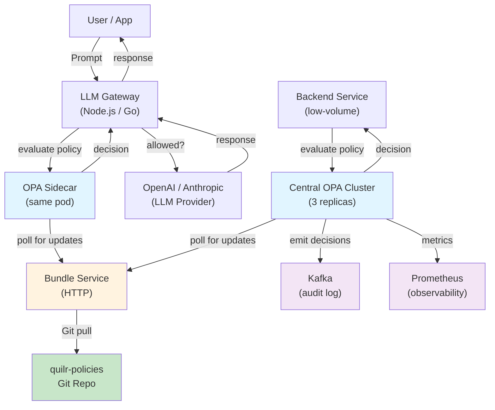

# Quilr Policy Engine – Implementation Guide

## Table of Contents

1. [Overview](#overview)
2. [Architecture](#architecture)
3. [Components](#components)
4. [Quick Start](#quick-start)
5. [Known Unknowns](#known-unknowns)
6. [Testing](#testing)
7. [Deployment](#deployment)
8. [Integration Example](#integration-example)

---

## Overview

**Policy Engine:** Uses **Open Policy Agent (OPA)** as the Policy Decision Point (PDP).

**Deployment Model:** Hybrid
- **Sidecar OPA** for high-throughput components (LLM gateway, MCP gateway) deployed in the same Kubernetes pod, intercepting requests via HTTP POST.
- **Central OPA cluster** for low-volume services (backend, reporting) behind a load balancer, 3 replicas for HA.

---

## Architecture



**Data Flow:**

1. **LLM Gateway** receives a user prompt
2. **DLP Classifier** pre-computes: `contains_ssn`, `contains_pii`
3. **Content Classifier** pre-computes: `is_coding`
4. **Gateway** calls **OPA Sidecar** (localhost:8181) with structured JSON input
5. **OPA** evaluates Rego policies and returns: `{ "allow": true/false, "reason": "...", "matched_rule_id": "..." }`
6. **Gateway** allows or blocks the request based on decision
7. **OPA** emits decision logs to Kafka for audit/analytics

---

## Components

### 1. Rego Policy Files (`policies/`)

**Location:** `policies/llm_gateway/authz.rego`

Policy rules (in OPA's Rego language):
- **Rule 1:** Block SSN/PII in any LLM request (DLP violation)
- **Rule 2:** Allow coding prompts to Anthropic only
- **Rule 3:** Risk-based allow to OpenAI (custom built-in: `quilr.get_risk_score`)
- **Rule 4:** Allow Azure OpenAI for low-risk users
- **Rule 5:** Deny unknown resource types

**Testing:** `policies/llm_gateway/authz_test.rego`
```bash
opa test policies/ -v
```

### 2. Custom OPA Server (`cmd/opa-server/`)

**Go program** embedding OPA with custom built-in:
- `quilr.get_risk_score(userID, resourceID) -> float`
- HTTP handler: `POST /v1/data/quilr/llm_gateway/authz`
- Includes mock risk scoring (cache in `riskScoreCache`)

**Build & Run:**
```bash
cd cmd/opa-server
go mod download
PORT=8181 go run main.go
```

**Test:**
```bash
curl -X POST http://localhost:8181/v1/data/quilr/llm_gateway/authz \
  -H "Content-Type: application/json" \
  -d '{
    "input": {
      "source": "llm_gateway",
      "actor": "user@example.com",
      "action": "prompt",
      "resource_hint": "openai",
      "payload": {
        "prompt": "test",
        "contains_ssn": false,
        "is_coding": false
      }
    }
  }'
```

### 3. Bundle Service (`bundle-service/`)

**Node.js HTTP server** that:
- Runs `opa build` to compile policies from Rego files into a `bundle.tar.gz`
- Optionally pulls policies from Git repository
- Polls for changes every 5 minutes (configurable)
- Serves bundles at `GET /bundles/quilr-policies.tar.gz`

**Environment Variables:**
```bash
POLICIES_DIR=/app/policies           # Local directory of .rego files
BUNDLE_OUTPUT_DIR=/tmp/bundles       # Where to store compiled bundles
GIT_REPO=https://...quilr-policies   # (optional) Git repo to pull from
POLL_INTERVAL=300                    # Seconds between polling
```

**Build & Run:**
```bash
cd bundle-service
npm install
POLICIES_DIR=../policies npm start
```

### 4. Kubernetes Manifests (`k8s/`)

#### `k8s/opa-sidecar.yaml`
- ConfigMap with OPA sidecar config
- Template for adding sidecar to LLM Gateway pod
- InitContainer to fetch policies
- NetworkPolicy for sidecar access

#### `k8s/opa-central.yaml`
- Deployment (3 replicas)
- Service (ClusterIP)
- ServiceAccount & RBAC
- HorizontalPodAutoscaler
- PodDisruptionBudget
- NetworkPolicy

#### `k8s/bundle-service.yaml`
- Deployment (2 replicas)
- Service
- ConfigMap for Git repo URL
- NetworkPolicy

### 5. Docker Images

#### `docker/Dockerfile` – Custom OPA Server
```bash
docker build -f docker/Dockerfile -t quilr-opa-server:latest .
docker run -p 8181:8181 quilr-opa-server:latest
```

#### `bundle-service/Dockerfile` – Bundle Service
```bash
docker build -f bundle-service/Dockerfile -t quilr-bundle-service:latest .
docker run \
  -e GIT_REPO=https://github.com/quilr/quilr-policies.git \
  -p 8080:8080 \
  quilr-bundle-service:latest
```

### 6. Integration Example (`examples/integration.js`)

Demonstrates how the LLM Gateway integrates with OPA:
1. **OPAClient** – HTTP client for policy decisions
2. **DLPClassifier** – Mock content classification (detects SSN/PII)
3. **ContentClassifier** – Mock content classification (detects coding vs. non-coding)
4. **LLMGateway** – Main orchestrator
5. **Test cases** – Demonstrates allow/deny scenarios

---

## Quick Start

### Local Development (Docker Compose)

**Prerequisites:** Docker, Docker Compose, Go 1.21+, Node.js 18+

#### 1. Start OPA server

```bash
cd cmd/opa-server
go mod download
PORT=8181 go run main.go
```

Expected output:
```
[INFO] Starting OPA server on port 8181
[INFO] Policy endpoint: POST http://localhost:8181/v1/data/quilr/llm_gateway/authz
[INFO] Health endpoint: GET http://localhost:8181/health
```

#### 2. Start bundle service

```bash
cd bundle-service
npm install
POLICIES_DIR=../policies npm start
```

Expected output:
```
[INFO] Bundle service listening on http://0.0.0.0:8080
[INFO] Bundle endpoint: GET http://0.0.0.0:8080/bundles/quilr-policies.tar.gz
[INFO] Rebuild endpoint: POST http://0.0.0.0:8080/rebuild
```

#### 3. Test policy evaluation

```bash
# Test: Allow coding prompt to Anthropic
curl -X POST http://localhost:8181/v1/data/quilr/llm_gateway/authz \
  -H "Content-Type: application/json" \
  -d '{
    "input": {
      "source": "llm_gateway",
      "actor": "dev@example.com",
      "action": "prompt",
      "resource_hint": "anthropic",
      "payload": {
        "prompt": "Write a Go function",
        "contains_ssn": false,
        "is_coding": true
      }
    }
  }'

# Expected response:
# {
#   "result": {
#     "allow": true,
#     "reason": "Allowed: Coding prompt to Anthropic",
#     "matched_rule_id": "rule_anthropic_coding_only"
#   }
# }

# Test: Deny non-coding to Anthropic
curl -X POST http://localhost:8181/v1/data/quilr/llm_gateway/authz \
  -H "Content-Type: application/json" \
  -d '{
    "input": {
      "source": "llm_gateway",
      "actor": "user@example.com",
      "action": "prompt",
      "resource_hint": "anthropic",
      "payload": {
        "prompt": "What is the weather?",
        "contains_ssn": false,
        "is_coding": false
      }
    }
  }'

# Expected response:
# {
#   "result": {
#     "allow": false,
#     "reason": "Denied: Only coding prompts allowed to Anthropic",
#     "matched_rule_id": "rule_anthropic_coding_only"
#   }
# }
```

#### 4. Run Rego unit tests

```bash
opa test policies/ -v
```

Expected output:
```
PASS: data.quilr.llm_gateway.authz_test
PASS: data.quilr.common_test (if tests exist)

7 test(s), 7 passed, 0 failed
```

#### 5. Test integration (simulate LLM Gateway)

```bash
node examples/integration.js
```

Expected output:
```
=== Test 1: Allow coding to Anthropic ===
[INFO] Handling prompt from dev@example.com to anthropic
[INFO] Policy decision: { ... allow: true ... }
Result: { allowed: true, reason: ..., ruleId: ... }

=== Test 2: Deny non-coding to Anthropic ===
[DENY] Prompt denied by rule: rule_anthropic_coding_only
Result: { allowed: false, reason: ..., ruleId: ... }
...
```

---

## Known Unknowns

This table lists all uncertainties and assumptions made during implementation. **Replace all `???` placeholders** before production deployment.

| **Item** | **Why Unknown** | **Where Used** | **How to Resolve** | **Current Assumption** |
|---|---|---|---|---|
| **LLM Gateway event schema** | Schema not finalized; team still designing | `input` JSON structure in Rego policies | Coordinate with Praneeth; finalize and update `authz.rego` | Minimal schema: `source`, `actor`, `action`, `resource_hint`, `payload` |
| **LLM provider names** | Not all providers may be relevant | Policy rules for `resource_hint` | Confirm which LLMs to support (OpenAI, Anthropic, Azure, Cohere, etc.) | `["openai", "anthropic", "azure", "cohere"]` |
| **Risk score API endpoint** | Intelligence layer not built | Custom built-in `quilr.get_risk_score` | Create risk scoring service; set `RISK_SERVICE_URL` env var | Mock cache returning 0.3–0.8 |
| **Risk score threshold** | Tuning requires production metrics | Rego rule: allow if `risk_score < 0.7` | Collect decision logs; adjust thresholds | Hardcoded 0.7 for OpenAI, 0.5 for Azure |
| **DLP classifier API** | Not yet implemented | Pre-computed in payload: `contains_ssn`, `contains_pii` | Build or integrate DLP service | Mock regex (SSN: `/\d{3}-\d{2}-\d{4}/`) |
| **Content classifier API** | Not yet implemented | Pre-computed in payload: `is_coding` | Build ML classifier or use existing service | Mock keyword detection |
| **Kafka topic name** | Not chosen | OPA `decision_logs` config | Finalize topic name; update ConfigMap | `opa-decisions` (placeholder) |
| **Kafka broker addresses** | Not finalized | `opa-config.yaml` decision logging | Set `KAFKA_BROKERS` env var; configure auth | Commented out; needs real broker info |
| **Bundle service Git repo URL** | Repository not yet created | `bundle-service-config` ConfigMap | Create `quilr-policies` GitHub repo; set URL | `???` (must be replaced) |
| **Git authentication** | Method not decided (HTTPS token, SSH, etc.) | Bundle service init container | Configure Kubernetes secret; mount in init container | None (assumes public repo) |
| **OPA bundle signing** | Security posture not decided | `opa-config.yaml` signing block | Decide if bundles need signing; generate keys | Disabled (commented out) |
| **Authentication between gateway and OPA** | Not yet designed (token, mTLS, none) | OPA HTTP handler | Implement token validation or mTLS | None (localhost only, assumes secure network) |
| **Kubernetes namespace** | Not finalized | All manifests: `namespace: quilr` | Adjust to your namespace strategy | `quilr` (placeholder) |
| **OPA container image registry** | Not finalized | K8s manifests | Push images to your registry (e.g., ECR, GCR) | `openpolicyagent/opa:latest` or `quilr-opa-server:latest` |
| **Performance thresholds** | Not yet measured | Horizontal Pod Autoscaler, resource requests | Run load tests; adjust replicas, CPU, memory | P99 ≤ 10ms, 10k decisions/sec per sidecar (targets) |
| **Deployment environment** | May not be Kubernetes | K8s manifests provided | Provide Docker Compose for local/non-K8s deployments | Kubernetes 1.24+; Docker Compose example TODO |
| **Prometheus scrape path** | Not confirmed | Annotations in K8s manifests | Verify actual metrics endpoint in custom OPA server | `/metrics` (placeholder, not fully implemented) |
| **Component names & service discovery** | Naming not finalized | K8s service names, environment variables | Align with actual Quilr architecture | Generic: `opa-central`, `bundle-service`, etc. |

---

## Placeholders Reference

All `???` in code/config must be replaced:

### Environment Variables

```bash
# OPA Server
export PORT=8181
export RISK_SERVICE_URL=???  # ??? – Replace with actual risk scoring service URL

# Bundle Service
export POLICIES_DIR=/app/policies
export GIT_REPO=???          # ??? – Replace with quilr-policies Git repo URL
export POLL_INTERVAL=300

# LLM Gateway (integration)
export OPA_URL=http://localhost:8181
export OPENAI_API_KEY=???
export ANTHROPIC_API_KEY=???
export AZURE_OPENAI_API_KEY=???
```

### Configuration Files

#### `k8s/opa-config.yaml`
```yaml
services:
  bundle_service:
    url: ???  # Replace with bundle-service URL, e.g., http://bundle-service.quilr:8080
```

#### `k8s/bundle-service.yaml`
```yaml
data:
  git-repo: ???  # Replace with https://github.com/quilr/quilr-policies.git
```

#### Rego Policies
```rego
// In policies/llm_gateway/authz.rego
// ??? – resource_hint values may expand; add more rules as needed
// ??? – payload schema not finalized; adjust field names
```

---

## Testing

### 1. Unit Tests (Rego)

```bash
# Run all Rego tests
opa test policies/ -v

# Run specific test file
opa test policies/llm_gateway/authz_test.rego -v

# Output:
# PASS: data.quilr.llm_gateway.authz_test
# 6 tests passed, 0 failed
```

**Test Coverage:**
- SSN/PII blocking (all LLMs)
- Coding-only to Anthropic
- Risk-based allow to OpenAI
- Unknown resource type rejection
- Audit output structure

### 2. Integration Tests (Go)

```bash
# Build & run OPA server
cd cmd/opa-server
PORT=8181 go run main.go &

# In another terminal, test endpoints
curl http://localhost:8181/health
curl http://localhost:8181/ready

# Kill background process
kill %1
```

### 3. End-to-End Tests (Node.js)

```bash
# Run integration example (requires running OPA server)
PORT=8181 go run cmd/opa-server/main.go &
node examples/integration.js
kill %1
```

### 4. Policy Bundle Tests

```bash
# Verify bundle builds correctly
cd bundle-service
npm install
POLICIES_DIR=../policies npm start &

# Test bundle endpoint
curl http://localhost:8080/ready
curl -o bundle.tar.gz http://localhost:8080/bundles/quilr-policies.tar.gz
tar tzf bundle.tar.gz | head

# Verify contents
kill %1
```

---

## Deployment

### Kubernetes Deployment

#### Prerequisites

```bash
# Create namespace
kubectl create namespace quilr

# (Optional) Create Git credentials secret for private repo
kubectl create secret generic git-credentials \
  --from-literal=token=??? \
  -n quilr
```

#### 1. Push Docker images

```bash
# Custom OPA server
docker build -f docker/Dockerfile -t YOUR_REGISTRY/quilr-opa-server:latest .
docker push YOUR_REGISTRY/quilr-opa-server:latest

# Bundle service
docker build -f bundle-service/Dockerfile -t YOUR_REGISTRY/quilr-bundle-service:latest .
docker push YOUR_REGISTRY/quilr-bundle-service:latest
```

#### 2. Deploy bundle service (required first)

```bash
# Update image registry and Git repo URL in k8s/bundle-service.yaml
kubectl apply -f k8s/bundle-service.yaml

# Wait for deployment
kubectl wait --for=condition=available --timeout=60s \
  deployment/bundle-service -n quilr
```

#### 3. Deploy central OPA cluster

```bash
# Update image registry in k8s/opa-central.yaml (if using custom OPA server)
kubectl apply -f k8s/opa-central.yaml

# Verify deployment
kubectl get pods -n quilr -l app=opa-central
kubectl logs -n quilr deployment/opa-central -f
```

#### 4. Add OPA sidecar to LLM Gateway

```bash
# Reference the OPA sidecar template in k8s/opa-sidecar.yaml
# Copy the container spec into your LLM Gateway Deployment's pod.spec.containers

# Example (merge into existing LLM Gateway Deployment):
kubectl patch deployment llm-gateway -n quilr --type='json' \
  -p='[
    {
      "op": "add",
      "path": "/spec/template/spec/containers/-",
      "value": {
        "name": "opa-sidecar",
        "image": "openpolicyagent/opa:latest",
        "args": ["run", "--config-file=/etc/opa/config.yaml", "/policies"],
        ...
      }
    }
  ]'
```

#### 5. Verify deployments

```bash
# Check all pods are running
kubectl get pods -n quilr

# Check services
kubectl get svc -n quilr

# Test OPA endpoint
kubectl port-forward -n quilr svc/opa-central 8181:8181 &
curl http://localhost:8181/health
kill %1

# Check logs
kubectl logs -n quilr -l app=opa-central --tail=50
kubectl logs -n quilr -l app=bundle-service --tail=50
```

### Local Development (Docker Compose)

**TODO:** Create `docker-compose.yml` for local testing without Kubernetes.

Example structure:
```yaml
version: '3.8'
services:
  opa-server:
    build:
      context: .
      dockerfile: docker/Dockerfile
    ports:
      - "8181:8181"

  bundle-service:
    build:
      context: .
      dockerfile: bundle-service/Dockerfile
    ports:
      - "8080:8080"
    environment:
      POLICIES_DIR: /app/policies
      GIT_REPO: ???
```

---

## Integration Example

See [examples/integration.js](examples/integration.js) for a complete working example.

### Flow:

1. **LLM Gateway receives user prompt**
   ```javascript
   POST /api/v1/llm/prompt
   {
     "actor": "user@example.com",
     "llm_provider": "openai",
     "prompt": "Write a Go function"
   }
   ```

2. **Gateway classifies content**
   - DLP Classifier: `{ contains_ssn: false, contains_pii: false }`
   - Content Classifier: `{ is_coding: true }`

3. **Gateway calls OPA**
   ```json
   POST http://localhost:8181/v1/data/quilr/llm_gateway/authz
   {
     "input": {
       "source": "llm_gateway",
       "actor": "user@example.com",
       "action": "prompt",
       "resource_hint": "openai",
       "payload": {
         "prompt": "Write a Go function",
         "contains_ssn": false,
         "contains_pii": false,
         "is_coding": true
       }
     }
   }
   ```

4. **OPA evaluates policies (Rego)**
   - Check DLP rules ✓ (no SSN/PII)
   - Check provider rules ✓ (OpenAI allows coding)
   - Check risk score ✓ (user risk < 0.7)
   - **Decision: ALLOW**

5. **Gateway forwards to LLM**
   ```javascript
   POST https://api.openai.com/v1/chat/completions
   {
     "model": "gpt-4",
     "messages": [{ "role": "user", "content": "Write a Go function" }]
   }
   ```

6. **Gateway returns response**
   ```json
   {
     "result": { ... LLM response ... },
     "policy_decision": {
       "allowed": true,
       "rule_id": "rule_openai_risk_based"
     }
   }
   ```

---

## File Structure

```
Project-Starliner/
├── policies/                      # Rego policy files (GitOps)
│   ├── llm_gateway/
│   │   ├── authz.rego            # Main policy rules
│   │   └── authz_test.rego       # Unit tests
│   ├── mcp_gateway/
│   │   └── authz.rego            # (future) MCP gateway policies
│   └── common/
│       └── utils.rego            # Shared utilities
│
├── cmd/opa-server/                # Custom OPA server (Go)
│   ├── main.go                   # HTTP server with custom built-ins
│   └── go.mod                    # Dependencies
│
├── bundle-service/                # Policy bundle service (Node.js)
│   ├── index.js                  # HTTP server
│   ├── package.json              # Dependencies
│   └── Dockerfile                # Container image
│
├── docker/
│   └── Dockerfile                # Custom OPA server image
│
├── k8s/                            # Kubernetes manifests
│   ├── opa-sidecar.yaml          # Sidecar template for LLM gateway
│   ├── opa-central.yaml          # Central OPA cluster deployment
│   ├── opa-config.yaml           # OPA configuration
│   └── bundle-service.yaml       # Bundle service deployment
│
├── examples/
│   └── integration.js            # Integration example (LLM Gateway + OPA)
│
└── README.md                      # This file
```

---

## Common Issues & Troubleshooting

### Issue: OPA server not starting

```bash
# Check Go version
go version  # Should be 1.21+

# Check dependencies
cd cmd/opa-server
go mod download
go build -v

# Run with debug output
PORT=8181 go run -v main.go
```

### Issue: Bundle service fails to pull from Git

```bash
# Verify Git credentials
git clone https://github.com/quilr/quilr-policies.git /tmp/test

# Check SSH key (if using SSH)
ssh -T git@github.com

# In K8s, check secret
kubectl get secret git-credentials -n quilr -o yaml
```

### Issue: Rego policies not loading

```bash
# Verify .rego syntax
opa fmt policies/

# Run Rego parser
opa check policies/

# Check for import errors
opa build -b policies/ -o /tmp/bundle.tar.gz -v
```

### Issue: Policy decisions taking too long

```bash
# Check OPA memory usage
kubectl top pod -n quilr -l app=opa-central

# Check bundle size
curl -s http://bundle-service:8080/bundles/quilr-policies.tar.gz | wc -c

# Profile with OPA metrics
curl http://localhost:8181/metrics
```

---

## Next Steps

1. **Finalize all `???` placeholders** – Coordinate with the team
2. **Set up Git repository** – Create `quilr-policies` repo and configure CI/CD
3. **Integrate with LLM Gateway** – Use [examples/integration.js](examples/integration.js) as reference
4. **Configure Kafka** – Set up decision logging to Kafka topic
5. **Load testing** – Verify P99 latency ≤ 10ms, throughput 10k decisions/sec
6. **Production deployment** – Push to your container registry, deploy to Kubernetes
7. **Observability** – Configure Prometheus scraping, alerts, dashboards

---

## References

- **OPA Docs:** https://www.openpolicyagent.org/docs/
- **Rego Language:** https://www.openpolicyagent.org/docs/latest/policy-language/
- **OPA Bundles:** https://www.openpolicyagent.org/docs/latest/management-bundles/
- **Custom Built-ins:** https://www.openpolicyagent.org/docs/latest/extensions/#custom-built-in-functions
- **Decision Logging:** https://www.openpolicyagent.org/docs/latest/decision-logs/

---
