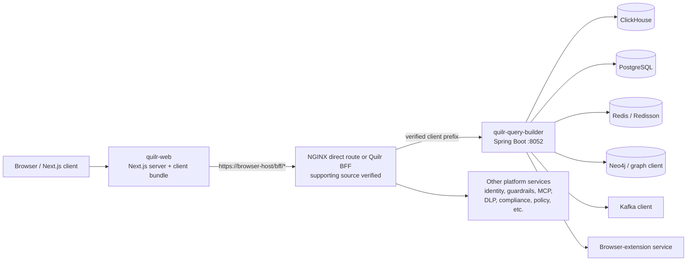
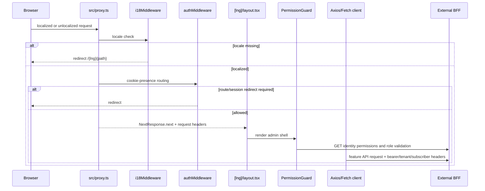
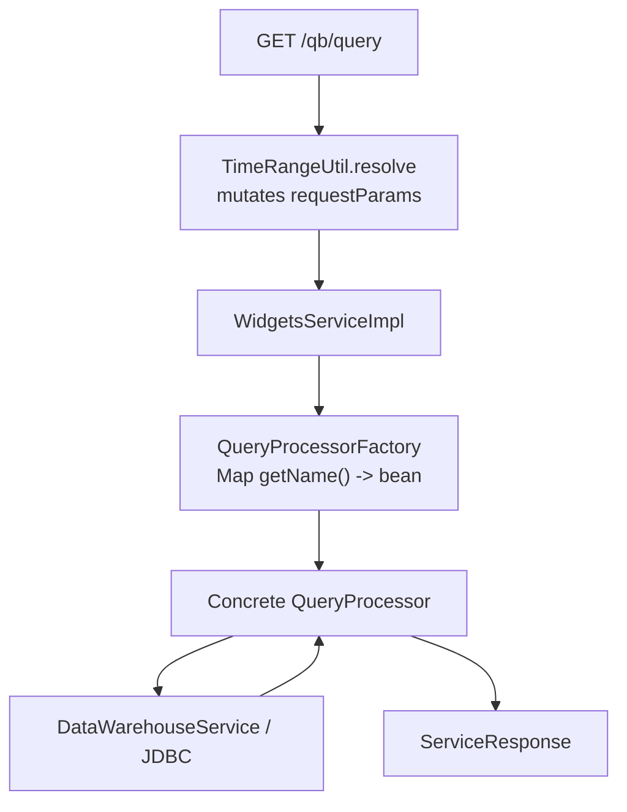
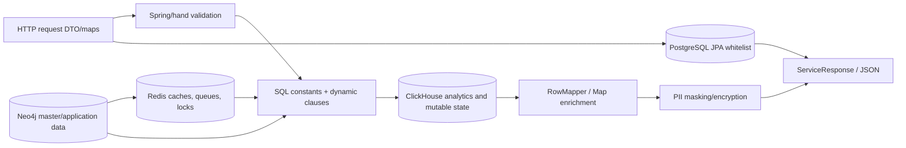
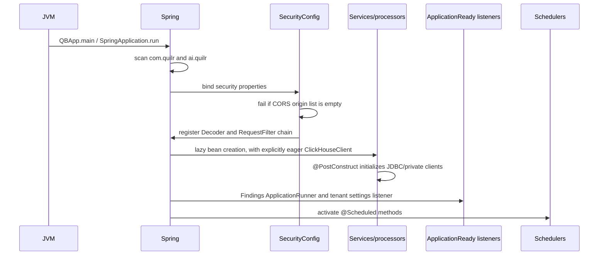
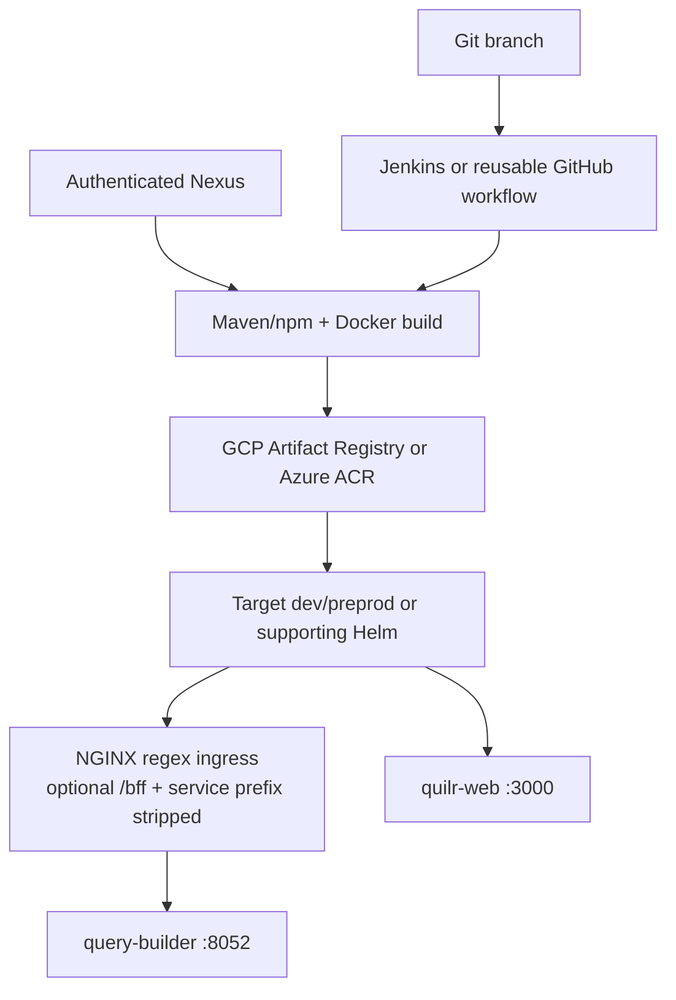

# Architecture

## Component map



**Verified edges:** browser-to-Next, Next/BFF URL construction, NGINX/BFF query-builder routing, query-builder prefix stripping, and query-builder client/storage calls.  
**Unresolved:** which route is currently deployed, TLS termination, network policies, live service discovery, and which external systems are enabled in each environment.

## Repository boundaries

### `quilr-web`

- Build-time boundary: `next build --webpack` produces `.next`; public assets and `node_modules` are copied into the runtime image.
- Server boundary: Next proxy, server components, route handlers, redirects/rewrites, and server-side `fetch` calls.
- Browser boundary: most feature code is client-side React. Jotai, cookies, `sessionStorage`, `localStorage`, SWR, Axios, and browser navigation hold transient state.
- External dependency boundary: the private `@quilrbusiness/quilr-components` package supplies much of the component system. Its pinned source/build/test behavior is now documented as supporting evidence.

### `quilr-query-builder`

- HTTP boundary: Spring MVC controllers and Springdoc.
- authentication boundary: JWT `Decoder` plus authz annotations/library; pinned source and dynamic contract are documented, while live issuer/PDP/gateway policy remains external.
- domain boundary: service classes and named `QueryProcessor` components.
- persistence boundary: ClickHouse JDBC/private DWH client, Spring Data JPA/PostgreSQL, private Redis clients/Redisson, private graph client, and Kafka audit publisher.
- scheduled boundary: Spring schedulers plus one single-thread executor.

## Frontend request topology



`refreshAuthTokenMiddleware` is imported by `src/proxy.ts` but not called. Token refresh instead exists in two client request stacks.

## Query-builder request topology

```mermaid
sequenceDiagram
    participant B as BFF/client
    participant D as external Decoder
    participant R as RequestFilter
    participant C as Spring controller
    participant S as service/processor
    participant Q as SQL/repository layer
    participant DB as ClickHouse/other store

    B->>D: HTTP request
    D->>R: decoded/accepted request
    R->>R: choose context or raw headers; create trace ID; MDC
    R->>C: filter chain
    C->>S: typed DTOs or header/query maps
    S->>Q: build query / transform request
    Q->>DB: parameterized JDBC or external client call
    DB-->>Q: rows/result
    Q-->>S: DTO/map result
    S-->>C: ServiceResponse/ResponseEntity
    C-->>R: HTTP response
    R->>R: response headers; clear MDC
    R-->>B: response
```

**Failure boundary:** the decoder behavior is external. Controller/service error handling is inconsistent: some paths throw to Spring, some use HTTP status exceptions, and many encode `ERROR` in `ServiceResponse` while leaving HTTP status 200.

## Named query-processor architecture



- Spring injects every `QueryProcessor` bean as a list.
- `QueryProcessorFactory` inserts each by `getName()` into a `HashMap`; duplicate names overwrite earlier entries without a diagnostic.
- Missing names throw `IllegalArgumentException`.
- `AbstractQueryProcessor` supplies time helpers, ClickHouse datasource construction, a lazily initialized private Redis client, and empty `ServiceResponse` defaults for optional interface operations.

## Data flow by store



Not every flow uses every node. Exact tables, readers, and writers are in [data models and storage](09-data-models-and-storage.md).

## Startup sequence



Spring’s global `lazy-initialization: true` means many beans initialize only when demanded; `ClickHouseClient` is annotated `@Lazy(false)`. Framework ordering among multiple ready hooks is not explicitly declared.

## Frontend state model

| State mechanism | Owners | Lifecycle |
| --- | --- | --- |
| Auth cookie | login/OAuth, Axios/fetch token utilities, proxy | Browser cookie; no server-managed session is implemented here |
| `roles` cookie | password login | Map of role IDs to URLs; read but not used for decisions in `authMiddleware` |
| `permissions` session storage | permission fetch helper | Per-tab; explicit logout clears it, interceptor-driven token deletion does not |
| Jotai `AuthAtom` | hydration/login/OAuth | In-memory user derived from cookie |
| Jotai feature atoms | filters, layout, timezone, detection config, drilldown stash | Page/app-memory only |
| SWR caches | feature hooks/components | Browser memory, key-specific revalidation/deduplication |
| Local storage | notice preferences and selected findings/provider views | Survives browser sessions |
| Session storage | gateway app filters/lists, notice state, permissions | Survives navigation within one tab |

## Deployment topology evidenced in target and supporting repositories



The target repositories alone do not contain a complete production topology. Supporting Axis Helm supplies both target deployments: one replica each; TCP probes for query-builder; web probes commented; mutable ECR `latest`; Vault/ConfigMap/secret inputs. Supporting NGINX supplies direct query-builder routing, and the BFF independently implements the same service-prefix removal. This is source-controlled intended topology, not proof of current rendered/live state.
