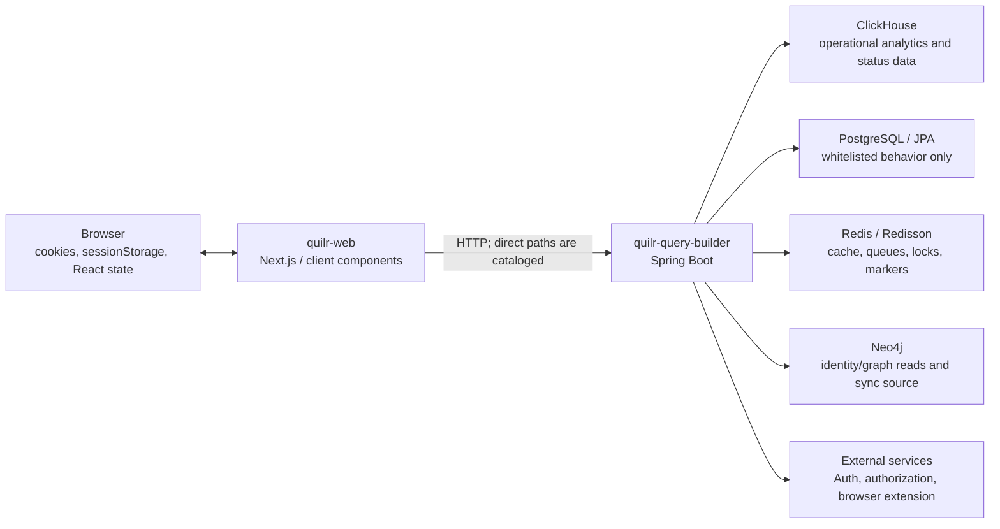
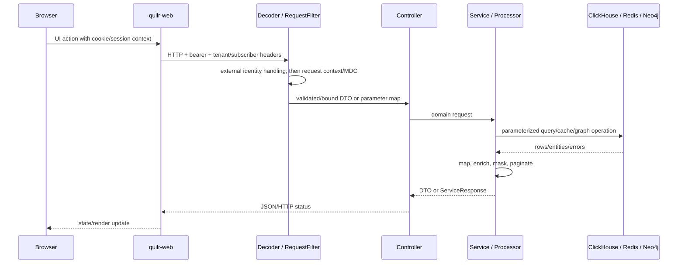
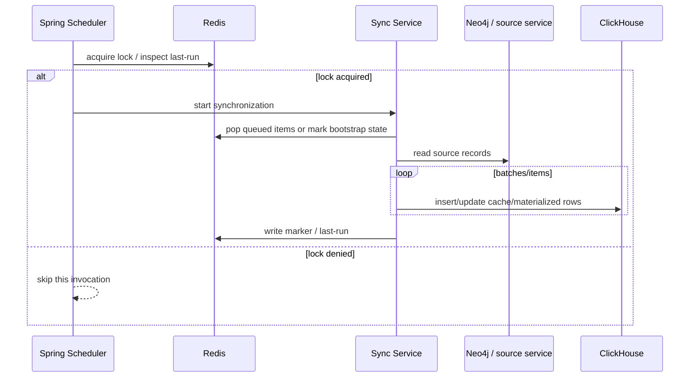
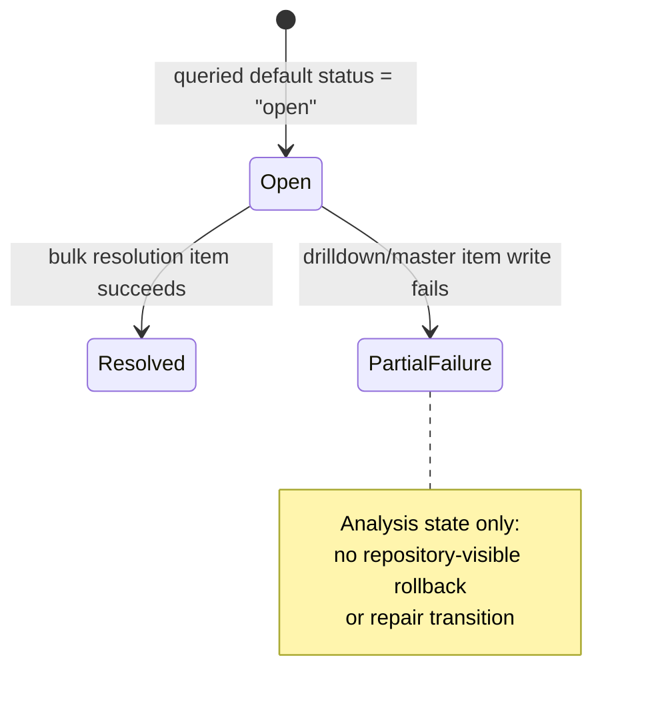

# Data models and storage

## Storage topology

All solid edges above are **Verified** by local imports, configuration, or outbound call construction. Deployment hosts, schemas, and credentials are environment supplied. No queue broker is directly configured in this repository even though private Kafka-related dependencies exist.

## PostgreSQL / Spring Data JPA

### `TenantAppWhitelistedBehavior`

**Location:** `quilr-query-builder/src/main/java/com/quilr/entities/TenantAppWhitelistedBehavior.java`  
**Identity:** `TenantAppWhitelistedBehaviorId` in the adjacent file  
**Repository:** `com.quilr.repository.TenantAppWhitelistedBehaviorRepository`

**Verified:** this is the only local class annotated as a JPA entity. `QBApp` scans `com.quilr.entities` and enables repositories under `com.quilr.repository`. The entity maps the tenant/application/behavior whitelist used by `WhitelistingController` and its services.

Lifecycle:

1. An HTTP whitelist request carries tenant/application/behavior identity and operation-specific data.
2. A method-level `@RequiresPermission(APP_MANAGEMENT, TENANT, WHITELIST)` annotation is present on each of the four controller operations.
3. The service queries or mutates the Spring Data repository.
4. Spring JPA uses `spring.datasource.*` connectivity from `application.yml`.
5. Repository deletion is permanent from the application perspective; no local soft-delete or audit version table is defined.

Supporting migration source resolves the physical definition:

- `quilr-migration-service/src/main/resources/db/migration/quilr/V20260223120001__create_tenant_app_whitelisted_behaviours.sql`;
- table `public.tenant_app_whitelisted_behaviours`;
- columns `tenant`, `app_id`, `behaviour_id`, `updated_by`, and `update_time`;
- primary key `(tenant, app_id, behaviour_id)`;
- indexes on application, tenant, and descending update time.

**Unresolved:** live schema drift and applied migration version. The local runtime used H2 only to exercise bootstrap and did not validate PostgreSQL DDL/dialect behavior.

## ClickHouse

### Access adapters

| Adapter | Construction | Users | Transaction/pooling evidence |
| --- | --- | --- | --- |
| `com.quilr.qb.ClickHouseClient` | Builds one `DriverManagerDataSource` and one `NamedParameterJdbcTemplate` in its constructor | Direct client consumers | `DriverManagerDataSource` opens connections directly; no application pool is configured here. |
| `com.quilr.qb.util.ClickHouseDbUtil` | Retains `DWHConfig`, but `namedJdbcTemplate()` constructs a new `DriverManagerDataSource`/template | repositories, asset/red-team/status/findings services | Each call can create a new non-pooled data source wrapper. No local transaction manager is used. |
| `AbstractQueryProcessor` | `namedJdbcTemplate()` creates a data source/template | most named query processors | Same non-pooled pattern; processor beans are normally Spring singletons. |
| domain-local constructors | e.g. `NonAIAppsServiceImpl` and executive dashboard helpers | individual features | Repeat the same JDBC configuration rather than sharing one managed pool. |

SQL values are commonly supplied through `NamedParameterJdbcTemplate`. This materially reduces value injection where placeholders are used. It does not protect concatenated identifiers or complete ad-hoc SQL strings.

### Schema evidence and limitations

The target repository contains query constants and one `db/dashboard-qry.sql` artifact but no migration set. Supporting `quilr-migration-service@e4a8ac44844b8c3991881cf7fe873d973fcdb7a7` contains cluster, SaaS, and PaaS ClickHouse migrations for many referenced tables. Those files establish source-controlled engines, columns, order/partition clauses, and later migrations. They still cannot establish:

- which profile and migration version is deployed;
- manual/live schema drift;
- live grants and row policies;
- live local/distributed topology and materialized-view state;
- row counts, query plans, and whether every referenced table is present in one environment.

### Write and consistency model

- Status-event resolution writes drilldown and master records through separate repository calls. **Verified:** there is no encompassing transaction, and item failures produce partial results.
- ClickHouse comments in `StatusEventQueries` state that sorting-key columns cannot be updated, and the implementation uses insert/version-style operations for affected state rather than a relational update transaction.
- Scheduler-driven synchronization reads Neo4j/external sources and writes ClickHouse batches. A Redis marker/lock is not atomic with the warehouse writes.
- Smart-group changes synchronize only within a single JVM method. Multiple replicas can execute independently unless an external constraint prevents it.
- Asset inventory pagination and count are separate reads and are not a consistent snapshot.
- Ad-hoc operations execute caller-provided query text after string-based guards; the 10,000-row constant is checked after query execution rather than enforced at the database.

### Serialization

JDBC query results are primarily represented as `List<Map<String,Object>>`. Processors then:

- normalize ClickHouse `Array`/string-array values;
- map rows into DTOs in the AI asset, audit, red-team, and status domains;
- convert JSON-text columns with Jackson;
- add computed/enriched properties;
- mask or decrypt selected content.

`AssetInventoryDao.putJson` omits a field when JSON parsing fails. `RedTeamDaoImpl` converts MITRE and OWASP ClickHouse arrays into both transformed and original mappings. `QuillyInteractionsProcessor` explicitly handles JDBC `java.sql.Array`.

## Redis and Redisson

### Connection configuration

`com.quilr.qb.common.RedissonConfig` customizes the Redisson starter with host, port, password, pool, retry, and timeout settings. `InteractionsCacheConfig` builds a Spring `RedisCacheManager` using string keys and `GenericJackson2JsonRedisSerializer`.

Supporting common-library source resolves `com.quilr.cache.RedisCacheServiceImpl`. Those instances are initialized imperatively with `RedisConfig` instead of being injected as a single Spring-managed adapter. Verified supporting behavior includes a hard-coded password assignment in initialization, one-hour entity TTL regardless of the supplied expiration argument, inconsistent delete-key construction, and an empty `closeCache`.

### State classes

| State | Owner | Creation/update | Read/delete/expiry | Recovery implications |
| --- | --- | --- | --- | --- |
| interaction result caches | `InteractionsCacheConfig` plus cache annotations/services | populated after interaction queries | four named caches, each three-minute TTL | Cache failure behavior depends on Spring/Redisson exceptions; no local stale fallback is visible. |
| tenant/app settings cache | `TenantAppCacheService` | reads ClickHouse then writes entity keyed by tenant/app; can merge update data | explicit fetch/delete methods; TTL consumers use `cache.*` property names | YAML exposes similarly purposed `redis.*` keys that do not feed those consumers. |
| global app details | app sync/cache services | synchronized from `apps_db` | Redis namespace operations exposed through AI user endpoints | Broad key-list/delete endpoints have no local method permission annotation. |
| work queue | `AppSyncService` / scheduler | scheduler adds; worker iterates a Redisson set then `removeAll`s the selected batch | removed before downstream work; claim is non-atomic | A live two-consumer test returned the same 800/800 members to both consumers; no local requeue path exists. |
| distributed lock | `RedisLockService` | conditional lock acquisition | key suffix `:lock`, configured timeout | failure skips the run; no durable job retry ledger. |
| last-run marker | `RedisLockService` / schedulers | timestamp after/around eligible run | key suffix `:last_run` | marker and business work are not transactional. |
| app-admin marker | app-admin synchronization | set after loop | no TTL | Individual row failures do not prevent marker creation, which can suppress a later repair run. |
| master-data bootstrap state | `MasterDataScheduler` | compare-and-set before async bootstrap | subsequent startup observes state | failed async work is not automatically retried after the state transition. |

### Cache key scope

Interaction keys include subscriber, tenant, and request data. Tenant/app settings use `tenant + ":" + appId`. The explicit inclusion of tenant/subscriber IDs is a local isolation mechanism, but it depends on correct request-context population.

## Neo4j

Graph configuration is supplied through `GraphConfig`/YAML values. Verified local consumers include:

- executive dashboard row-one user/extension counts;
- endpoint device synchronization from Neo4j into `ep_user_devices`;
- application/user/master-data synchronization;
- findings whitelist account-existence checks.

`FindingsWhitelistService` checks account existence but logs TODO messages instead of creating missing Neo4j accounts or the intended ClickHouse whitelist entry. Those effects are **Documentation-only / placeholder**, not implemented.

`FindingsCacheInitializer` runs as an `ApplicationRunner`, obtains graph-backed master data, and populates caches. A null graph result can raise an exception that is caught; subsequent stages can be skipped. The POSTURE population path is commented out.

Supporting graph/common source resolves additional labels, queries, and adapters. **Unresolved:** current deployed constraints/indexes, complete relationship cardinalities, authoritative ownership, and live graph-to-warehouse drift.

## Browser and Next.js transient state

| Mechanism | Data | Writers/readers | Persistence and cleanup |
| --- | --- | --- | --- |
| cookies | auth JSON, refresh/user data, roles, external auth state | login/OAuth/route handler → middleware, API utilities, UI | Browser-persistent according to writer options; OAuth uses 12 hours. Explicit logout deletes selected cookies. |
| `sessionStorage` | permission map and UI/session values | permission fetch → guards/hooks | tab-scoped; explicit logout clears permission storage; Axios interceptor cookie deletion does not perform the same cleanup. |
| React state/hooks | form values, filters, modals, selected rows, fetched page data | thousands of client components/hooks | page/component lifetime; some values mirrored into URL/query/cache. |
| Zustand/global stores | authenticated user and domain UI state | hydration/auth/domain actions | memory until reload unless storage middleware is used by that store; see generated `store.md` reference for exact declarations. |
| Next.js server request cookies | auth cookie read by `ServerApiService`/Axios server branch | per incoming request | missing cookie can throw; no server database is created by the web repository. |
| PostHog browser storage | analytics/session replay state | instrumentation on permitted hostnames | vendor-managed client state; OAuth paths pause/suppress sensitive capture. |

## Files and static resources

- `quilr-query-builder/src/main/resources/application.yml` is the backend configuration file.
- Classpath JSON/CSV resources under `src/main/resources` provide query/master/static mapping data. Their individual paths are in the [inventory](inventory/quilr-query-builder-files.md); source consumers are indexed in the backend references.
- `quilr-query-builder/db/dashboard-qry.sql` is a reference/query artifact, not a migration runner input.
- `quilr-web/public` and imported `src` assets are browser-delivered images/icons/fonts/static documents. They have no server-side mutation lifecycle in this repository.
- `/api/download-mdm-file` downloads a caller-selected remote URL into memory/streaming response behavior and returns it; it does not persist a local file.

## Data lifecycle diagrams

### Normal query flow

### Scheduler synchronization

The Redis and ClickHouse operations in this diagram are not a distributed transaction. Failure after a pop/marker can leave state partially synchronized.

### Verified status-event transition

Only the `open` query default and the resolution write path are verified. Other deployed status values/transitions are **Unresolved** because no authoritative state enum or table constraint is present. `PartialFailure` is an analysis state describing split writes, not a persisted status literal.

## Deletion, expiration, and retention gaps

- PostgreSQL whitelist deletion exists; database retention/audit policy is unresolved.
- Redis interaction entries expire after three minutes; app/settings and marker TTLs vary, and the app-admin marker has no TTL.
- ClickHouse queries update/insert operational records, but no table TTL/retention or deletion policy is present locally.
- Browser logout deletes selected cookies/session state, but 401/406 interceptor paths do not all perform identical cleanup.
- Logs can include SQL and parameter maps from `ClickHouseDbUtil` error paths. Retention and redaction are external.
