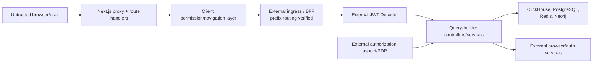
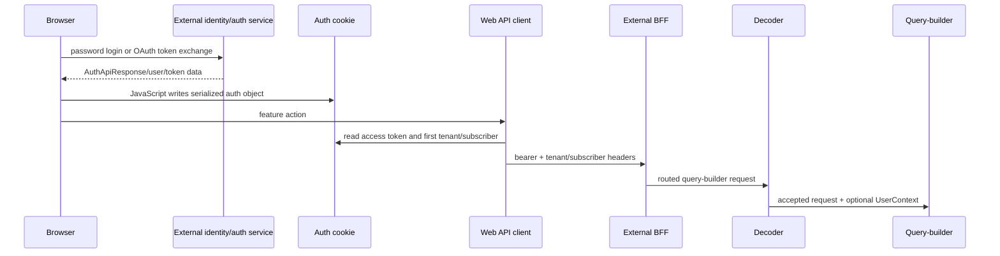
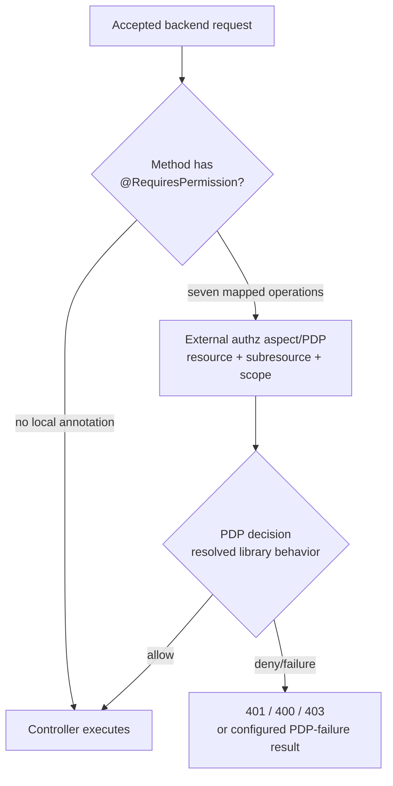

# Security model

This is a code-evidence assessment, not a penetration-test report. Concerns that depend on deployment or private dependencies are labeled **Potential issue requiring validation** rather than asserted vulnerabilities.

## Trust boundaries

The frontend route guard is not a security boundary for backend data. The locally visible backend boundaries are the external decoder filter, seven `@RequiresPermission` annotations, access-code checks for ClickHouse operations, DTO/query validation, and tenant context carried into data access.

## Control matrix

| Control | Enforcement location | Decision input / protected resource | Failure behavior | Coverage |
| --- | --- | --- | --- | --- |
| JWT decoding | resolved `Decoder` inserted by `SecurityConfig` | request token/headers; all nonexcluded backend paths | 400/401 on malformed/invalid inputs; context cleared in `finally` | source inspected; seven harness tests plus live HTTP probes |
| Spring route authorization | `SecurityConfig` | every request | `.anyRequest().permitAll()` | no local authenticated-route rule |
| method permission | resolved `@RequiresPermission` aspect | resource/subresource/scope plus context | 401 missing auth, 400 missing tenant, 403 denial; PDP failure obeys fail-open setting | seven mapped operations; five aspect and two REST-client harness tests |
| tenant context | `RequestFilter`, frontend headers, processor parameters | selected tenant/subscriber | external `UserContext` preferred; raw headers otherwise | broad but not a centralized mandatory validator |
| frontend auth navigation | `authMiddleware` | auth cookie presence/content, onboarding and self-service flags | redirects or permits route | browser navigation only |
| frontend route permission | `PermissionGuard` / route map | `sessionStorage` permission map | resource/any checks can permit while loading; exact permission denies | 59/112 pages match a rule |
| CORS | `SecurityConfig` | configured origin/method/header | startup fails without allowed origins | all backend paths |
| security response headers | backend `RequestFilter`; Next `next.config.js`/middleware | static configuration | writes headers; Spring defaults disabled backend | broad |
| CSRF | backend Spring | state-changing requests | disabled | absent locally |
| ClickHouse ops code | `ClickhouseOpsProcessor` | `access_code` request-body field | returns error data inside `ServiceResponse` | both ops routes |
| query validation | processors/DTOs | fields, operators, identifiers, SQL text | varies: error wrapper, exception, or no whitelist | domain-specific |
| encryption/masking | masking package | configured master key, masked attributes | startup warning/first-use failure; token-level fallback varies | conversation/sensitive fields |
| audit | `AuditService`, ClickHouse audit repositories, method calls | domain action metadata | Kafka toggle/private publisher; exceptions vary | partial, not a universal interceptor |

## Backend authentication

The web requests, cookie writes, header construction, decoder registration, downstream order, BFF/ingress routing, and decoder acceptance criteria are **Verified** from target/supporting source and dynamic probes. Real identity-service token issuance and current deployed routing/policy remain external edges.

`SecurityConfig.filterChain`:

1. disables CSRF;
2. disables Spring Security's default response-header writer;
3. marks explicitly listed docs/DWH paths and then every other path permitted;
4. inserts external `ai.quilr.jwtdecoder.filter.Decoder` before `BasicAuthenticationFilter`;
5. inserts `RequestFilter` after the basic filter;
6. enables configured CORS.

**Verified:** local Spring authorization does not require an authenticated principal. The resolved decoder independently rejects missing/invalid credentials, checks revocation/optional expiry, validates a selected tenant when supplied, populates `UserContextHolder`, and clears context after the request. A live no-identity `/qb/health` request returned 401; `internal: true` reached the controller only when internal-header mode was enabled.

The decoder exclusion string includes `/quilr-query-builder/dwh`, while the local routes are `/dwh/**`. Pinned NGINX/BFF implementations strip the service prefix before the request reaches query-builder, and the decoder uses `AntPathRequestMatcher` against the backend request. **Contradiction at the inspected commits:** the configured exclusion does not match the known rewritten `/dwh` servlet path. A divergent live route/config remains possible.

## Backend authorization

This graph represents repository-local method annotations. A gateway/decoder may apply additional policy to the “no local annotation” branch; that is **Unresolved**.

Seven HTTP operations have local method-level policy annotations:

- `AIAppsController.updateAppTenantSettings`: `APP_MANAGEMENT / TENANT / UPDATE`
- `AIConversationsController.getUnMaskedData`: `AI_USAGE / CONVERSATION / READ`
- `UserAppApprovalController.updateApprovals`: `APP_MANAGEMENT / USER / UPDATE`
- four `WhitelistingController` methods: `APP_MANAGEMENT / TENANT / WHITELIST`

High-impact operations without a local annotation include ClickHouse ad-hoc SQL, Redis namespace key enumeration/deletion, manual synchronization, endpoint graph-to-warehouse sync, DWH configuration/host diagnostics, audit master-code mutation, smart-group synchronization, and status resolution.

This does not prove they are unprotected in deployment: decoder or gateway policy may be global. It does mean the local source does not express resource-specific authorization for them.

`quilr.authz.fail-open: false` configures the resolved authorization library. Dynamic tests verified deny on PDP failure when false, allow when true, 401/400 for missing authorization/tenant context, 403 on denial, and no aspect decision when no HTTP request context exists.

## Tenant isolation

`RequestFilter` chooses:

- tenant from external user selected tenant when non-null, else incoming header;
- subscriber from external user context when non-null, else incoming header;
- client only from the incoming header;
- trace from incoming nonblank header, else a generated UUID.

It writes all values to MDC and response headers, invokes the chain, then clears MDC in `finally`.

Many SQL queries bind tenant/subscriber predicates. Cache keys also include tenancy. These are concrete isolation controls.

**Potential issue requiring validation:** when `UserContextHolder` is absent, raw client headers become the identity partition inputs. If the decoder/gateway permits such a request, the service has no centralized proof that the supplied tenant belongs to the caller. Some routes accept header maps and use them directly rather than a typed request context.

## Browser authentication and session handling

Login and OAuth paths serialize the authentication object into a cookie. Frontend code reads the access token and refresh token from JavaScript. Writers set `path: "/"`; the OAuth path adds a 12-hour age. No local writer sets `HttpOnly`, `Secure`, or `SameSite`.

Consequences supported by the code:

- JavaScript must be able to read the token cookie, so `HttpOnly` is not in effect from these writers.
- Cookie presence drives server proxy navigation.
- `authMiddleware` calls `JSON.parse` without catching malformed values.
- `/api/cookie` accepts arbitrary `user` JSON and writes the same cookie without authenticating the caller; no active in-repository caller was found, but the HTTP route remains reachable.
- roles/permissions stored in cookies/session storage are client-controllable. They are used for UI behavior, not shown as backend policy proof.

Live development probes confirmed that a parseable `{}` cookie admitted a protected UI route, malformed cookie JSON produced 500, and a schema-compatible body to `/api/cookie` was written back as the configured auth cookie. These are UI-session semantics; downstream query-builder requests still encounter decoder/permission controls.

**Potential issue requiring validation:** a cross-site scripting flaw would expose bearer and refresh material because the cookie is JavaScript-readable. Deployment-level response/cookie rewriting cannot be assumed.

## Refresh and logout behavior

`AxiosService` retries a 401 when a refresh token exists and `originalRequest._retry` is false. It never sets `_retry = true`, and refresh uses the same interceptor-enabled Axios instance. **Potential issue:** repeated 401 responses can recursively refresh/retry.

On refresh failure:

- status 406 deletes cookies, reloads, and redirects;
- other Axios errors are returned as resolved values from the helper rather than consistently rejected.

On 403, non-self-service sessions call `identity/roles/my/validate`; a non-200 result clears selected cookies and redirects to login. On 406, selected cookies are removed and the page reloads. These interceptor paths do not clear the same `sessionStorage` permission state as explicit logout.

`useLogout` gets a user setter but does not call it. In-memory state cleanup therefore relies on subsequent navigation/reload/hydration.

## Client route permissions

`evaluatePageAccess` processes 38 route rules. Static evaluation at the pinned commit yields:

- 112 page routes;
- 59 matching a rule;
- 53 with no rule.

Once a nonempty permission map is available, a page without a rule is allowed. Resource-level and any-of checks are fail-open during loading, while exact permission checks are fail-closed. Direct and fallback rules disagree for some pages, including a user-management `USER` versus `RBAC_ADMIN` distinction and a profile fallback using `ORG_POLICY`.

This is a navigation/presentation system. Users can request routes directly, and APIs must independently authorize access.

## Input validation and injection boundaries

### Stronger local controls

- Interaction advanced search accepts only whitelisted fields/operators and binds values with named parameters.
- Findings timezone values are validated before being inserted into ClickHouse query text.
- DTO Bean Validation is used on selected typed endpoints.
- The current encryption format authenticates ciphertext with AES-GCM.
- Select-side ClickHouse operations reject non-`SELECT`/`WITH`, semicolons, and mutation keywords.

### Potential issues requiring validation

| Surface | Verified implementation evidence | Concern |
| --- | --- | --- |
| `AssetInventoryDao` | concatenates `searchFields`, filter keys, and order field into SQL; binds values | caller-controlled SQL identifiers are not locally allowlisted |
| ClickHouse update operations | blocks a finite substring list but otherwise sends full SQL to `update`; `INSERT` is not in the update blocklist | shared access code can authorize broader statements than the method comment suggests |
| ClickHouse select operations | 10,000-row check occurs after result materialization | resource limit is advisory, not an execution cap |
| `/api/download-mdm-file` | server fetches caller-provided URL, follows platform fetch semantics, buffers response; a local HTTP fixture succeeded dynamically | deployed egress reachability, memory pressure, and filename/header controls require environment validation |
| `/api/cookie` | unvalidated arbitrary `user` body becomes auth cookie | session fixation/confused UI state if route is exposed |
| smart-group operation | unknown operation is not rejected | inconsistent state/audit paths |
| status pagination | negative page/pageSize are not clamped | invalid SQL/large/undefined warehouse behavior |
| `RestTemplate` users | several clients have no visible explicit timeout; browser extension factory does | stalled threads on network failures |

The code frequently uses named SQL parameters for values. Findings above are specific exceptions, not a claim that all SQL is concatenated.

## ClickHouse operations boundary

Both `/clickhouse/ops/query` and `/clickhouse/ops/update` require an `access_code` in the JSON body. The configured fallback code is committed.

Select path:

1. exact trimmed code comparison;
2. query must start with `SELECT` or `WITH`;
3. semicolon and `INSERT`/`UPDATE`/`DELETE`/`ALTER` substrings rejected;
4. optional parameter map passed to JDBC;
5. results returned with row count and execution time;
6. a warning is added at 10,000 or more rows, after fetch.

Update path:

1. same code comparison;
2. finite blocklist: destructive DDL fragments such as drop/truncate/rename/create;
3. any nonblocked SQL is passed to `ClickHouseDbUtil.update`;
4. response includes the submitted query and raw exception message.

No tenant predicate is injected. Caller headers are logged, not applied as a database restriction. **Potential issue requiring validation:** effective safety relies on decoder/gateway protection, ClickHouse credentials/grants, and secrecy of the committed-overridable code.

## Cryptography and secret handling

Current masking encryption uses:

- AES-256-GCM;
- random 12-byte IV;
- 128-bit authentication tag;
- Base64 serialization prefixed `v2:`.

Legacy decryption accepts ciphertext produced with a hard-coded AES/ECB key. New encryption does not use the legacy mode.

The master-key source comment says no default is committed, but YAML and `EncryptMaskingKeyBootstrap` both provide a nonempty fallback. Other checked-in fallbacks include PostgreSQL/Redis credentials, ClickHouse and Neo4j credentials, and the ops access code. This analysis does not determine whether any value is live.

Docker development build accepts an npm token as a build argument and writes `.npmrc` in a layer. Production uses a BuildKit secret, which is the safer of the two repository implementations.

## Response security and output handling

Backend headers default to HSTS, no-sniff, frame denial, referrer policy, COOP/COEP/CORP, no-store, and a restrictive CSP. Spring default headers are disabled so `RequestFilter` is the single backend writer.

Next configuration supplies no-sniff, frame denial, and CSP `frame-ancestors`; exact frontend header matrix is in `next.config.js`. PostHog sanitization removes credential/header/JWT/query properties and limits recursive depth before capture.

Raw SQL/database errors can be returned by ClickHouse ops and are logged with exceptions. `ClickHouseDbUtil` error logs include SQL and parameter maps. **Potential issue requiring validation:** sensitive query values may reach logs or clients.

## Network and filesystem boundaries

- Backend listens on configurable port 8052; frontend on 3000.
- Target dev/preprod Kubernetes uses `LoadBalancer`; supporting Axis charts use ClusterIP services behind NGINX. Current applied exposure/network policy remains unresolved.
- Backend Docker runs without a non-root `USER`; frontend selects `nextjs` but switches back to root before `CMD`.
- Backend image applies `chmod -R 777 /quilr`.
- `SnippetFileService` accesses `/quilr-data-upload`; exact caller-derived path safety should be validated against its symbol reference.
- No Kubernetes pod security context, read-only filesystem, seccomp profile, capability drop, or probes are checked in.

## Security test coverage

No unit, integration, end-to-end, security, or authorization tests are tracked in either target repository. The analysis harness added seven decoder and seven authorization/PDP tests, all passing, plus HTTP probes for cookie/filter/CORS behavior. These are external verification artifacts rather than target-owned regression coverage. Exact GitHub runs skip the target application builds; the reusable security workflow is documented separately.
