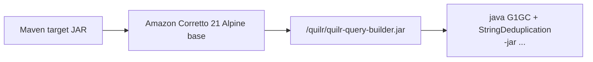
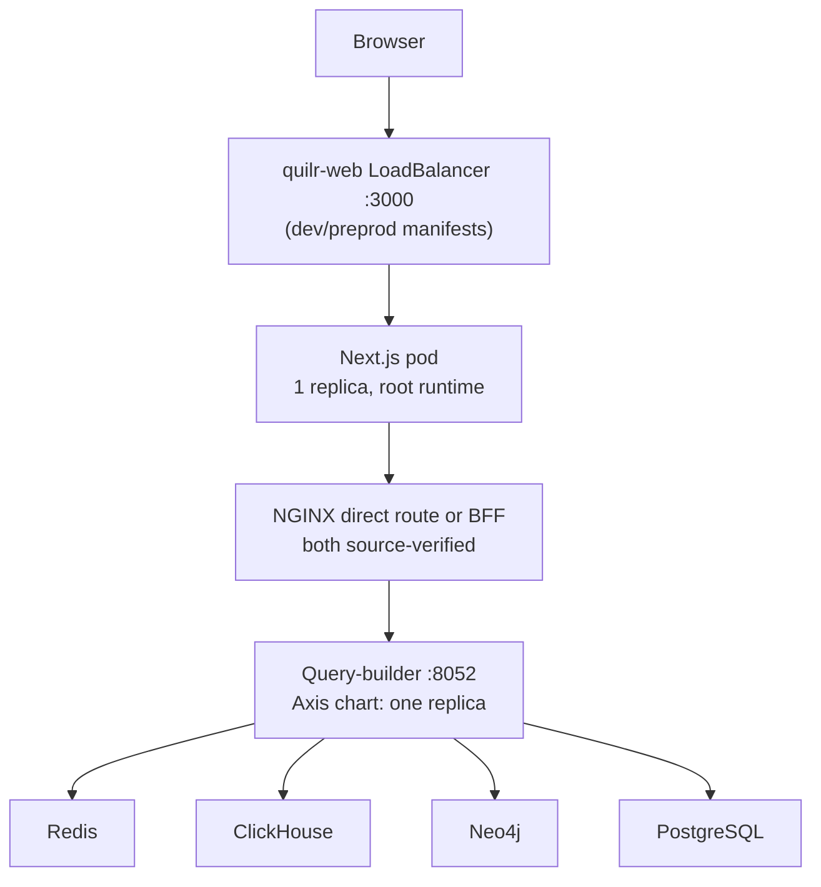

# Build, deployment, and operations

## Toolchain summary

| Repository | Build identity | Runtime | Package source constraints |
| --- | --- | --- | --- |
| `quilr-query-builder` | Maven JAR `com.quilr:quilr-query-builder:1.0.0` | Java 21, Spring Boot 3.5.14, Tomcat 10.1.55 | private Quilr/AI artifacts through checked-in Nexus settings |
| `quilr-web` | private npm package `quilr-web@0.1.0` | Node 20 container, Next.js 16.2.6, React 19.2 | private `@quilrbusiness/quilr-components`; lockfile pinned npm graph |

## Query-builder build

### Local commands evidenced by the repository

Typical Maven lifecycle:

```text
mvn clean package -s nexus-settings.xml
```

Jenkins actually runs:

```text
mvn clean package -DskipTests -s nexus-settings.xml
```

The Spring Boot plugin repackages with main class `com.quilr.QBApp`. The resulting `target/quilr-query-builder-*.jar` is copied into the container.

### Maven configuration

- Java property: 21.
- Spring Boot parent/starter/plugin: 3.5.14.
- Tomcat override: 10.1.55, with a comment linking it to specific CVE patches.
- Direct major dependencies: Spring MVC/JPA, PostgreSQL, Redisson, Springdoc, Feign, Micrometer Prometheus, JSqlParser 5.1, and private DWH/Kafka/authorization/JWT decoder artifacts.
- JaCoCo 0.8.2 attaches an agent and report to `test`.
- `maven-compiler-plugin` is explicitly version 2.4 and configured with `<skip>true</skip>`, source/target 21.

**Verified effective build:** after the private dependencies were built from pinned source into the isolated Maven repository, the unmodified target completed a clean Java 21/Maven 3.9.11 package. The executable JAR is 117,763,412 bytes and contains 370 `BOOT-INF/classes` class entries plus 158 nested JARs. The old compiler-plugin/`skip` block is unusual and misleading as lifecycle documentation, but it did not prevent the effective Spring Boot parent lifecycle from compiling this target. The exact green GitHub Actions run did not supply this evidence because its application build job was skipped.

### Backend container



Dockerfile behavior:

1. creates `/quilr/conf`;
2. copies the built JAR;
3. recursively sets mode `777` on `/quilr`;
4. exposes 8052;
5. starts Java with G1 GC, string deduplication, survivor ratio 7, and 100 ms max-pause target.

No `USER` instruction is present, so runtime identity is inherited from the base image; the Dockerfile does not establish non-root execution. There is no `HEALTHCHECK`.

## Web build

### npm scripts

| Script | Command | Role |
| --- | --- | --- |
| `prepare` | `husky` | install Git hooks |
| `dev` | `next dev --webpack` | development server |
| `turbo` | `next dev --turbo` | Turbopack development |
| `build` | `next build --webpack` | production build |
| `start` | `next start` | production server |
| `analyze` | `ANALYZE=true next build --webpack` | bundle analysis |
| `clean` | remove `.next` | build-output cleanup |
| `checkBuild` | `sh script.sh` | repository-specific build check |
| `localInstall` | install private components from localhost Verdaccio | local component development |
| `lint` / `lint:fix` | ESLint over `src` | static lint |
| `format` / `format:check` | Prettier | formatting |
| `typecheck` | `tsc --noEmit` | TypeScript checking |
| `lint-staged` | lint-staged config | commit-time checks |

There is no `test` script.

`package-lock.json` is committed and the Docker build uses `npm ci`, making the resolved dependency graph reproducible when the private registry is available.

### Next.js build configuration

- transpiles the private component package;
- enables experimental CSS optimization;
- injects auth/feature/public environment variables;
- provides three security headers;
- rewrites three locale-prefixed PostHog ingest paths;
- declares eight permanent redirects;
- allows HTTPS images from Azure blob hosts;
- disables browser `canvas`, externalizes server canvas, and ignores `.node` modules;
- enables bundle analyzer when `ANALYZE=true`;
- builds with webpack explicitly even though Next 16 also supports Turbopack.

### Production web container

Three stages:

1. **deps:** private Node 20 Bullseye base, installs native graphics/build/git tooling, uses a required BuildKit `.npmrc` secret, runs `npm ci`.
2. **builder:** copies dependencies and source, bakes selected build args into environment, runs `npm run build`.
3. **runner:** copies `public`, `.next`, `node_modules`, and package manifest; adds UID/GID 1001; exposes 3000.

The runner selects `USER nextjs` and then selects `USER root` immediately before `CMD`. **Verified:** effective startup user is root.

The image copies the whole `.next` directory and `node_modules`; Next standalone output is not configured.

### Development/on-prem image

`Dockerfile.dev` uses Node 20 Alpine and passes `NPM_TOKEN` as an ordinary build argument, writes it into root's `.npmrc`, and otherwise follows the same build/run pattern. It also switches back to root before startup.

**Potential issue requiring validation:** build arguments and prior layers can reveal the npm token. Production's BuildKit secret mount avoids writing it into the layer.

## CI/CD

### GitHub Actions

Both repositories have a build workflow triggered on:

- manual dispatch;
- push to `main` or `quilr-preprod`;
- pull request targeting either branch.

They delegate entirely to:

`quilrbusiness/ci-scripts/.github/workflows/build.yml@devops/nexus-ci-integration`

with inherited secrets and read/pull-request permissions.

The backend additionally delegates PR security work to:

`quilrbusiness/ci-scripts/.github/workflows/ci.yml@ci-security-tools-integration`

Supporting-source and exact-run verification resolved this boundary. Both pinned commits used `ci-scripts@cf687f6a1713498d2843f0f60a8ddf30d672775d`. `scripts/ci.sh detect` enables the Nexus build only for repositories named in `config/<type>-libraries.txt`; neither target is listed.

| Target run | Detect | Build | Exact reason |
| --- | --- | --- | --- |
| query-builder `30017726685` | success | skipped | Java service is not in `java-libraries.txt` |
| web `30077640570` | success | skipped | Node application is not in `node-libraries.txt` |

**Contradiction:** the green top-level CI conclusions at the pinned commits do not prove an application compile. Their build jobs were skipped. The web's separate Platformdocs workflow built documentation, not `quilr-web`.

### Jenkins: backend

1. polls SCM every minute;
2. derives image name/tag and selects Maven Nexus group by branch;
3. uses Jenkins Nexus credentials;
4. runs Maven package with tests skipped;
5. authenticates to Google Artifact Registry;
6. builds and pushes the image through a shared library.

Supporting `quilr-jenkins-shared-library@d16ec670f1a5e9d6f641b099c52e6ecab9f854c3` resolves the shared push implementation. Query-builder paths use mutable `latest`/`latest_prod`-family tags by registry/branch. No tested rollback procedure is defined.

### Jenkins: web

Main Jenkinsfile:

1. polls every minute;
2. derives image/tag and branch-specific npm group;
3. creates an in-memory authenticated `.npmrc`;
4. passes it as a BuildKit secret;
5. passes public auth/PostHog/feature values as build args;
6. builds with `--no-cache`;
7. pushes a `latest` image through the shared library.

`Jenkinsfile.dev`:

1. builds `Dockerfile.dev` with an npm token and dev values;
2. pushes `quilrdev.azurecr.io/quilr-web:latest_devonprem`;
3. applies dev ConfigMap/deployment/service;
4. restarts the deployment.

The older commented pipeline block is not active.

## Kubernetes

Only dev and preprod manifests are checked into the web target. Supporting Helm repositories add Axis and SaaS manifests and supporting NGINX ingress:

| Property | Dev | Preprod |
| --- | --- | --- |
| replicas | 1 | 1 |
| service | `LoadBalancer`, port 3000 | same |
| request | 250m CPU / 256 MiB | 500m CPU / 1024 MiB |
| limit | 500m CPU / 1024 MiB | 1000m CPU / 2048 MiB |
| image pull | always | always |
| probes | none | none |
| security context | commented/none | commented/none |
| environment source | inline; `envFrom` commented | inline; `envFrom` commented |

Both ConfigMaps duplicate the `NEXT_PUBLIC_EXT_AUTH_COOKIE` key. Neither is actually referenced by the deployment as committed.

The Axis target chart verifies:

- query-builder service 8052, HPA min/max one, 125m/512Mi requests, 1000m/2048Mi limits, TCP readiness/liveness after 40 seconds, ECR `main/quilr-query-builder:latest`, Vault/ConfigMap/secret inputs, and a shared volume;
- web service 3000, HPA min/max one, 125m/512Mi requests, 1000m/1024Mi limits, ECR `main/quilr-web:latest`, and commented-out probe blocks;
- NGINX direct regex route `/(?:bff/)?quilr-query-builder(/|$)(.*)` with rewrite target `/$2`.

Still missing as live evidence:

- current rendered production objects and image digests;
- network policy and load-balancer/DNS selection;
- PodDisruptionBudget/startup probe;
- actual Secret/Vault values;
- service account/RBAC;
- topology spread/anti-affinity;
- rollout strategy override;
- persistent volumes in active configuration;
- backend Kubernetes deployment.

## Runtime topology



The gateway and query-builder deployment edges are **Verified in supporting source**. NGINX strips optional `/bff/` plus the service name and routes directly to query-builder. The BFF independently strips its Express mount prefix. A live BFF echo trace verified the latter. Which path a current deployment selects remains runtime state.

## Start, stop, health, and rollback

### Start

- backend: Java `-jar` command in Docker; configuration/environment must include allowed CORS origins;
- web: `npm start`, with `PORT=3000`, after a successful Next build.

### Stop

- Spring context shutdown invokes `@PreDestroy`, logs through `QBAppListener`, shuts the master bootstrap executor, and gives the dashboard executor up to 30 seconds.
- No custom Node shutdown handler exists.
- Kubernetes manifests do not set termination grace or lifecycle hooks.

### Health/monitoring

- backend `/dwh/health` is a mapped application endpoint.
- YAML intends actuator metrics, Prometheus, logfile, and shutdown endpoints and exposes `"*"`.
- Resolved dependency/runtime evidence shows Actuator is present transitively; `/actuator/mappings` returned 200 and `/actuator/health` returned 503/DOWN with unavailable stores.
- Axis query-builder probes are TCP-only; they do not consume `/dwh/health` or Actuator and can pass while data features fail.
- No frontend health endpoint is declared beyond Next serving behavior.
- Logs go to console and backend file paths; aggregation/tracing systems are external.

### Upgrade/rollback

The repository builds/pushes mutable `latest`-style tags in some Jenkins paths. Kubernetes `imagePullPolicy: Always` plus a rollout restart deploys the current tag. No automated rollback command, revision policy, database migration ordering, canary, or blue/green mechanism is defined. Kubernetes native rollout history may exist operationally, but it is not scripted here.

## Verification performed

| Check | Result |
| --- | --- |
| repository parse/index | 312/312 Java and 2439/2439 TS/JS files parsed; zero parse errors |
| private component | 0.2.79 built and packed from pinned source; published-tar byte equality remains unresolved |
| npm dependency install | exact locked versions installed under Node 20 after the documented private-tar/public-registry substitutions |
| web typecheck/lint/format | all passed; lint had 44 warnings and zero errors |
| web production build/start | passed; Next reported 114 static outputs and became ready |
| backend Maven build | passed under Java 21.0.11/Maven 3.9.11; executable JAR inspected |
| target unit/integration suites | none tracked |
| dynamic harness | 17/17 passed |
| application probes | backend mappings/HTTP/failure/shutdown and frontend HTTP/browser/shutdown exercised |
| exact GitHub CI | both application build jobs skipped |
| Git cleanliness | pinned targets have no tracked/staged diff; query-builder retains only untracked `target/` and `logs/` verification output, while substitutions used detached runtime worktrees |

Full commands, runtime substitutions, endpoint results, and remaining limits are in [dynamic verification](22-dynamic-verification.md).

## Local-versus-production discrepancies

- local frontend `.env.example` leaves most values blank; Jenkins bakes selected production-like values at image build.
- `Dockerfile.dev` uses GitHub Packages token flow; main Docker/Jenkins uses Nexus.
- dev/preprod use Azure registry images; main Jenkins authenticates a Google registry/shared push target.
- backend target Docker exists; supporting Axis Helm shows one intended production-like deployment, but current rendered live state remains unavailable.
- comments in Next rewrites mention a nonlocalized PostHog path, while only locale-prefixed rules are implemented.
- production and development web images both create a non-root user but ultimately run as root.
