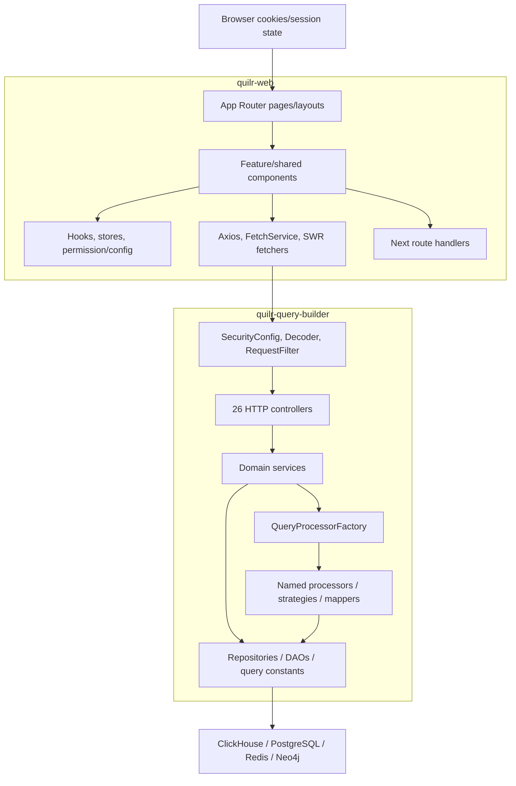

# Dependency and call graph

## Repository dependency direction



Not every controller uses the factory; many call domain services/repositories directly. The diagram shows allowed/observed directions, not one mandatory layered path.

## Backend package model

| Package / area | Depends on | Used by | Role |
| --- | --- | --- | --- |
| `com.quilr` bootstrap | Spring Boot, security, external decoder | JVM/Spring | process and filter-chain setup |
| `com.quilr.config` | servlet API, external user context | security chain/controllers/logging | request context and configuration |
| `com.quilr.qb.controller` | service interfaces, DTOs, auth annotations | HTTP mappings | transport layer |
| `com.quilr.qb.service` | processors, repositories, external clients, cache/graph configs | controllers/schedulers | orchestration/domain behavior |
| `com.quilr.qb.processors` | JDBC, query constants, mappers, Redis | services/factory | query selection/transformation |
| `com.quilr.qb.repository` | `ClickHouseDbUtil`, query constants | services | status/visit data access |
| `com.quilr.qb.aiassets` | JDBC DAO, DTO mapper | AI asset controller | bounded feature package |
| `com.quilr.qb.audit` | ClickHouse repository/DTOs | controller and async audit service | audit read/reference data |
| `com.quilr.qb.findings` | processors, graph/browser client, ClickHouse, JPA | findings/whitelist controllers | finding aggregation and remediation |
| `com.quilr.qb.executive` | graph + ClickHouse query groups | executive controller | dashboard rows |
| `com.quilr.qb.mcpgateway` | table processor/service | MCP controller | MCP gateway analytics |
| `com.quilr.qb.redteam` | DAO/query mapping | red-team controller | red-team metrics/results |
| `com.quilr.qb.scheduler` | Redis locks, sync services | Spring scheduler | background synchronization |
| `com.quilr.entities` / `com.quilr.repository` | JPA | whitelisting services | PostgreSQL persistence |

The generated [backend symbol reference](07-symbol-reference/backend/README.md) divides all 312 Java files into 23 groups with exact declarations and method bodies.

## Frontend module model

| Layer | Primary paths | Dependencies / consumers |
| --- | --- | --- |
| runtime boundary | `src/proxy.ts`, `src/Middlewares`, `instrumentation-client.ts`, `next.config.js` | Next request lifecycle and browser analytics |
| route entries | `src/app/**/page.tsx`, `layout.tsx`, `route.ts` | import page-base and feature components |
| page-base orchestration | `src/app/[lng]/**` | domain components, hooks, translations, stores |
| feature components | `src/components/{apps,users,findings,ai-assets,...}` | UI package, SWR, clients, types |
| shared components | `src/components/ui`, `common-ui`, app layout | all domains |
| API clients | `src/app/Utils`, `src/utils/api.ts`, feature `*Api*` modules | components/hooks |
| access/auth state | `src/components/PermissionGuard.tsx`, auth hooks, stores | proxy/navigation and rendered UI |
| schema/constants | `src/types`, `src/app/Types`, `src/constants`, feature models | compile-time transport/UI contracts |
| static data/assets | `src/mockdata`, JSON, images/SVG/styles | UI only |

The generated [frontend reference](07-symbol-reference/frontend/README.md) accounts for all 2,439 TS/JS source/tooling modules in 65 feature groups.

## Major backend call graphs

### Generic named widget/query

```text
GET /qb/query
→ WidgetsController.getDashboardResults
→ WidgetsServiceImpl.getDashboardResults
→ QueryProcessorFactory.getQueryProcessor(queryName)
→ selected QueryProcessor.processQuery(...)
→ AbstractQueryProcessor.namedJdbcTemplate() and processor query constants
→ ClickHouse JDBC
→ row mapper/transformation
→ ServiceResponse
```

Registration is constructor-based dependency injection: Spring supplies all `QueryProcessor` beans; the factory keys each by `getName()`. This is a registration relationship even when no controller statically references a concrete processor.

### AI application table

```text
POST /aiapps/table/data
→ AIAppsController.getTableData
→ AIAppsServiceImpl.getTableData
→ AIAppsTableProcessor
→ AIAppsQueries + mapper/transformation
→ NamedParameterJdbcTemplate / ClickHouse
→ ServiceResponse<List<Map<String,Object>>>
```

`AIAppsServiceImpl.initialize` connects related processors after bean construction. The frontend references this route from the apps table, findings APIs, and source views.

### AI users dashboard/table

```text
POST /aiusers/table/data
→ AIUsersController.getTableData
→ AIUsersServiceImpl.getTableData
→ CompletableFuture.supplyAsync(users KPI)
→ CompletableFuture.supplyAsync(users table)
→ CompletableFuture.supplyAsync(department count)
→ dashboardQueryExecutor
→ allOf(...).join()
→ combined ServiceResponse
```

The service also dispatches user/department/smart-group processors based on request state. Manual sync routes call `synchronized` service methods and graph/cache/ClickHouse adapters.

### Conversation unmask

```text
POST /aiconversations/unmasked
→ external @RequiresPermission(AI_USAGE, CONVERSATION, READ)
→ AIConversationsController.getUnMaskedData
→ AIConversationsServiceImpl.getUnMaskedData
→ masking/decryption utility and conversation data
→ resolve actor and client IP on request thread
→ AuditService.auditSensitiveDataUnmask (@Async)
→ Kafka/private audit client
→ unmasked response
```

The service's null handling for `masked_attributes` is incomplete; decryption and async audit can fail independently.

### Interactions advanced search

```text
POST /interactions/query
→ InteractionsController
→ InteractionsService
→ InteractionsProcessor
→ request field/operator validator
→ source strategy (BrowserExtensionStrategy / EndpointAgentStrategy /
   LlmGatewayStrategy / McpGatewayStrategy)
→ InteractionsQueries + named SQL parameters
→ ClickHouse
→ mask/enrich/serialize rows
→ three-minute Redis cache
```

The strategy relationship is selection/dispatch rather than controller imports. Each strategy contributes source-specific predicates and transformation.

### Status-event bulk resolve

```text
POST status resolve route (exact path in HTTP matrix)
→ StatusEventController
→ StatusEventServiceImpl
→ loop BulkResolveRequest items
   → StatusEventRepositoryImpl
   → StatusEventQueries drilldown write
   → ClickHouseDbUtil.update
   → StatusEventQueries master write
   → ClickHouseDbUtil.update
   → item result success/failure
→ aggregate partial result
```

No transaction covers the two writes or the item loop.

### AI asset list

```text
POST /ai-assets/v1/assets/list
→ AIAssetController.listAssets
→ AIAssetService implementation
→ AssetInventoryDao
→ build dynamic SELECT/count predicates
→ NamedParameterJdbcTemplate / ClickHouse
→ AssetInventory row mapping
→ DTO mapper
→ paginated response
```

Values are bound; client-supplied identifier names are concatenated without a local whitelist.

### Password whitelist

```text
POST /whitelisting/<behavior-specific path>
→ external @RequiresPermission(APP_MANAGEMENT, TENANT, WHITELIST)
→ WhitelistingController
→ behavior-specific service
→ account extraction/Neo4j existence check
→ PostgreSQL TenantAppWhitelistedBehaviorRepository and/or ClickHouse insert
→ browser-extension service for applicable path
→ response/audit
```

Exact effects vary by weak/reuse/shared/compromised behavior. `FindingsWhitelistService` contains TODO-only missing-account creation and intended ClickHouse write; these are not active effects.

### Endpoint synchronization

```text
GET /endpoint/sync/{all|tenant|tenant/device}
→ EndpointController
→ EndpointSyncServiceImpl
→ graph client query
→ batches of endpoint/persona data (default 300)
→ ClickHouseDbUtil / ep_user_devices
→ sync summary
```

Scheduled and manual sync can target overlapping data. No local cluster-wide lock is shown for every manual path.

### ClickHouse operations

```text
POST /clickhouse/ops/{query|update}
→ ClickhouseOpsController
→ ClickhouseOpsProcessor
→ access_code comparison
→ select guard OR mutation blocklist
→ ClickHouseDbUtil.query/update
→ rows/affected/error/query metadata in ServiceResponse
```

Tenant/subscriber headers are audit/log inputs, not injected SQL predicates.

## Scheduler and event graphs

### Application synchronization

```text
@Scheduled AppSyncScheduler.processQueue
→ RedisLockService acquire
→ AppSyncService pop batch from Redis
→ app/global/tenant settings services
→ source graph/ClickHouse reads
→ ClickHouse/cache writes
→ lock/last-run update
```

The pop precedes processing, so errors have no local requeue path.

### Startup cache population

```text
Spring ApplicationRunner FindingsCacheInitializer
→ findings.populate.enabled
→ graph master data
→ findings processors/cache
→ posture stage (commented, therefore not invoked)
```

`MasterDataBootstrap` separately uses a run-once scheduler, Redis CAS state, and a daemon single-thread executor.

### Audit publication

```text
domain service
→ AuditService.audit* Spring proxy
→ @Async executor
→ private Quilr Kafka/audit client
```

`audit.kafka.enabled` controls publication. No local broker consumer or retry/dead-letter configuration is present.

## Frontend request graphs

### Proxy and page render

```text
Next request
→ src/proxy.ts
→ additionalHeaders
→ OPTIONS/path handling
→ i18n middleware
→ authMiddleware
   → read auth cookie
   → public/self-service/onboarding/auth route decision
   → allow or redirect
→ App Router layout/page
→ AppLayout
→ PermissionGuard / route rule
→ page-base component
```

`refreshAuthTokenMiddleware` is imported by proxy code but not invoked.

### Login

```text
login form
→ useLogin
→ POST auth/auth/login via API utility
→ set auth cookie + roles cookie
→ fetch permission map into sessionStorage
→ fetch identity/current user
→ set client auth state
→ identify PostHog user
→ navigate based on onboarding/default route
```

The auth service is not query-builder.

### OAuth landing

```text
OAuth landing URL token
→ OAuth page pauses PostHog replay
→ bearer GET /auth/get-user
→ OAuthSuccess utility
→ auth/user cookie
→ permissions + self-service/onboarding routing
→ analytics identity/resume behavior
```

### Authenticated Axios call

```text
component/SWR hook
→ axiosInterceptorInstance
→ getAuthCookie
→ Authorization + first Tenant + Subscriberid headers
→ https://<baseUrl>/bff/<service>/<path>
→ response
   401 → refreshTokensAndRedoRequest → replay
   403 → identity role validation → possible clear/redirect
   406 → clear/reload
→ SWR/component state
```

The missing `_retry` assignment makes repeated refresh/replay possible.

### MDM download

```text
IntuneForm
→ POST /api/download-mdm-file {url,fileName}
→ Next server fetch(url)
→ response.arrayBuffer()
→ attachment response
→ browser download
```

No host/size/filename validation occurs.

## External dependencies and boundaries

### Backend direct dependency roles

| Dependency | Verified local use |
| --- | --- |
| Spring Boot web/security/JPA | servlet MVC, filter chain, DI, lifecycle, PostgreSQL repository |
| Redisson starter | Redis connection/cache manager |
| Springdoc | OpenAPI UI/annotations |
| PostgreSQL JDBC | JPA whitelist table |
| Feign | browser extension/external client interface |
| Micrometer Prometheus | registry dependency plus transitively supplied Actuator; live health/mappings/env/metrics handler registration verified |
| JSqlParser 5.1 | dependency override for JPA/private decoder compatibility |
| `quilr-dw-client` | DWH/graph/Redis configs and clients |
| `quilr-kafka-client` | audit publication path |
| `quilr-authz-lib` | `@RequiresPermission` and PDP integration |
| `ai.quilr:jwt-decoder` | filter, user context, request identity |

### Frontend direct dependency roles

Next/React provide routing/rendering; Axios and SWR provide HTTP/caching; React Cookie holds authentication; i18next localizes routes; PostHog captures analytics; Highcharts/grid/flow/PDF/image/canvas packages render data-heavy UI; Jotai and local stores hold state; private Quilr components provide the design/UI library.

The complete versions are pinned in `package.json`/`package-lock.json`; repeating the entire transitive npm graph here would be less precise than the lockfile inventory.

## Dynamic, registration, and framework relationships

- Spring discovers controllers/services/components by component scanning.
- `@Scheduled`, `@Async`, `@EventListener`, `ApplicationRunner`, `@PostConstruct`, and `@PreDestroy` create framework-driven callers.
- JPA implements `TenantAppWhitelistedBehaviorRepository` dynamically.
- `QueryProcessorFactory` performs name-based registration/dispatch.
- Interaction strategies are selected from request source, not directly mapped routes.
- Next derives routes from filesystem conventions.
- React dynamically invokes callbacks/event handlers referenced in JSX.
- SWR revalidation/cache callbacks are library-driven.
- Next loads `proxy.ts`, layouts, route handlers, and instrumentation by framework convention.

These relationships were included before making unused-code classifications.

## Cross-repository edge summary

Static extraction found:

- 120 frontend syntax occurrences containing `quilr-query-builder`;
- 77 normalized operation/path candidates;
- 71 compatible backend route matches;
- six items requiring classification, of which two are credible concrete mismatches (`GET /aiconversations/filters/app/users`, `/findings/kpi`).

The detailed [cross-repository trace](cross-repository/frontend-to-query-builder.md) lists every source occurrence and backend symbol.

## Dynamically verified indirect edges

```text
/bff/quilr-query-builder/<suffix>
→ NGINX regex /(?:bff/)?quilr-query-builder(/|$)(.*)
→ rewrite /$2
→ quilr-query-builder:8052/<suffix>
```

The supporting BFF offers an alternate equivalent edge:

```text
/quilr-query-builder/<suffix>
→ Express app.use("/quilr-query-builder", express-http-proxy(...))
→ upstream /<suffix>
```

A live echo upstream verified query string and JSON body preservation, `Authorization` forwarding, and cookie removal. This proves prefix behavior; current deployed route selection remains external.

Supporting decoder/authz source plus the dynamic harness also resolves:

```text
HTTP request
→ Decoder signature/revocation/tenant filter
→ UserContextHolder
→ RequestFilter/MDC
→ optional @RequiresPermission aspect
→ REST PDP client
→ controller
```

Exact decisions and failure statuses are in [dynamic verification](22-dynamic-verification.md).
