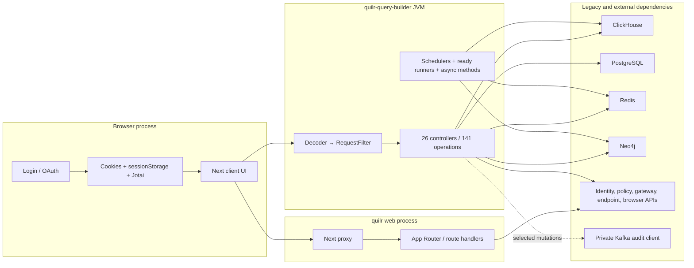
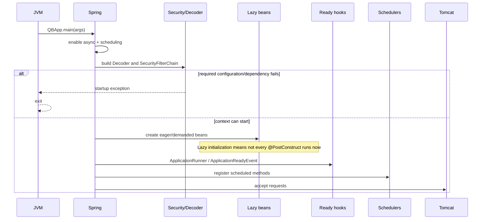
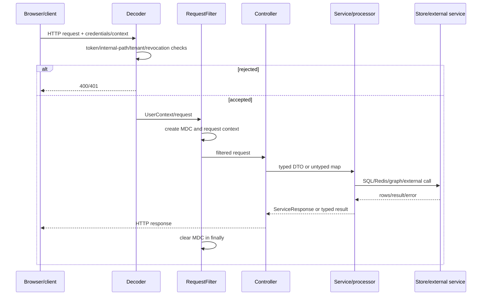
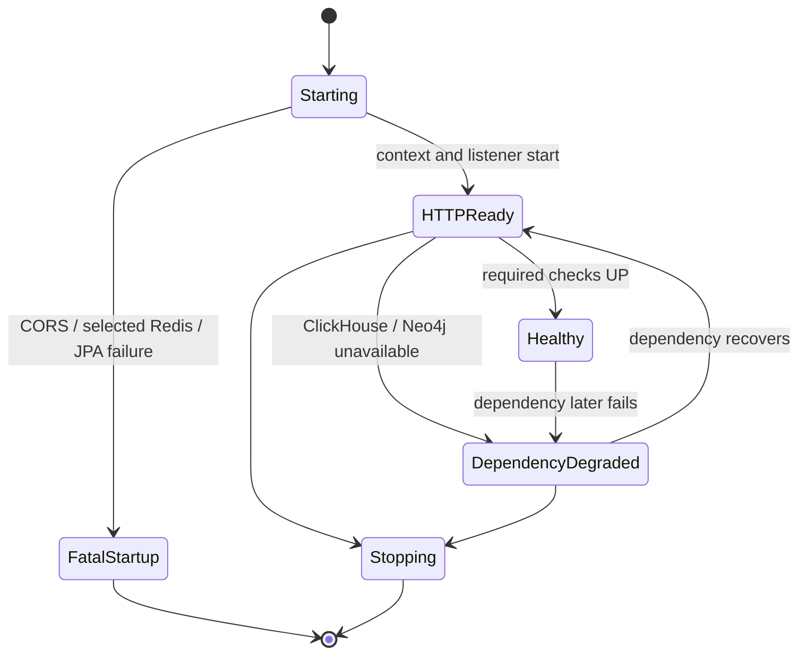

# Runtime Lifecycle

The row-level lifecycle ledger is
[`runtime-entry-points.csv`](../../../matrices/sensor-intelligence/quilr1-platform/runtime-entry-points.csv).
It reconciles process, browser, request, scheduled, asynchronous,
administrative, and shutdown triggers. The 141 backend operations and 134
frontend route artifacts remain exhaustively enumerated in the first-pass API
and route references; this document groups them only where their lifecycle
mechanism is identical.

## Runtime boundaries



Every solid edge above is source-verified. The dashed Kafka edge is also
verified but dashed to emphasize selective, asynchronous coverage rather than
a universal event stream.

## Backend startup



Verified startup facts:

- `QBApp.main` calls `SpringApplication.run`; `@EnableAsync` and
  `@EnableScheduling` activate the two framework mechanisms.
- `spring.main.lazy-initialization=true` is configured. Therefore a
  `@PostConstruct` declaration proves a lifecycle hook but does not prove it
  executes during the initial boot unless its bean is eagerly demanded.
- `SecurityConfig` fails startup when configured CORS origins are absent or
  empty. Development probes also demonstrated startup-fatal Redis/JPA
  dependency failures.
- ClickHouse and Neo4j failures can be non-fatal to the HTTP listener because
  selected initializers catch/log or defer access.
- `QBAppListener.onApplicationEvent` logs only. Its comment about starting
  consumers is not implemented behavior.
- `FindingsCacheInitializer` populates mutable process-local mappings through
  `ApplicationRunner`; graph failure can leave the mapping absent or partial.
- `TenantAppSettingsService.onApplicationReady` is both an event listener and
  `@Async`; its completion is not a readiness barrier.

## Normal HTTP/query processing



Selected methods also pass through the external authorization aspect. Only
seven operations carry the verified method-permission annotation; no evidence
supports treating it as a universal controller control.

The named dashboard path is:

```text
GET /qb/query
→ WidgetsController.getDashboardResults
→ WidgetsServiceImpl
→ QueryProcessorFactory
→ named QueryProcessor
→ ClickHouse/JDBC
→ ServiceResponse
```

`queryName` dispatch is string-based. An unknown name throws; duplicate names
overwrite in the factory map without a diagnostic. Several abstract processor
defaults return an empty `ServiceResponse`, so empty output must not be
normalized to “source observed zero.”

## Degraded runtime



The development runtime directly verified `GET /qb/health` returning
`RUNNING` while Actuator health returned `DOWN` with HTTP 503. This is not a
contradiction in the probes: they measure different things. The target model
must expose process readiness, source reachability, extraction progress,
delivery health, and product freshness separately.

## Background and asynchronous work

| Mechanism | Trigger | State/delivery consequence |
| --- | --- | --- |
| `HuntingScheduler` sync methods | one minute or hourly cron | retry is only the next scheduled invocation; failures are logged |
| `AppSyncScheduler.processQueue` | fixed delay, default five seconds | members are removed from a Redis set before processing; failures can lose pending work |
| `AppAdminUsersBackfillScheduler` | hourly after 60 seconds | a permanent marker may be set despite row-level failures |
| `MasterDataBootstrap.scheduledRunOnce` | initial 20 ms, then effectively once | CAS occurs before daemon-executor work; failure is not retried in the JVM |
| `AuditService.audit*` | selected mutation calls crossing the Spring proxy | publish is asynchronous; no repository-local acknowledgement, replay, or DLQ exists |

`Inference:` framework schedulers and async proxies provide concurrency but
not durable delivery. This inference follows from the verified state changes
and absence of a committed outbox/acknowledgement mechanism; deployed broker
configuration remains unresolved.

## Frontend lifecycle

The production process is built by `next build --webpack` and served by
`next start`. `src/proxy.ts` performs locale and cookie-presence routing before
App Router rendering. The browser then holds authentication state in cookies,
permissions in `sessionStorage`, and user state in Jotai.

Password and OAuth flows depend on the external identity service. Logout paths
clear different subsets of client state, and one path does not clear
`AuthAtom`. Axios and FetchService contain overlapping refresh behavior; the
Axios path checks `_retry` without setting it.

There is no repository-specific web shutdown, browser evidence flush,
checkpoint, offline buffer, or delivery acknowledgement.

## Shutdown

On managed backend shutdown:

1. Spring closes the context.
2. `QBAppListener.onExit` runs but only logs.
3. `MasterDataBootstrap.shutdownExecutor` calls `shutdownNow`.
4. Framework/dependency beans close managed resources. Dynamic SIGINT testing
   observed Kafka producer-factory and ClickHouse-client cleanup.

Abrupt container/process termination can bypass managed destruction.
`quilr-web` has no target-specific shutdown hook.

## Lifecycle phases absent from Quilr 1

The following Starliner-style source lifecycle phases are
`Documentation-only` for this subject because no implementation was found:

- sensor install/enrollment;
- capability-manifest publication;
- observation-envelope creation;
- monotonic source sequencing;
- durable local outbox;
- collector acknowledgement;
- replay from a source cursor;
- policy pull with signed/versioned activation;
- self-update/rollback;
- source-native uninstall/decommission record.

These gaps are expected for an aggregation/product platform, but they prevent
Quilr 1 from being modeled as a native sensor.
