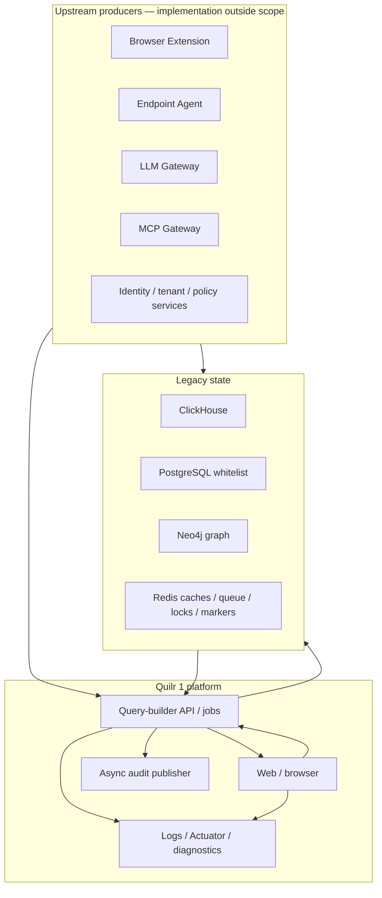
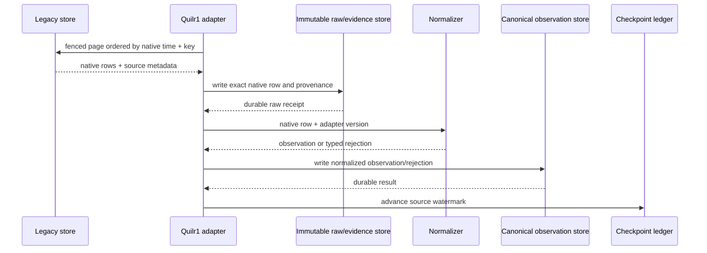

# Capture and Extraction Surface Catalog

The exhaustive surface ledger is
[`capture-points.csv`](../../../matrices/sensor-intelligence/quilr1-platform/capture-points.csv).
It contains 21 current read, write, transport, cache, graph, audit, diagnostic,
file, and manual surfaces.

## Meaning of “capture” for Quilr 1

Quilr 1 does not natively capture browser, endpoint, LLM, or MCP behavior. It
receives, queries, enriches, caches, mutates, or renders data produced by other
systems.

This analysis therefore separates:

1. **Upstream native capture** — browser extension, endpoint agent, LLM
   Gateway, MCP Gateway, identity, and other producers outside these two
   repositories.
2. **Legacy persistence** — rows already present in ClickHouse, PostgreSQL,
   Redis, or Neo4j.
3. **Platform request capture** — HTTP request context, browser state, logs,
   diagnostics, and product analytics created while operating Quilr 1.
4. **Extraction boundary** — the bounded adapters proposed to move legacy
   evidence into Quilr 2.

Only categories 2 and 3 are directly observable in Quilr 1 code. Category 1
is visible only through downstream fields, strategies, and external clients.

## Current surface topology

`Inference:` the upstream-producer-to-legacy edges are strongly implied by
source-specific tables, sync code, and the product’s read paths, but the
producer implementations and deployed pipelines are not in the two pinned
repositories. The diagram marks the boundary explicitly rather than
attributing those observations to Quilr 1.

## Store surfaces

### ClickHouse

ClickHouse is the principal legacy operational/analytics source. Verified
adapters include `ClickHouseClient`, `ClickHouseDbUtil`,
`AbstractQueryProcessor`, domain repositories, and DAOs. They return
`List<Map<String,Object>>`, typed DTOs, arrays, JSON-text values, counts, and
aggregates. The same platform also writes status, synchronization,
cache/materialization, and master/reference rows.

Blind spots:

- most physical schemas are supplied only by a supporting migration
  repository, not the target;
- deployed migration/profile, manual drift, grants, row policies,
  local/distributed topology, materialized views, TTLs, and row counts are
  unresolved;
- several results are projections or summary rows, not native events;
- no repository-wide transaction coordinates multi-row/multi-table writes;
- malformed JSON can be silently omitted by `AssetInventoryDao.putJson`.

### PostgreSQL

The only target-local JPA family is
`TenantAppWhitelistedBehavior`, keyed by tenant, application, and behavior.
Supporting migrations define the resolved columns and indexes. It is useful
legacy operational state, but deletion is permanent from the application
view and no local version/audit table exists.

### Redis

Redis stores:

- three-minute interaction query caches;
- application/settings and global-detail caches;
- a set-backed work queue;
- locks and last-run timestamps;
- app-admin and master-bootstrap markers.

These values are coordination/projection evidence only. Expiry, deletion,
non-atomic pop behavior, and inconsistent property binding make Redis
unsuitable for historical backfill or canonical identity.

### Neo4j

Neo4j supplies graph nodes/relationships, counts, account existence,
application/user/master data, endpoint sync material, and findings labels.
No target evidence establishes live graph constraints, authority, cardinality,
history, or drift versus ClickHouse. Extract it as a timestamped relationship
snapshot with low/unknown authority, never as an unqualified historical fact.

## Transport and runtime surfaces

### HTTP and browser

The browser and query-builder create platform-local request context:
paths, headers, cookies, DTOs/maps, tenant/subscriber context, trace/MDC,
responses, and client state. This is sufficient for request/audit correlation
where retained, but it is not proof that an upstream sensor observed an
activity.

Frontend clients also call external identity, gateway, policy, endpoint, and
browser services. A successful response proves only that the platform
received that response; completeness and native lineage remain external.

### Audit publication

Four `AuditService.audit*` methods asynchronously publish selected mutation
families through a private Kafka client. There is no universal audit
interceptor and no committed consumer, acknowledgement ledger, replay
protocol, or dead-letter configuration. Extracted audit rows/messages must
carry a delivery-confidence qualifier.

### Diagnostics, logs, and product analytics

Custom health routes, Actuator, DWH diagnostics, Next/Spring logs, and PostHog
are operations surfaces. They may support platform-health and user-experience
analysis, but they are not source behavior evidence. Runtime testing proved
that process health and dependency health diverge.

## Recommended legacy extraction modes

| Source | Extraction mode | Cursor/checkpoint | Authority/disposition |
| --- | --- | --- | --- |
| ClickHouse append/time-key tables | deterministic partition/time/native-key backfill | source high-watermark plus last stable native key | immutable legacy observation/evidence |
| ClickHouse mutable/master/status tables | fenced snapshot plus periodic reconciliation | extraction run, snapshot time, source version/key | legacy state observation, not canonical truth |
| PostgreSQL whitelist | primary-key snapshot plus `update_time` where reliable | `(tenant, app_id, behaviour_id)` and snapshot time | legacy configuration/control state |
| Neo4j | tenant-scoped snapshot | extraction run, snapshot time, node/relationship native IDs | low/unknown-authority relationship observation |
| Redis | diagnostics-only inventory | capture time and key namespace; never replay cursor | health/repair input only |
| Kafka audit | future consumer only after broker contract is supplied | broker partition/offset and publish/consume IDs | qualified legacy audit event |
| External services | source-specific adapter, not web/API scraping | native cursor/version specified by source | preserve true upstream authority |

### Backfill transaction rule

The downstream checkpoint advances only after:

1. the native row/payload is durably preserved;
2. its provenance and source location are stored;
3. its normalized observation is durably written;
4. validation records the record-level outcome.

Offset-only query endpoints require a snapshot/time fence and deterministic
tie-break key. Aggregate/widget APIs are not a valid raw backfill source
because their projection can lose native records and field lineage.

## Proposed adapter flow

This is a **Proposed** target design, not current Quilr 1 behavior.

## Completeness and blind-spot rules

- An empty query result is not an absence claim unless source health,
  extraction coverage, filters, retention, and expected scope are known.
- A cache miss is never negative evidence.
- A summary-table count is not a native-record count unless its construction
  and refresh are verified.
- A Neo4j snapshot is not a historical lifecycle.
- A UI/API response is not the authoritative source when its service reads
  another store.
- Rows with parse/enrichment failure must be retained with the error, not
  dropped or converted to null.
- Deployed schema, tenant coverage, rate limits, retention, data volume, and
  external-service contracts remain `Unresolved` pending live estate access.
