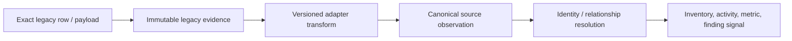

# Native Record-Type Catalog

The exhaustive record-family ledger is
[`native-record-types.csv`](../../../matrices/sensor-intelligence/quilr1-platform/native-record-types.csv).
It contains 29 distinct current record families. “Native” here means native
to a Quilr 1 storage, transport, runtime, or client boundary—not necessarily
native to the upstream sensor that originally observed an activity.

## Record classification

| Class | Record families | Evidence meaning |
| --- | --- | --- |
| Stored legacy evidence/state | ClickHouse application, user, asset, interaction, conversation, alert, status, audit, compliance, red-team and summary rows; PostgreSQL whitelist | durable source rows at extraction time, with deployed provenance/retention gaps |
| Graph snapshot | Neo4j nodes/relationships/results | point-in-time relationship/enrichment evidence, authority unresolved |
| Ephemeral projection/coordination | Redis cache, queue, lock and marker values | operations/repair evidence only; not canonical history |
| Transport | query DTO/map, `ServiceResponse`, external service object, Kafka audit message | request/response/message representation; durability varies |
| Browser/runtime state | authentication, permission, analytics, request context, health and logs | platform operation evidence, not upstream activity |
| Static/reference | classpath CSV/master rows and audit master codes | versionable reference/configuration content |

## Stored row families

### Applications, people, assets, and relationships

Application/settings records occupy `apps_db`, cache/settings tables, Redis,
and graph results. User/account/group/approval records occupy `users`,
`smart_groups`, `user_app_approvals`, summaries, and graph/cache paths. Asset
inventory uses `quilr_asset_inventory`; endpoint inventory uses
`ep_user_devices`.

These are not one ontology. The same product can appear as a domain, process,
application row, graph node, tenant setting, cache entry, gateway app, or
endpoint asset. Extraction must preserve the native key and source table
before resolution.

### Activity

Interaction and visit rows are read from:

- `quilr_interaction_logs`;
- `quilly_interactions`;
- `quilly_summaries`;
- `visit_app_logs`;
- `enriched_events`.

Source strategies apply browser-extension, endpoint, LLM Gateway, or MCP
predicates and transformations. A strategy-selected query result is a
platform projection; the underlying stored row remains the legacy evidence
record. Conversation records add masked/encrypted content and unmask/audit
behavior.

### Findings, status, and controls

Alerts, actions, outcomes, statuses, insights, master rows, and drilldown rows
are separate record families. They are legacy finding signals and workflow
state, not automatically canonical customer findings.

Status resolution can write master and drilldown rows separately and return a
partial result. Control, approval, smart-group, and whitelist state likewise
have operation-specific storage and failure semantics. They must not be
collapsed to one “control succeeded” record.

### Compliance, red-team, audit, and summaries

Compliance tables mix events, policy details, scores, and type-specific
results. Red-team rows map arrays into MITRE/OWASP views. Audit includes:

1. stored audit rows;
2. mutable master/reference codes;
3. asynchronously published audit messages.

Summary materializations are derived dashboard inputs. They cannot substitute
for raw activity without a verified refresh formula, source coverage, and
lineage.

## Transient and projection records

### `ServiceResponse`

`ServiceResponse` is a common HTTP wrapper carrying status/message/data-like
content. It has no observation ID, source cursor, schema version,
acknowledgement, or replay contract. Route-specific code can combine HTTP 200
with an application-level error. It is therefore a compatibility transport
model, not a telemetry envelope.

### Redis state

The interaction cache holds a three-minute query projection. Other Redis
values include entity/settings caches, a set-backed work queue, locks,
last-run timestamps, and permanent markers. These records reveal operational
state at capture time. They do not establish source truth, history, or an
absence of records.

### Browser identity and permissions

Cookie/session/Jotai identity and `sessionStorage` permissions are
presentation/session records. They are relevant to reproducing current UI
behavior and audit attribution, but neither is a canonical identity or
backend authorization record.

## Record delivery properties

No record family implements all of:

- source-generated immutable record ID;
- source sequence/cursor;
- schema version;
- durable local outbox;
- downstream acknowledgement;
- replay;
- record-level rejection/dead-letter;
- source capability/version manifest.

Kafka audit messages are asynchronous but lack repository-local delivery
confirmation/replay. Redis work is claimed non-atomically. HTTP is
request/response only. Stored rows can support backfill, but their original
producer delivery semantics are outside the two target repositories.

## Target disposition

This flow is **Proposed**. The immutable raw stage is required because current
processors can enrich, mask, omit malformed fields, aggregate, and use
multiple authority sources. A normalized record must always be traceable to
the exact native row/payload and adapter version.

## Unresolved record-level evidence

- deployed ClickHouse and Neo4j schemas/versions;
- which service originally produced each warehouse table family;
- source-native IDs, ordering and delete/tombstone semantics per table;
- live retention and tenant coverage;
- broker audit schema, consumer, acknowledgements and retention;
- external service DTO contracts not committed in the target repositories;
- actual runtime volumes and duplicate rates.

These prevent final adapter readiness but do not prevent classifying the
record families present in source.
