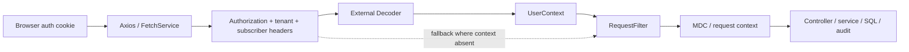
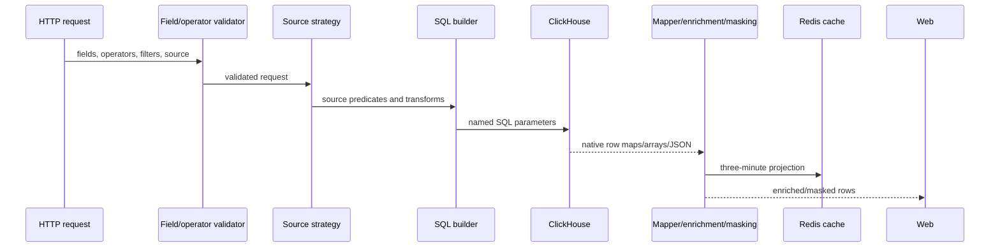

# Field Transformation Lineage

The field-level ledger is
[`field-lineage.csv`](../../../matrices/sensor-intelligence/quilr1-platform/field-lineage.csv).
It contains one reviewed row for each of the 62 current field/resource seed
rows. Every target destination is labeled as a reviewed disposition because
Quilr 1 does not emit a canonical Quilr 2 envelope.

## Request identity lineage



Verified transformations:

1. frontend clients parse browser auth state and attach the token and selected
   tenant/subscriber;
2. the decoder validates according to its external-library rules and can
   populate `UserContext`;
3. `RequestFilter` prefers context values and otherwise reads raw headers;
4. it generates or accepts a trace ID, writes MDC/request context and response
   headers, then clears MDC in `finally`;
5. downstream code uses context values in SQL parameters, cache keys, logs,
   external calls, and selected audit messages.

Information that can be lost:

- whether a tenant/subscriber value came from verified decoder context or a
  fallback header is not represented in common domain records;
- email versus stable user ID semantics are inconsistent;
- request and trace ID generators/authority are not globally recorded;
- browser state cleanup differs by logout/error path.

## Named query and dashboard lineage

```text
HTTP query parameters/map
→ WidgetsController time-range normalization
→ QueryProcessorFactory queryName lookup
→ processor-specific SQL and parameter map
→ ClickHouse rows
→ processor aggregation/enrichment
→ ServiceResponse
→ frontend chart/table
```

Transformations are processor-specific. The output may be a raw-ish row,
count, trend bucket, label-enriched result, or summary-table projection.
`queryName`, time range, filters, and processor implementation/version are
therefore required provenance for any migrated metric.

Loss/failure points:

- duplicate processor names overwrite;
- unknown names throw;
- abstract defaults can return empty wrappers;
- aggregate responses omit contributing row identity;
- ClickHouse live schema and materialization freshness are unresolved.

## Interaction lineage



The `source` field is a strategy selector. It does not by itself prove the
row’s original producer. Transformation can add labels, apply masking,
normalize arrays, and cache the result. Backfill should read native warehouse
rows rather than the cached or UI projection.

## Asset lineage

```text
SearchAndFilterDto
→ AssetInventoryDao predicate/ordering construction
→ ClickHouse list query + separate count query
→ manual JDBC field mapping
→ JSON parse via putJson
→ AssetInventory/DTO
→ API page
```

Values are generally bound, while selected client field identifiers are
concatenated. Malformed JSON causes the property to be omitted. Separate list
and count reads are not a consistent snapshot. Target extraction must retain
the original JSON text, parse outcome, and query fence.

## Conversation masking lineage

```text
stored conversation/masked_attributes
→ query/mapping
→ encrypted inline tokens
→ authorized unmask request
→ AES-GCM v2 or legacy AES/ECB decrypt
→ response content
→ async audit construction/publication
```

Individual inline-token failures can leave ciphertext unchanged;
attribute-level failure can abort. A null `masked_attributes` value is not
fully handled. The migration path must preserve:

- original ciphertext and format marker;
- key reference/version where available, never raw key;
- decrypt/parse result;
- access actor, request and authorization decision;
- audit publish attempt and delivery status separately.

## Findings and label enrichment

Legacy alert/status/action/outcome rows are enriched using static mappings and
mutable graph-backed maps populated by `FindingsCacheInitializer`. The
POSTURE population stage is disabled.

```text
native alert/status row
→ behavior/use-case key
→ graph/static mapping lookup
→ rendered label/category
→ dashboard/finding projection
```

The rendered label loses which mapping source/version supplied it unless the
adapter records that explicitly. Missing maps can yield partial/failed
enrichment. Target storage should retain native code and mapping release, with
the rendered value as a derived attribute.

## Status mutation lineage

```text
BulkResolveRequest item
→ validation
→ drilldown write
→ master write
→ per-item success/failure
→ aggregate partial result
```

There is no encompassing transaction. An accepted request, first write,
second write, returned outcome, and later observed state are separate facts.
The target control model must not synthesize success from only the HTTP
wrapper.

## Graph and synchronization lineage

```text
Neo4j query/snapshot
→ graph client result
→ service-specific mapping/batching
→ ClickHouse ep_user_devices / app/user/settings rows
→ Redis cache/marker
→ API/dashboard projection
```

The graph result is a point-in-time source snapshot. Warehouse and Redis
writes are not transactionally coupled with it. No record-wide provenance
field preserves graph query, snapshot time, graph revision, mapping version,
or partial batch outcome.

## Master/reference lineage

`MasterDataBootstrap` reads classpath CSVs, changes Redis CAS state, then uses
a daemon executor to write ClickHouse reference rows. The commit pins the CSV
content, but the write does not emit a content digest or explicit mapping
version. Because CAS occurs first, a failed transform/write can leave
“executed” state without complete reference rows.

## Audit lineage

```text
selected domain mutation
→ resolve actor/client IP/request metadata
→ construct eventCode/task/level/extraInfo/before-after
→ @Async AuditService
→ private Kafka client publish attempt
→ external broker/consumer (unresolved)
```

Not all mutations invoke this path. Repository evidence does not show a
delivery acknowledgement, replay cursor, target consumer, or dead-letter
record. A migrated audit event must retain whether it was a stored audit row,
a publish attempt, or a broker-confirmed delivery; those states are not
interchangeable.

## Information-loss register

| Transformation | Verified loss or ambiguity |
| --- | --- |
| asset JSON parsing | malformed property omitted |
| summary aggregation | contributing row identities and coverage not returned |
| graph/static enrichment | source/version of rendered label not retained |
| masking/decryption | token-level failure may preserve ciphertext; broader failure may abort |
| `ServiceResponse` | transport/application/HTTP success semantics can diverge |
| Redis cache | expiry/miss destroys history and cannot prove absence |
| Redis work pop | item removed before processing; no local requeue |
| status bulk update | partial cross-table state without rollback |
| app-admin marker | completion marker can coexist with row errors |
| master bootstrap CAS | state advances before asynchronous writes |
| browser auth/logout | different paths clear different state |
| source strategy | selected source label is not independently attested provenance |

## Required target lineage fields

The following are **Proposed** Starliner adapter fields, not current Quilr 1
fields:

```text
legacy_source
legacy_store
legacy_table_or_endpoint
legacy_primary_key
legacy_native_time
extraction_run_id
snapshot_or_watermark
raw_content_hash
raw_payload_reference
adapter_name
adapter_version
transform_name
transform_version
mapping_release
parse_status
normalization_status
authority_class
source_tenant_alias
canonical_resolution_id
conflict_status
```

Checkpoint advancement requires durable raw preservation plus durable
normalization/rejection outcome. This is deliberately stricter than the
current query/cache/scheduler behavior.

## Remaining field-lineage work

The 62-row ledger closes the prior high-level dictionary, not every physical
warehouse/API field. Table-by-table closure remains blocked by the absence of
verified deployed schemas and source-producer contracts. Supporting migration
DDL can supply an offline candidate schema, but it must remain labeled
candidate until compared to the live selected environment.
