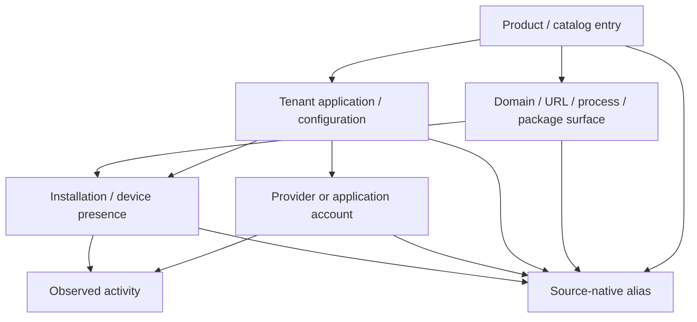

# Discovery and Inventory Contributions

The entity ledger is
[`inventory-entities.csv`](../../../matrices/sensor-intelligence/quilr1-platform/inventory-entities.csv).
It contains 21 entity/object families surfaced by Quilr 1.

## What Quilr 1 contributes

Quilr 1 contributes a broad composite inventory:

- tenants/subscribers;
- users, accounts, departments, and smart groups;
- applications, tenant settings, domains, processes, and AI assets;
- endpoint devices and browser-extension projections;
- model/provider/route/deployment and MCP client/server/tool projections;
- agents and credentials where external systems expose partial metadata;
- finding signals, policies/controls/approvals, interactions/conversations,
  audit records, and runtime components.

It does not directly discover most of these objects. It queries warehouse and
graph projections, calls external services, accepts authenticated user
context, and joins/render results in query-builder processors and web pages.

## Direct versus indirect discovery

| Class | Quilr 1 evidence | Classification |
| --- | --- | --- |
| application/settings/user/asset/status/audit rows | directly queried from named stores | direct legacy record discovery |
| Neo4j user/app/device/relationship data | graph snapshot consumed by services/jobs | direct snapshot read, authority unresolved |
| browser and endpoint activity/inventory | exposed through source rows/external APIs | indirect upstream-sensor projection |
| model/provider/gateway configuration | external service plus warehouse analytics | partial composite discovery |
| MCP client/server/tool | external UI/API and analytics projection; native repo absent | partial, unresolved authority |
| human/tenant identity | token/context/external identity responses | request identity, not authoritative directory discovery |
| runtime components | Actuator, diagnostics, logs/manifests | platform operations inventory only |

## Inventory layering required by the target

Current Quilr rows can conflate these layers. For example, `app_id`, domain,
process, gateway application, asset, and graph node can all be rendered as an
“application.” Migration must preserve each native record and resolve it only
at the correct layer.

## Inventory freshness and lifecycle

Current lifecycle signals are source-specific:

- login/current-user responses show an identity at request time;
- minute/hour/startup jobs synchronize application, user, settings, device,
  admin, and reference records;
- interactions/visits provide event-time or row-time observations;
- settings, approvals, whitelist, group, and status mutations provide
  operational state changes;
- Redis caches/markers provide only transient operational hints;
- graph reads are snapshots;
- external gateway/policy/MCP configuration may expose remote lifecycle state.

No universal create/update/delete/tombstone/retire protocol exists. A missing
row or cache entry therefore cannot retire a canonical entity.

## Product use

Useful current product patterns to retain:

- source-aware inventory list/detail pages;
- application/user/account/asset/device drill-down;
- current configuration and approval views;
- activity and finding context;
- executive/adoption summaries;
- source/status/coverage filtering.

Request-time joins should move behind canonical inventory APIs. Source-native
aliases and evidence remain visible in advanced drill-down.

## Required migration behavior

For each discovered object:

1. store the exact source row/payload;
2. create a source observation with extraction/snapshot time;
3. preserve source-native identifier and scope;
4. classify the object layer;
5. resolve to an existing canonical entity only on deterministic or reviewed
   evidence;
6. record conflicts and unresolved candidates;
7. materialize product inventory from canonical entities plus coverage.

`Inference:` existing inventory rows are valuable catalog seeds because
multiple product features consume them. They are not authoritative merely
because they are widely reused.

## Unresolved

- native producer/authority for many warehouse tables;
- complete external identity, policy, gateway, and MCP contracts;
- live graph constraints and ownership;
- deletion/tombstone and full-snapshot semantics;
- deployed refresh latency and row coverage;
- stable source keys for several account/agent/model/tool concepts.
