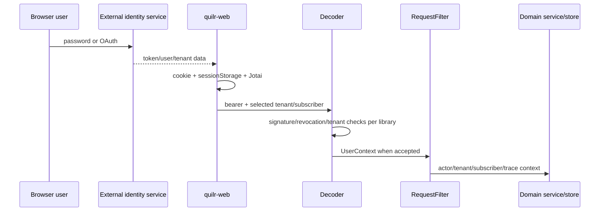

# Identity and Attribution

Detailed ledgers:

- [`identifiers.csv`](../../../matrices/sensor-intelligence/quilr1-platform/identifiers.csv)
  — 26 identifier families;
- [`identity-coverage.csv`](../../../matrices/sensor-intelligence/quilr1-platform/identity-coverage.csv)
  — 15 representative activity/control flows and their attribution coverage.

## Verified current identity chain



Supporting source and tests verify RSA/SHA-512 token signature handling,
optional expiration enforcement when present, Redis revocation, selected
tenant validation, internal-header configuration, and context cleanup.
Issuer/audience are not required by the resolved decoder library.

This chain authenticates a request under specific paths. It does not establish
a repository-wide person/account/directory identity authority.

## Human and account identity

Current human/account indicators include:

- token/user-context ID;
- email;
- browser authenticated-user object;
- ClickHouse `users` and account rows;
- graph nodes and relationships;
- departments and smart groups;
- gateway API-key/JWT ownership where exposed;
- conversation/interaction actor fields.

Email is mutable and reassignable. A token subject is issuer-scoped and may
identify an account rather than a person. A browser user object is cached
presentation state. The target must separate:

```text
Human
↕ membership/employment/ownership
Account
↕ authenticates_as / uses
Credential
↕ authorized_by
Grant / role / policy decision
```

## Tenant and subscriber

Tenant and subscriber values appear in tokens/context, raw headers, cookies,
cache keys, SQL predicates, and rows. `RequestFilter` prefers decoded context
but has fallback header paths. Local code does not define a universal
tenant/subscriber hierarchy or syntax.

Target rule: every alias and observation is scoped by the verified canonical
tenant plus source namespace. A caller-selected/fallback tenant value remains
a claim until its authenticated binding is retained.

## Application and asset identity

Application identity is assembled from:

- `app_id`;
- domain/URL;
- product/name/category;
- process/package/path;
- graph node;
- tenant settings;
- AI asset row;
- provider account/gateway application;
- device/installation presence;
- source enum/strategy.

These identify different layers. No legacy app ID is assumed globally unique
or promoted directly to a canonical product. Each becomes a typed alias with
tenant, source, validity, confidence, and evidence.

## Model, agent, tool, and workload identity

Model/provider/route/deployment strings and IDs appear in gateway
configuration/analytics. MCP client/server/tool concepts appear in external
management surfaces and query projections. Agent metadata may be present in
endpoint/gateway data.

`Unresolved:` no verified chain establishes:

```text
agent definition
→ exact version/artifact
→ deployment
→ workload/runtime instance
→ session
→ run and parent run
→ credential/effective principal
→ model route/deployment
→ tool call and observed effect
```

No SPIFFE/SPIRE/SVID or cryptographically attested workload identity was found
in the supplied Quilr 1 evidence.

## Attribution coverage

Strongest current attribution:

- browser login/request actor within the external auth contract;
- tenant/subscriber request context;
- app/user/account native rows where their source key is populated;
- selected control actor and audit metadata;
- native activity/finding IDs within their source table.

Weakest current attribution:

- upstream workload/process/agent identity;
- credential inventory/delegation;
- external MCP tool-call/effect chain;
- cross-store app/account/person equality;
- point-in-time organization ownership;
- source-native producer/build/deployment identity.

The `identity-coverage.csv` ledger never treats “unknown” as “not
applicable.” Missing attribution remains explicit.

## Resolution policy

### Deterministic candidate matches

Deterministic resolution requires a strong source namespace and key, such as
issuer+subject, provider+resource ID, or a verified source-native immutable ID.
Quilr 1 alone does not supply all of those contracts, so most current values
begin as aliases.

### Non-deterministic evidence

Email, name, domain, process name, model name, graph label, and mutable
configuration can generate candidates but do not auto-merge canonical
entities. Conflicts enter a review/reconciliation queue.

### Merge/split and time

Aliases carry validity intervals and observation times. Canonical merges are
reversible and evidence-backed. Historical events retain the resolved
identity version used at materialization time plus the original native alias,
so later splits do not erase provenance.

## Credential handling

Raw auth cookies, bearer tokens, refresh tokens, and provider/API credentials
are not canonical identifiers. Where audit or migration requires correlation,
store a protected source reference or tenant-scoped nonreversible fingerprint
under explicit policy. Current browser state and runtime logs do not form a
central credential inventory.

## Identity target disposition

| Current datum | Target |
| --- | --- |
| tenant/subscriber/user/app/account/device/model/tool IDs | namespaced aliases |
| email/domain/name/process/model strings | mutable attributes/candidate aliases |
| browser cookie/permission state | platform session evidence only |
| Neo4j IDs/edges | graph snapshot evidence |
| ClickHouse keys | immutable legacy row locators |
| trace/request IDs | correlation aliases |
| bearer/API-key value | excluded/protected reference only |
| runtime host/container name | operational alias, not attested workload identity |

## Unresolved

- external IdP/HRIS/SCIM authority and issuer semantics;
- production tenant/subscriber contract;
- live gateway/API-key/model/provider identity contracts;
- MCP native identifiers;
- authoritative device and installation identity;
- deployed workload/service-account/image-digest identity;
- alias uniqueness and reassignability for many table fields.
