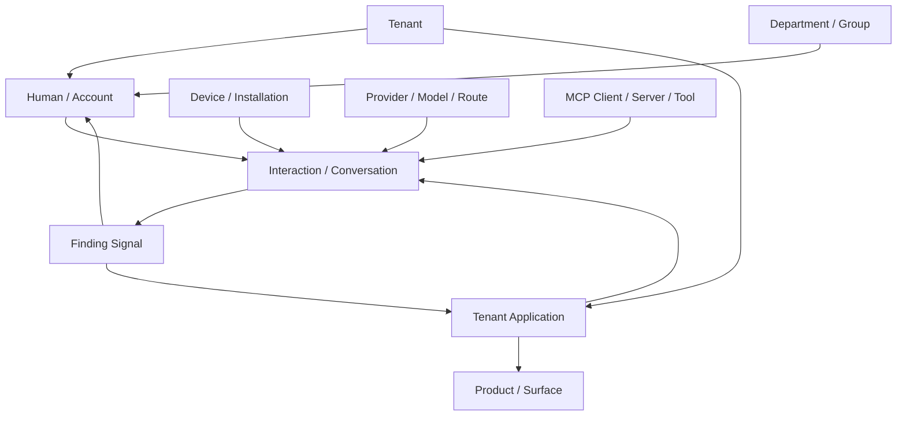

# Relationship Contributions

The relationship ledger is
[`relationships.csv`](../../../matrices/sensor-intelligence/quilr1-platform/relationships.csv).
It contains 27 typed candidate relationships and classifies whether the
current edge is direct, inferred, or an external/projection claim.

## Relationship sources

| Source | Relationship contribution | Limitation |
| --- | --- | --- |
| ClickHouse rows | tenant/app/user/account/group/approval/activity/finding/status associations | table-specific current or event state; deployed schema/producer unresolved |
| PostgreSQL whitelist | tenant application whitelists behavior | current state with update actor/time; delete history absent |
| Neo4j | node/relationship snapshots and source counts | authority, history, constraints and drift unresolved |
| request context | actor/tenant/subscriber and correlation | request-scoped claim; not durable relationship by itself |
| external APIs | gateway, model, MCP, policy, endpoint and browser relations | source contracts frequently absent |
| processor enrichment | app/finding labels and related rows | mapping version/source often not retained |
| audit | actor performed action on target | selective coverage and delivery uncertainty |

## Core estate relationships



The edges represent relationship families evidenced by source rows or product
flows. They do not imply that every activity row contains all endpoints.
`identity-coverage.csv` records the actual gaps.

## Direct relationships

Higher-confidence direct records include:

- tenant + application in `app_tenant_settings`;
- user + application approval in `user_app_approvals`;
- tenant application + behavior in PostgreSQL whitelist;
- smart group + member under known operation paths;
- status master/drilldown + native finding/event key;
- interaction/conversation + populated user/account/app/model fields;
- audit actor + action/target where emitted/stored.

“Direct” means directly present in the native row/command, not globally
authoritative.

## Inferred or projected relationships

Lower-confidence examples:

- user owns/uses account based on email/name or graph projection;
- domain/process maps to application;
- browser extension installation belongs to device/user;
- graph node relation represents current/historical truth;
- gateway app/model/provider strings identify one stable deployment;
- MCP client/server/tool projections reflect the native source;
- finding affects a canonical entity after label/alias resolution.

These remain relationship observations with confidence and evidence. They do
not mutate canonical edges automatically.

## Temporal treatment

Current sources mix:

- event-time relations (`user performed interaction`);
- configuration/current-state relations (`tenant app has setting`);
- snapshot relations (Neo4j, device sync);
- mutable reference relations (app/process labels);
- command intents (add member, approve, whitelist);
- observed outcomes (stored row after mutation).

The target relationship record needs:

```text
subject alias/canonical ID
relationship type
object alias/canonical ID
valid_from / valid_to if known
observed_at
transaction/extraction time
source record/evidence
authority and confidence
command/outcome classification
supersedes/retracts reference
```

No missing snapshot edge is converted to a deletion unless the source
contract guarantees a complete healthy snapshot and a reconciliation policy
authorizes retirement.

## Control and activity relationships

Command intent and observed state are separate:

```text
actor REQUESTED approval/whitelist/group/status change
→ platform ACCEPTED or REJECTED request
→ store write ATTEMPTED
→ row/state OBSERVED
→ external effect OBSERVED or UNKNOWN
```

This distinction is necessary because:

- status writes can partially complete;
- smart-group unknown operations are inconsistent;
- findings whitelist contains TODO-only effects;
- audit publishing is asynchronous;
- scheduler markers can claim completion before/without complete work.

## Graph migration

Neo4j is extracted as relationship observations:

1. retain graph environment, query, snapshot time, native node and edge IDs;
2. preserve node labels/properties and edge type exactly;
3. map endpoints to source aliases;
4. resolve aliases independently;
5. materialize a target graph only from typed ledger records;
6. keep authority `unknown` or source-specific until proven.

The current graph is not imported as canonical truth.

## Product use

Canonical relationship projections support:

- entity detail and related inventory;
- user→app→activity investigation;
- device/process/application coverage;
- model/provider/route and MCP topology;
- finding impact/evidence;
- organizational ownership;
- configuration/control scope;
- audit actor/target context.

Advanced drill-down retains native edge source and confidence.

## Unresolved

- live Neo4j schema, constraints, cardinality and temporal fields;
- full foreign-key/key semantics across ClickHouse tables;
- stable source keys for many gateway/MCP/agent relations;
- whether snapshots are complete or partial;
- authoritative ownership and joiner/mover/leaver relations;
- delete/tombstone behavior;
- event-time relationship reconstruction for historical rows.
