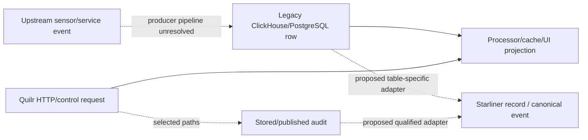
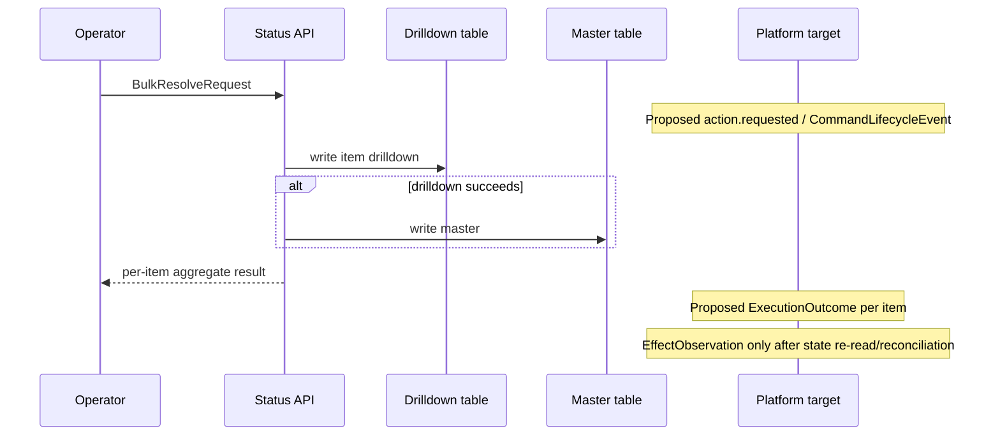

# Events and Emissions

Ledgers:

- [`native-events.csv`](../../../matrices/sensor-intelligence/quilr1-platform/native-events.csv)
  — 22 current event-like record/transition families;
- [`event-mappings.csv`](../../../matrices/sensor-intelligence/quilr1-platform/event-mappings.csv)
  — 17 reviewed Starliner/canonical dispositions.

## Current event model verdict

Quilr 1 has event-named warehouse rows, request-time actions, scheduler runs,
browser analytics events, and selected Kafka audit publications. It has no
universal native event envelope.

Absent common properties include:

- event/record schema version;
- source installation/runtime identity;
- claimed versus admitted tenant/producer identity;
- native sequence and previous-record hash;
- consistent occurred/observed/ingested times;
- source-scoped idempotency key;
- acknowledgement/replay;
- privacy capture summary;
- raw/evidence hash and reference;
- typed actor/target/correlation chain.

Therefore existing “events” must first become immutable legacy source
observations.

## Event-like layers



The dotted upstream edge is an inference from tables and source strategies;
Quilr 1 does not implement the native producer.

## Activity events

Interaction, visit, enriched, Quilly, and conversation rows can support:

- `ai.application.used`;
- interaction started/completed;
- `prompt.submitted`/`response.received` when direction is proven;
- model invocation started/completed when provider/model/route/outcome fields
  are sufficient;
- data movement/action events where concrete fields establish them.

Mapping is table-specific. An interaction strategy selector is not
attestation. Summary rows become metric inputs, not raw events.

MCP mapping is blocked: current UI/warehouse projections do not establish a
native server/tool schema identity, stable call ID, request/result pairing, or
observed side effect.

## Finding and workflow events

Alert/raw detection rows become `FindingSignal`, not customer findings.
Action, status, outcome, master, and drilldown rows must be classified by
their concrete semantics.

Status resolution illustrates why:



Current code lacks a durable command ID/outbox and encompassing transaction.
Acceptance, write attempts, returned outcome, and observed effect remain
separate.

## Control/configuration events

Approval, whitelist, smart-group, settings, policy, and control changes map to
some combination of:

- `ControlConfigEvent`;
- `DecisionResult`;
- `ActionEvent`;
- `ExecutionOutcome`;
- `EffectObservation`;
- `CommandLifecycleEvent`.

No current path supplies this complete sequence. In particular:

- method authorization covers only seven operations;
- unknown smart-group operation values take inconsistent branches;
- whitelist families have different stores/effects and TODO-only paths;
- selected mutation failures can still surface success;
- audit emission is selective and asynchronous.

## Audit events

Stored audit rows and publisher attempts are different:

```text
domain mutation
→ AuditService method construction
→ Spring @Async submission
→ private Kafka client publish attempt
→ broker acknowledgement (not exposed locally)
→ consumer persistence/use (unresolved)
```

The target adapter records which stage is evidenced. It cannot claim delivery
from method invocation alone.

## Synchronization and reconciliation

Current scheduler logs, Redis locks/markers, and row writes do not meet the
Starliner reconciliation contract. A target adapter needs:

- `ReconciliationStarted`;
- page/batch manifest and `ReconciliationPageCommitted`;
- exact scope and authoritative-negative rules;
- cursor/watermark;
- source/read, raw-written, normalized, rejected, and duplicate counts;
- `ReconciliationCompleted` only after durable downstream commit;
- `ReconciliationFailed` and `SourceGapNotice`.

Current app-sync and bootstrap state can advance before work completes, so it
cannot be translated directly to “completed.”

## Deduplication and ordering

Current source duplicates can arise from:

- client retries without universal idempotency;
- overlapping interaction/enriched/summary tables;
- manual and scheduled sync overlap;
- Redis non-atomic work claim;
- retries after partial status/control writes;
- asynchronous audit publish behavior;
- multiple projections of one upstream source record.

Target exact dedup occurs first on source namespace + native key/revision/body
hash. Canonical correlation follows later and never deletes independent
observations.

## Time

Do not substitute:

- query time for event occurrence;
- extraction time for source observation time;
- cache timestamp for event time;
- status update time for detection time;
- graph snapshot time for relationship valid time.

Each mapped record carries every available native timestamp plus extraction
and ingestion time. Missing occurrence time remains unknown.

## Emission boundary

Current outbound emission is limited to:

- HTTP responses;
- selected asynchronous audit publication;
- logs/metrics/product analytics;
- store/cache mutations.

There is no Starliner publisher/outbox. `event-mappings.csv` therefore marks
target mappings as backfill candidates or instrumentation requirements, not
implemented emissions.

## Unresolved

- physical event-table schemas and native keys in the selected deployment;
- original producers, sequences, delivery and retention;
- cross-table duplicates and materialization formulas;
- native MCP contract;
- private Kafka audit schema/broker acknowledgement/consumer;
- external policy/control decision schemas;
- live volumes and event-time quality.
