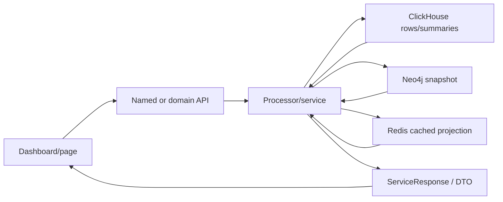

# Metrics and Analytics

The metric ledger is
[`metrics.csv`](../../../matrices/sensor-intelligence/quilr1-platform/metrics.csv).
It contains 28 current metric families/formulas and two proposed target
metrics. Exact SQL is recorded where a compact, directly verified formula is
available; processor-family rows explicitly say when formula closure remains
operation-specific.

## Current analytical architecture



Most metrics are calculated at request time or read from summary/cache rows.
They have no common metric-definition ID, formula version, population
contract, denominator, coverage state, correction model, or materialization
version.

## Precisely verified executive formulas

### Identity/coverage-like counts

- Total users: distinct `USER.mail` created after the lower time bound in
  Neo4j.
- Rolled-out extensions: distinct `PERSONA.emailaddress` joined to `USER` and
  filtered by `extensionadddate`.
- Active extensions: distinct persona emails that accessed a workstation
  after the lower bound.
- Findings count: count of `quilr_alert_events` rows with nonempty `control`
  in the tenant/subscriber/time window.

These count source aliases/rows, not canonical users, installations, or
root-cause findings.

### Action distribution

Request and response actions use `countIf` over `blocked`, `anonymized`, and
the complement. “Partially redacted” means request action was neither blocked
nor anonymized while response action was anonymized. Request rows left join
responses by a UUID conversion of `context_id` to `prompt_id`.

Null/missing response and join multiplicity affect semantics. A percentage is
not defined in this query; the output is counts.

### MCP dashboard

- MCP users: `uniqExact(user_principalname)`.
- Per-source application usage: `count()`, distinct users, and distinct
  `mcp_tool`.
- Outcome distribution: row counts for blocked/anonymized/failed/complement.

These are warehouse projections. They do not establish complete native MCP
client/server/tool identity or side effects.

### LLM gateway/home-grown apps

- Home-grown apps: distinct `app_id` in `app_tenant_settings FINAL` matching
  three exact “Custom” category strings and the millisecond update range.
- Latency: daily count, average, p50 and p95 of
  `coalesce(quilr_latency,0)+coalesce(llm_latency,0)` for
  `user_principalname='llmproxy'`.
- Component averages: separate Quilr and LLM averages with missing values
  coerced to zero.
- Tokens: total and average request/response tokens.
- Model/provider distribution: row count grouped by `model_name, provider`.

Coercing missing latency to zero is a semantic choice and can lower averages
or quantiles. Request row grain and join coverage must be shown with these
metrics.

## Other metric families

The product also calculates:

- application, user, account, department and smart-group KPIs;
- application/user adoption and risk;
- AI asset totals, trends and type distribution;
- findings carousel, KPI, posture, table and occurrence aggregates;
- interaction result counts;
- compliance events/scores;
- red-team run/category/technique/result views;
- guardrail, LLM Gateway and MCP Gateway outcomes/latency;
- audit/filter/pagination totals;
- executive and summary-table analytics.

The generated backend symbol reference contains the exact processor bodies and
SQL constants. The specialized ledger does not invent one formula for a
family whose route/request mode selects multiple queries.

## Metric correctness risks

### Grain

Current formulas can count:

- source rows;
- normalized email strings;
- native app IDs;
- graph emails;
- alert rows;
- response joins;
- summary rows.

None is automatically a distinct canonical entity/event count.

### Coverage

Metrics generally filter tenant/subscriber/time but do not attach:

- expected source set;
- source health;
- successful reconciliation boundary;
- stale/missing source state;
- unresolved alias count;
- rejected/parse-failed record count.

An empty or declining result can mean real decline, retention, source outage,
sync failure, query filter change, identity merge/split, or mapping failure.

### Time

Queries mix `index_time`, `event_time`, `last_updated`,
`userCreationTime`, `extensionadddate`, and workstation last-access time.
Some are milliseconds, others ClickHouse timestamps. They answer different
questions and must not share an unlabeled “time” dimension.

### Derived labels and risk

Findings and user/app risk values can incorporate static/graph mappings,
default/coalesced values, cached data, or source-specific risk scores. Target
metrics need definition and mapping versions.

## Target metric contract

Every migrated metric needs:

```text
metric_definition_id and version
business question
canonical grain
eligible population
numerator and denominator or aggregation
unit
event/valid/transaction time semantics
dimensions and allowed cardinality
source/coverage requirements
unknown/not-evaluable handling
dedup and correction behavior
privacy classification
materializer version
drill-down query
```

Current source formulas can be retained as validation baselines. Target
materialization recomputes on canonical entities/events and must expose source
row counts alongside canonical counts during parity.

## Recommended parity method

For each current dashboard card:

1. freeze tenant, time window, source filters, and source snapshot;
2. run the exact legacy query;
3. store contributing native row IDs;
4. run canonical materializer definition;
5. compare legacy source rows, normalized observations, canonical entities or
   events, unresolved aliases, and rejected records;
6. explain every delta;
7. approve a new definition/version rather than forcing equality where the
   legacy grain is wrong.

## Proposed baseline metrics

Two target-only rows in the ledger demonstrate the correction:

- canonical distinct active applications;
- source coverage ratio.

Both depend on resolved canonical IDs and explicit healthy expected-source
coverage. They are **Proposed**, not current Quilr 1 outputs.

## Unresolved

- exact formula closure for every operation-specific processor/route mode;
- deployed summary/materialized-view definitions and refresh cadence;
- source row counts and join cardinality;
- target/current parity on real tenant data;
- canonical entity resolution outcomes;
- metric retention/correction behavior;
- external gateway/compliance analytics contracts.
