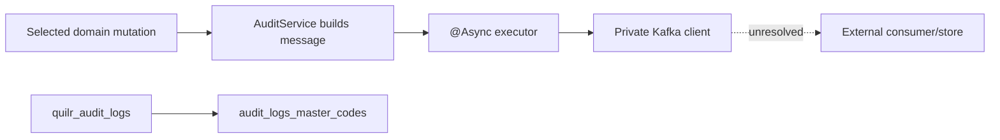

# Logs, Traces, Audit, and Evidence

The artifact ledger is
[`logs-traces-audit.csv`](../../../matrices/sensor-intelligence/quilr1-platform/logs-traces-audit.csv).
It contains 17 log, trace, error, audit, diagnostic, analytics, build, and
verification artifact families.

## Request correlation

`RequestFilter` accepts or generates a trace ID, writes tenant/subscriber/
client/trace context to MDC and selected response headers, invokes the chain,
then clears MDC in `finally`.

This is request correlation, not distributed tracing:

- no repository-wide `traceparent`/span model is documented;
- external service/store calls do not consistently propagate a verified span;
- trace ID format/authority is not validated;
- browser, BFF, query-builder, scheduler, broker and upstream source are not
  one end-to-end trace;
- trace IDs do not authorize tenant or actor.

## Logs

Backend logging uses a JSON-like pattern, root `error`, and `com.quilr`
`info`. Individual call sites log messages, exceptions, IDs, counts, SQL and
parameters. Frontend/Next uses framework/custom server logs, while browser
errors live in console or rendered error boundaries.

No checked target configuration establishes:

- centralized log destination;
- retention/legal hold;
- immutable integrity;
- tenant/customer visibility;
- field schema;
- global redaction;
- alerting/SLOs.

`Potential issue:` ClickHouse error paths log SQL and parameter maps, and the
ops endpoint can return query/error details. Treat logs as sensitive operator
data.

## Error evidence

Error representation varies:

- thrown exception/framework error;
- logical error in `ServiceResponse`;
- explicit `ResponseEntity`;
- per-item partial result;
- caught/logged/suppressed exception;
- Axios rejection or mistakenly fulfilled error object;
- fixed Next JSON 500.

Therefore HTTP 2xx, application wrapper status, store mutation, and audit
delivery are independent evidence dimensions.

## Audit stores and flows



Verified audit capabilities:

- stored audit search/filter/pagination;
- before/after JSON parsing where present;
- master-code CRUD;
- selected async publication for smart group, approval, unmask and app-sync
  changes.

Gaps:

- no universal interceptor;
- no local broker acknowledgement/offset/replay/DLQ;
- no proof stored audit rows are the consumer result of every publisher;
- no immutable/versioned master-code mapping;
- no common action/target/actor/effect schema;
- delivery can fail independently of the mutation response.

## Evidence classification

| Artifact | Evidence strength |
| --- | --- |
| exact legacy row with table/key/snapshot/hash | strong legacy source evidence, authority still source-specific |
| PostgreSQL whitelist row | strong current-state evidence at snapshot time |
| Neo4j edge snapshot | relationship claim with unknown authority/history |
| Redis cache/marker | weak operational snapshot; never canonical history |
| HTTP response | proves returned platform behavior, not upstream source completeness |
| application log | supporting operational evidence, durability/completeness unresolved |
| audit publish invocation | publish attempt only |
| Actuator/DWH probe | point-in-time runtime/dependency evidence |
| PostHog event | product-usage evidence only |
| CI log | build workflow evidence; exact target GitHub build jobs were skipped |
| dynamic harness artifact | development evidence tied to pinned commits and fixtures |

## Conversation evidence

Conversation content can be masked/encrypted. Authorized unmasking returns
content and attempts asynchronous audit. Migration must keep content separate
from event metadata:

- metadata may remain searchable;
- protected content uses a dedicated reference/store and shortest justified
  retention;
- encryption format/key reference and decrypt result are recorded;
- every privileged content access is audited;
- token/key values are never placed into general logs or canonical identity.

## Target evidence package

For imported Quilr 1 data, preserve:

```text
source environment/store/database/table/endpoint
native key/revision and all native timestamps
extraction run/snapshot/watermark
exact raw bytes or canonical byte representation
content/body hash
adapter/transform/mapping version
parse/normalize outcome
tenant/source identity claims and admitted values
privacy classification
evidence object/reference
supersedes/retracts lineage
```

No current Quilr 1 artifact contains this complete package.

## Unresolved

- deployed logging/metrics/audit backends and retention;
- Kafka broker schema, acknowledgement, consumer and storage;
- whether every stored audit row has a native immutable ID;
- external service audit coverage;
- production log redaction/access;
- live trace propagation and BFF/ingress behavior;
- evidence legal-hold/deletion policy.
