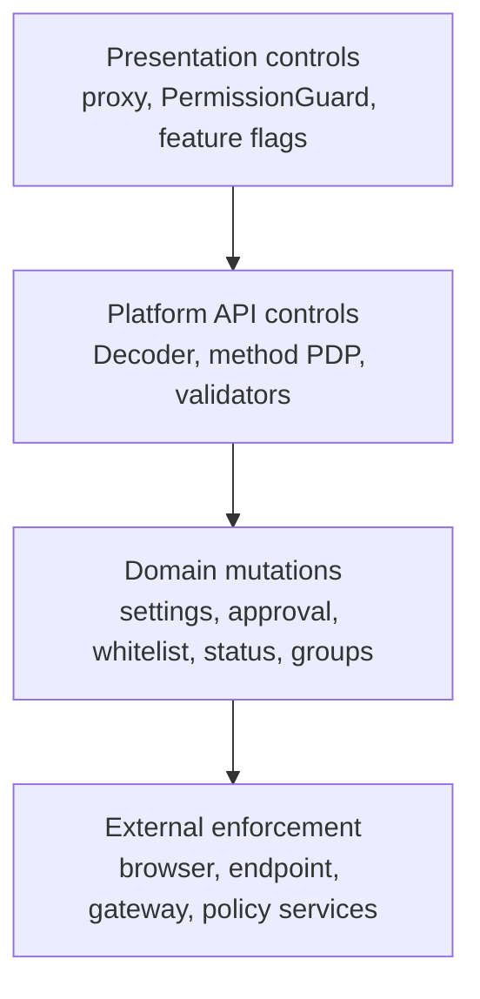
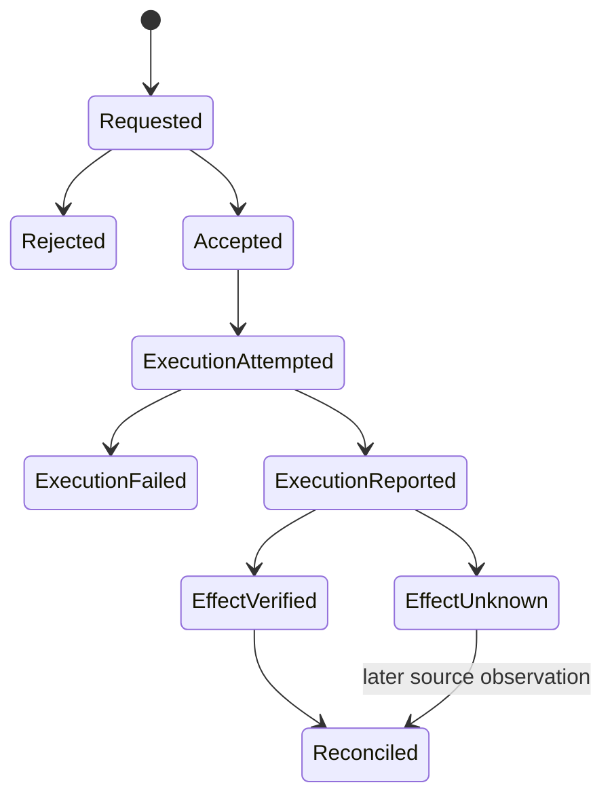

# Policy, Control, and Enforcement

The control ledger is
[`control-capabilities.csv`](../../../matrices/sensor-intelligence/quilr1-platform/control-capabilities.csv).
It contains 16 current or explicitly absent control families.

## Three different control planes



These layers are not interchangeable:

- UI controls affect navigation/visibility.
- API controls authenticate/authorize or validate a platform request.
- Domain mutations change legacy configuration/workflow state.
- Upstream services may enforce actions on actual traffic/devices/models.

Quilr 1 does not provide one end-to-end command/effect contract.

## Request admission and authorization

The external decoder runs before controllers. Spring itself permits all
requests after filter processing. Seven operations carry
`@RequiresPermission`:

- application tenant settings update;
- conversation unmask;
- user-app approval update;
- four password-whitelist operations.

The resolved authorization library uses resource/subresource/scope and
request context. With `quilr.authz.fail-open:false`, PDP failure denies in the
verified supporting tests; the library also has a fail-open option.

Many high-impact routes lack local resource-specific annotations, including
ad-hoc ClickHouse operations, status resolution, smart-group mutation, manual
sync, diagnostics, Redis administration and audit master-code mutation.
External gateway policy may still exist; it is `Unresolved`.

## Presentation controls

The Next proxy routes on cookie presence/content. `PermissionGuard` evaluates
38 rules, with 59 of 112 pages matching at the pinned commit. Unmatched pages
are allowed once the permission map is nonempty. These are UI controls only.

Feature flags hide selected Decision Engine, Lens, detection-model, and other
surfaces, but routable code can remain. Hidden is not disabled at the API.

## Domain controls

### Application settings and approval

Settings/approval updates use legacy services, ClickHouse/Redis state, and
selected audit. There is no common command ID, idempotency contract, outbox,
or effect reconciliation.

### Password whitelist

Four behavior-specific services use combinations of PostgreSQL, ClickHouse,
Neo4j account checks, and browser-extension service calls. The PostgreSQL
entity has a composite tenant/app/behavior key. Some intended graph/warehouse
effects are TODO-only.

### Smart groups

Mutation computes additions/removals and writes state. Unknown operation
strings are not rejected and can produce inconsistent state/audit behavior.
`synchronized` only coordinates the one JVM instance.

### Status resolution

Bulk resolution loops items and performs separate drilldown/master writes.
Partial result is valid current behavior; there is no cross-table rollback.

### Gateway, policy, endpoint and browser controls

The web exposes management actions through external services, while
query-builder often reads their analytics/projections. The target repositories
do not establish the authoritative remote command, enforcement, or observed
effect contracts.

## Action lifecycle required by target



This state machine is **Proposed**. Current HTTP success, store write, external
response, audit attempt, and later warehouse row correspond to different
states and cannot be collapsed.

Required record links:

```text
command_id
actor/effective principal
tenant and target aliases
requested action/config
policy/bundle/decision version
authorization result
accepted/rejected time
execution attempt and outcome
side-effect possibility
eligible effect observer
effect observation/reconciliation
idempotency key
audit/evidence references
```

## Failure behavior

- decoder/CORS can fail closed before controllers;
- method PDP behavior follows fail-open setting;
- frontend permission state can be stale/unmatched;
- selected services return success after caught failure;
- multi-store workflows can partially apply;
- browser/endpoint/gateway enforcement may be external and unobserved;
- async audit does not prove action delivery;
- no domain circuit breaker, durable retry, or dead-letter ledger is
  configured;
- no repository-wide rate limiter was found.

## Product disposition

- Keep settings, approvals, exceptions, and resolution workflows.
- Route target writes through canonical command/outbox and dual-write during
  migration.
- Display acceptance, execution, and effect-verification separately.
- Preserve legacy state/read APIs behind compatibility façades.
- Do not expose `ServiceResponse` success as verified enforcement.
- Keep operator-only SQL/Redis/sync operations outside customer policy APIs.

## Unresolved

- external PDP policy inventory and deployed fail-open value;
- upstream browser/endpoint/gateway control contracts;
- policy/control/detection-model service source and versions;
- actual effect/rollback/retry behavior of external actions;
- live authorization at ingress;
- tenant-specific exceptions, expiry and audit retention.
