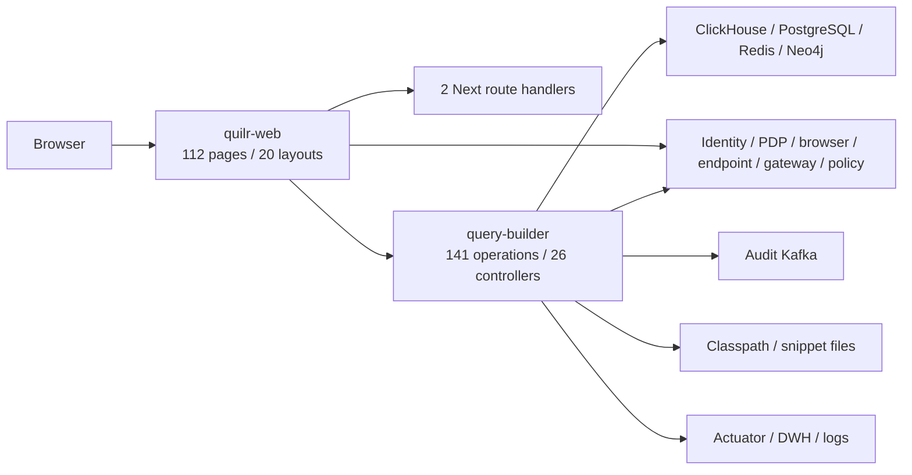

# Interfaces and Extraction Points

Ledgers:

- [`interfaces.csv`](../../../matrices/sensor-intelligence/quilr1-platform/interfaces.csv)
  — 25 interface families;
- [`extraction-points.csv`](../../../matrices/sensor-intelligence/quilr1-platform/extraction-points.csv)
  — 15 reviewed current/proposed extraction boundaries.

The exact 141 backend operations and every frontend route remain in the
first-pass [HTTP API](../../../quilr-platform-analysis/api/quilr-query-builder-http.md)
and [App Router](../../../quilr-platform-analysis/routes/quilr-web-app-router.md)
references.

## Interface topology



## HTTP interface properties

Backend operations use mixed typed DTO and untyped map inputs, context/header
tenant values, an external decoder, seven local method-permission annotations,
and route-specific response/failure semantics. `ServiceResponse` is common but
not universal. No complete local global exception contract exists.

The frontend composes query-builder plus external services. That composition
is a product interface, not an extraction API.

## Administrative interfaces

Operator surfaces include:

- ClickHouse query/update with shared access code;
- DWH configuration/database/container/host diagnostics;
- Actuator;
- Redis/cache/sync administration through domain routes;
- manual endpoint/application synchronization;
- audit master-code CRUD;
- guardrails smoke script and `CHLatestTest`.

They are not a canonical ingest plane. Several accept broad inputs, return
logical errors inside HTTP-success wrappers, or lack durable cursors.

## Preferred store extraction

### ClickHouse

Selected legacy tables are the principal backfill source after validating:

- deployed schema/profile;
- deterministic tenant/time/native-key order;
- stable snapshot/partition fence;
- bounded page size;
- native row preservation;
- record-level normalization/rejection;
- durable downstream checkpoint.

Mutable/master/status tables use fenced snapshots. Summary/materialized tables
are parity baselines only.

### PostgreSQL

Snapshot whitelist state by composite primary key. `update_time` is useful,
but delete history is absent.

### Neo4j and Redis

Neo4j becomes a timestamped low/unknown-authority relationship snapshot.
Redis is diagnostics/reconciliation only.

## Why aggregate APIs are unsuitable for raw migration

Widget/KPI/table/frontend APIs can filter, aggregate, enrich from mutable
maps, mask/decrypt, omit malformed fields, paginate separate snapshots, and
cache results. Extraction from them loses native row identity and lineage.
Use them for compatibility and parity tests only.

## Preferred source order

```text
native upstream sensor/service
> exact legacy stored row
> stored audit/event table
> graph snapshot
> platform request/diagnostic log
> aggregate API
> frontend projection
> Redis cache
```

This selects the least lossy boundary for the same datum; it is not a
universal authority ranking.

## Backfill algorithm

1. Resolve authorized tenant/source scope.
2. Validate and record physical schema/profile.
3. Open deterministic snapshot/time fence.
4. Read bounded page ordered by native time and tie-break key.
5. Preserve exact row and provenance.
6. Normalize or record typed rejection.
7. Commit raw plus normalized/rejection outcome.
8. Advance watermark only after durable commit.
9. Emit page manifest/count/hash.
10. Complete reconciliation only when totals balance.

## External sources

Use native identity, browser, endpoint, LLM Gateway, policy, and other source
adapters rather than Quilr projections when available.

MCP extraction is blocked because authoritative source repository, schemas,
IDs, cursor and payload contracts were not supplied.

## Rate, volume and retention

No repository-wide domain rate limiter exists. Adapter limits, volumes and
retention require live row counts, query plans, source-provider limits and
business policy. They remain `Unresolved`.
