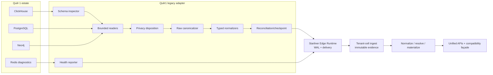

# Adapter Architecture

The proposed component ledger is
[`adapter-components.csv`](../../../matrices/sensor-intelligence/quilr1-platform/adapter-components.csv).
It defines 24 bounded components from schema inspection through cohort
rollback.

## Integration role

ADR-0014 is accepted: Quilr 1 migrates as immutable imported-legacy evidence,
not canonical truth. The adapter is a platform migration/compatibility
adapter, not a native sensor adapter.

## Logical architecture



## Safe-fact boundary

The adapter may say:

- table/database/environment X contained row R at extraction time;
- row R carried native app/user/device/model/behavior values;
- graph snapshot contained edge E;
- whitelist table contained composite-key state;
- a dependency probe returned a specific status;
- a reconciliation read/normalized/rejected specific counts.

It may not say:

- app IDs from different stores are the same canonical application;
- an email uniquely identifies a human;
- a cache/graph value is authoritative historical truth;
- a legacy alert is a unique customer finding;
- HTTP/store success proves external control effect;
- absence in a failed/partial query means deletion.

## Reader design

One reader/mapping is approved per physical family. Readers:

- use managed pooling and read-only credentials;
- enforce tenant/source scope;
- bind values and allowlist table/identifier choices;
- page on deterministic native keys;
- record deployed schema fingerprint;
- stream/bound memory;
- support cancellation/backpressure;
- never call aggregate UI/widget APIs for raw backfill.

## Raw and normalization order

```text
deployed native row
→ type-aware stable byte representation
→ raw hash/reference
→ privacy disposition
→ table-specific parser
→ typed Starliner body
→ local durable acceptance
```

The original row is retained before lossy parsing/enrichment. Parse failure
produces rejection/quarantine tied to raw evidence, not a dropped field.

## Identifier handling

The adapter emits source identifiers with issuing store/namespace,
tenant/account scope, native object type, stability/reassignability,
observation time, exact or approved tokenized value, and parsing confidence.
It never mints canonical entity IDs.

## Reconciliation

A run has explicit scope, snapshot fence, page chain, cursor, counts, hashes,
and completion state. Only a committed complete authoritative snapshot may
generate absence candidates. Most Quilr 1 sources do not prove
authoritative-negative semantics, so initial migration is upsert-only.

## Error behavior

| Failure | Adapter behavior |
| --- | --- |
| source unavailable | bounded retry; degraded health; checkpoint unchanged |
| schema drift | block affected mapping; quarantine/alert; continue independent families |
| malformed row/JSON | retain raw; typed rejection; continue under policy |
| tenant mismatch | fail closed and quarantine safe metadata |
| privacy/secret violation | reject before normal WAL; never log value |
| WAL unavailable | typed failure; never report admitted |
| retryable central rejection | retain and back off |
| permanent rejection | durable quarantine/operator action |
| source reset/rollback | new epoch or reviewed checkpoint transition |

## Deployment placement

`Proposed:` an independently authenticated migration adapter close to legacy
stores, using the normative Starliner runtime for WAL/delivery. Do not embed
it in the browser or reuse the query-builder Redis set.

Exact host/Kubernetes placement, workload identity, network route and secret
injection are `Unresolved`.

## Compatibility and rollback

Canonical reads launch per tenant/domain cohort. A façade returns approved
legacy shapes from canonical projections. Writes use typed canonical commands
plus tracked legacy dual-write until cutover. Rollback changes routing and
never deletes accepted evidence.

## Implementation status

Everything here is **Proposed target architecture** unless describing a
current source fact. No adapter, WAL, manifest, schema inspector, checkpoint
store or canonical façade exists in the two Quilr 1 repositories.
