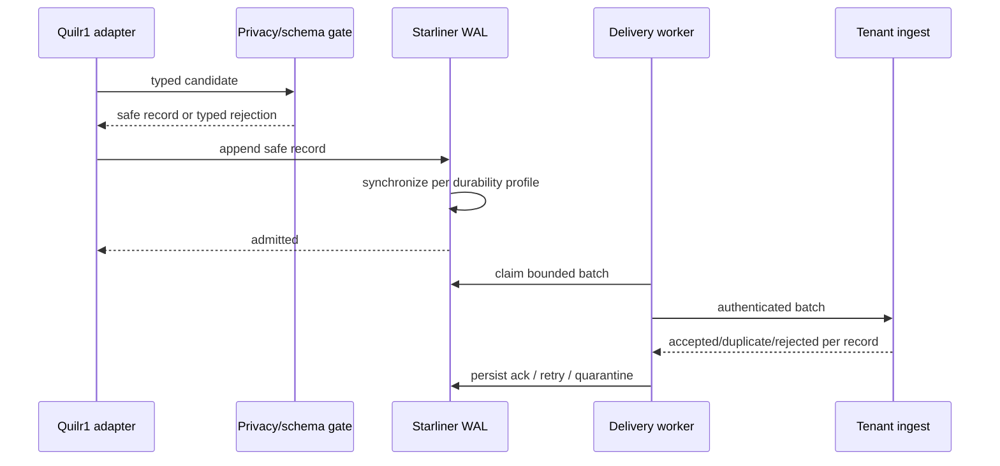

# Starliner and Durable Outbox Integration

This is a proposed binding to the normative Starliner protocol. Quilr 1 has no
Starliner envelope, edge WAL, authenticated acknowledgement, or replay.

## Adapter paths

```text
observe(record)          append observation where available
reconcile(snapshot page) principal migration path
report_health(status)    source/adapter/delivery health
apply_command(command)   future compatibility dual-write
report_effect(outcome)   after eligible state re-read
```

Initial MVS implements `reconcile` and `report_health`; append extraction may
add `observe`. Control waits for typed command/effect contracts.

## Envelope binding

Imported records include protocol/record/schema/source-profile versions,
claimed tenant and source/runtime/adapter identity, operation, source native
ID/revision, all available times, extraction sequence/correlation, privacy
state, idempotency key, and body/record hashes.

Claimed values are not admitted authority. Central ingest records authenticated
tenant, runtime, source installation, certification and integrity separately.

## Idempotency

For a legacy row:

```text
authenticated tenant
+ verified Quilr1 source environment
+ database/table/native object type
+ native stable key/revision or deterministic row identity
+ mapping/schema version where semantics changed
```

Timestamp/name-only keys are prohibited. Same key/hash is duplicate. Same
key/different hash is conflict/correction, never overwrite.

## WAL acceptance



`admitted` means local durability. `accepted` means central immutable evidence
durability. Neither means normalized, resolved, materialized or product
visible.

## Why Redis/Kafka do not qualify

Redis app-sync removes set members before processing, permits duplicate
claims, and has no durable outcome/ack/DLQ/replay. Audit Kafka is selective,
asynchronous and has no local acknowledgement/replay ledger. Neither is a
Starliner outbox.

## Checkpoints

1. read page under source fence;
2. durably admit each safe record;
3. record page manifest and rejections;
4. receive required central acknowledgement;
5. commit next source cursor;
6. release/re-read source page safely.

Source checkpoint and WAL acknowledgement remain distinct.

## Backpressure/offline behavior

Readers are bounded and obey runtime pressure. Offline budget, disk reserve
and degradation ladder are measured for this profile. At exhaustion:

- stop/slow new pages;
- retain reconciliation and health;
- report visibility gap;
- never delete admitted unacknowledged records.

## Reconciliation records

Every run emits started, page-committed, completed or failed, and gap notices
where needed. Completion contains scope, authoritative-negative semantics,
counts, cursor and page/hash manifest. Redis markers remain diagnostics only.

## Commands/effects

Future writes use independently authenticated typed commands:

```text
delivered → accepted/rejected → started
→ succeeded/failed/expired/cancelled
→ effect_observed → effect_verified/conflicted/unknown
```

Arbitrary SQL/scripts/opaque payloads are prohibited. ClickHouse ops is not a
command transport.

## Certification

Required tests cover duplicate/reordered pages/batches, partial ack, retry
storms, credential rotation, network partition/restart, disk full/torn
writes/corruption, schema drift, watermark reset, upgrade/rollback with
backlog, tenant mismatch, secret leakage, member parity and cohort rollback.

No target implementation/certification exists yet.
