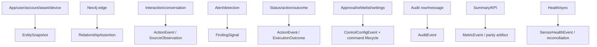

# Platform Contract Mapping

The mapping ledger is
[`platform-contract-mapping.csv`](../../../matrices/sensor-intelligence/quilr1-platform/platform-contract-mapping.csv).
It contains 16 record-family dispositions.

## Contract layers

| Layer | Contract | Quilr 1 use |
| --- | --- | --- |
| envelope | `starliner-envelope.schema.json` | common imported-record provenance/integrity |
| source profile | `source-profile.schema.json` | imported legacy authority/capabilities/limits |
| source body | source-specific schema still to author | exact physical record family |
| metric | `metric-definition.schema.json` | legacy parity and canonical definition |
| finding | `insight-definition.schema.json` | central admission; alerts remain signals |
| evidence package | `ga-evidence-package.schema.json` | release/cutover proof |
| product HTTP | OpenAPI 3.1.2 | canonical APIs and compatibility façade |

## Mapping

These are reviewed target dispositions, not current emissions.

## Source-body schemas

Do not create an untyped `quilr1_record`. Every approved family needs:

- schema `$id` and semantic version;
- source table/object and schema fingerprint;
- typed allowlisted fields;
- required native key;
- native time/unit/null semantics;
- privacy/prohibited-field rules;
- source operation/revision semantics;
- verified-schema fixture;
- mapper/conformance tests.

Unknown columns remain in immutable raw evidence but not silently in the typed
body.

## Boundaries

- Entity rows emit source-scoped state/aliases; resolution is central.
- Graph associations emit assertions with authority/confidence/snapshot time.
- Activity rows emit only proven actor/target/action/outcome fields.
- Alerts emit `FindingSignal`; central admission controls findings.
- Controls require command, decision, outcome and effect records.
- KPI/summary rows are parity artifacts or versioned metric inputs.
- Health/sync becomes dimension-specific health/reconciliation.

## Compatibility APIs

Candidate façades cover `/aiapps`, `/ai-assets`, `/aiusers`, `/aiaccounts`,
`/findings`, `/status-events`, `/interactions`, `/guardrails`,
`/mcp/gateway`, `/executive/dashboard`, and `/qb/query`.

Known route contradictions are not frozen into canonical contracts. Approved
legacy responses can include aliases, canonical IDs and deprecation metadata.

## Contract gaps

Still required:

- source profile/capability manifest;
- table-specific body schemas;
- deployed fingerprints;
- privacy/content policies;
- idempotency derivations;
- reconciliation body schemas;
- compatibility OpenAPI;
- typed dual-write commands/effects;
- fixtures and executable conformance tests.

Scaffold YAML is not implemented until populated, schema-validated and tested.
