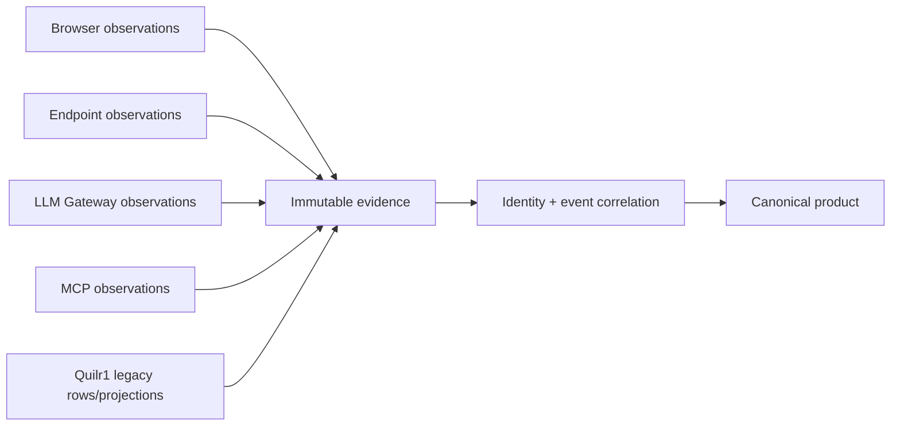

# Cross-Sensor Correlation

The overlap ledger is
[`cross-sensor-overlaps.csv`](../../../matrices/sensor-intelligence/quilr1-platform/cross-sensor-overlaps.csv).
It covers 15 shared concepts across Quilr 1, browser, endpoint, LLM Gateway,
MCP Gateway, identity/policy sources, and central materializers.

## Quilr 1’s correlation role

Current Quilr 1 already presents multi-source views, but it often joins at
request time using source strings, app IDs, emails, graph/cache mappings, and
frontend composition. It is useful evidence of desired workflows, not a
canonical correlation engine.



Quilr 1 participates as one imported source. It never outranks a native source
merely because it aggregated that source.

## Exact duplicate versus correlated observation

Exact duplicate:

```text
same source installation/profile/epoch/native id or deterministic key
+ same semantic revision/body hash
```

Correlated observation:

```text
different source records
+ compatible tenant/entity/time/action/correlation evidence
→ one candidate real-world activity with multiple observers
```

Correlated records remain independently visible. Two Quilr transformations of
one upstream record do not become independent evidence.

## High-risk overlaps

### Applications

Browser domain, endpoint process/package, gateway app/API key, MCP client,
asset row, app settings and graph node can all render as “application.”
Resolve product, surface, tenant application, installation and account layers
separately.

### People/accounts

Email, user ID, Persona, OS account, gateway JWT/API-key owner and graph user
do not prove one person. Use issuer/source IDs; email is a candidate alias.

### Activity

One prompt can create browser, endpoint, gateway request, response, alert,
enriched, conversation, audit and summary rows. Dedup exact rows first,
correlate causal stages second, and never count summaries as observers.

### Findings

One condition can generate several detector rows and current status/action
records. Preserve signals and contradictions; central root-cause materializer
owns the finding.

### Controls

Configuration, approval, decision, request, execution, store write, audit and
effect are distinct. Correlation uses action/decision/command IDs; current
Quilr often lacks them, so some chains remain unresolved.

## Contradiction handling

Examples:

- Quilr process `RUNNING` while ClickHouse/Neo4j health is down;
- graph says a relationship exists while warehouse row is stale/missing;
- platform mutation returns success while intended external/write effect
  failed;
- one source says approved and another says unapproved;
- source selector says MCP while stable MCP call identity is absent.

The platform stores each claim with time, authority, confidence and evidence,
then produces a conflict state. It never silently picks the last write or
averages incompatible claims.

## Time and windows

Correlation uses source occurrence time when available, plus observed and
ingested time. Query/extraction/cache time is not substituted. Late records
can restate a canonical event/finding/metric version without changing raw
evidence.

## Negative evidence

Only a healthy, complete, authoritative reconciliation can support absence.
Quilr 1 graph/cache/query silence generally cannot. Source failure changes
coverage/confidence rather than resolving a finding or retiring an entity.

## Product behavior

Default product shows:

- one canonical row/entity/event/finding;
- source/coverage badges;
- confidence/conflict state;
- latest materialization version;
- relevant source-specific facts.

Drill-down shows all contributing Quilr 1 and native-source observations,
mapping decisions, rejected candidates, and contradictory claims.

## Blocked correlation

Full MCP call/effect, agent definition/version/run, provider workload,
authoritative person/account, and several ClickHouse table mappings remain
blocked pending native contracts or deployed schema.
