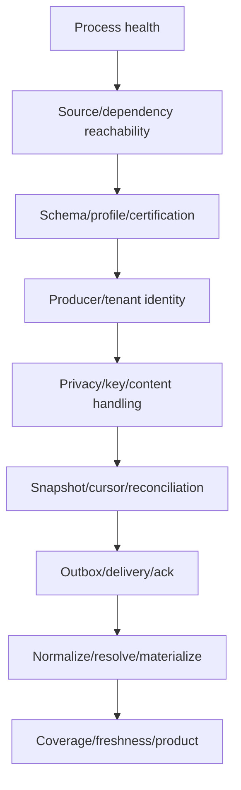

# Coverage, Capabilities, and Health

The metric ledger is
[`health-metrics.csv`](../../../matrices/sensor-intelligence/quilr1-platform/health-metrics.csv).
It separates 12 current runtime/dependency/coordination signals from six
proposed adapter/materialization health metrics.

## Current health dimensions

Quilr 1 exposes or logs:

- query-builder process reachability;
- Actuator aggregate health/metrics;
- ClickHouse, Neo4j, Redis and relational dependency behavior;
- DWH configuration/database/container/host diagnostics;
- scheduler locks, last-run values and markers;
- dashboard executor configuration;
- Next process readiness;
- HTTP failures/latency where framework/monitoring captures them.

These signals do not form a source capability/coverage protocol.

## Verified readiness contradiction

The dynamic harness reached this state:

```text
Tomcat listener ready
/qb/health = RUNNING
ClickHouse unavailable
Neo4j unavailable
/actuator/health = DOWN, HTTP 503
background/scheduled failures continue
```

This proves process reachability and dependency/data readiness are separate.
The checked Axis chart uses a TCP probe, which would accept the listening
process.

## Unreliable completion indicators

- app-sync members are removed before processing;
- scheduler lock/last-run keys are not transactional with work;
- app-admin marker can be written despite row errors and has no TTL;
- master-bootstrap CAS changes before async writes;
- logs show attempts/errors but no complete page manifest;
- HTTP success can wrap logical failure.

None is a valid reconciliation-completed record.

## Target health model



Each dimension has independent state/reason/time. “Healthy” at one layer does
not imply the rest.

## Required target metrics

- source watermark and extraction lag;
- durable outbox depth, oldest age and acknowledgement latency;
- reconciliation balance: read/raw/normalized/rejected/duplicate/committed;
- schema drift and rejection rate;
- source profile/certification/version health;
- producer identity and tenant-admission failures;
- alias-resolution conflict/backlog age;
- materializer lag/rebuild/error;
- expected capability/scope versus observed/stale/degraded/unknown;
- evidence store and protected-content access health.

These are **Proposed** and not current outputs.

## Coverage semantics

Product values distinguish:

```text
known
known absent from authoritative healthy complete source
not observed
out of scope
source stale/degraded
conflicting
not collected for privacy
unresolved
```

Current query results generally do not support these distinctions. A zero
must be accompanied by source coverage/reconciliation proof before it becomes
known absence.

## Customer versus operator visibility

Customer-visible:

- relevant source/capability coverage;
- last successful observation/reconciliation;
- stale/degraded state affecting inventory, metrics or findings;
- blind spots and privacy exclusions;
- actionable repair guidance.

Operator-only:

- raw Redis keys;
- connection details;
- thread/queue internals;
- stack traces and SQL;
- secret/config values;
- DLQ payload contents;
- host/container debug data.

## Unresolved

- deployed probe/monitor/scrape configuration;
- current SLOs and alert thresholds;
- live dependency contributor registration;
- source-specific expected scopes/cadence;
- production health history;
- ownership and repair workflow for each failure dimension.
