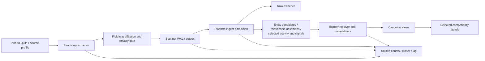

# Minimum Viable Quilr 1 Integration

## Objective

Move a bounded, useful Quilr 1 read cohort into the Starliner/platform data
path without changing the legacy sources, inventing canonical truth, or
requiring immediate parity for every route. The MVS proves evidence
preservation, identity candidates, relationship assertions, selected activity
and signals, reconciliation, compatibility reads, and rollback.

The row-level scope is
[`mvs-scope.csv`](../../../matrices/sensor-intelligence/quilr1-platform/mvs-scope.csv).

## Included source cohorts

### ClickHouse

- application and app-setting/resource inventory;
- user and account inventory;
- asset, endpoint, and related resource inventory;
- selected activity/interaction/status occurrence families after event-time
  semantics are pinned;
- alert/status/audit rows as imported evidence or signals.

### PostgreSQL

- `tenant_app_whitelisted_behaviours` snapshot;
- `ai_conv_filters` only if filter continuity is a first-cohort product
  requirement and restricted-field policy is approved.

### Neo4j

- selected relationship snapshots at explicitly low authority, with
  source-query provenance;
- graph unavailability must degrade only this capability and must not advance
  its checkpoint.

### Product-facing scope

- canonical inventory, activity/evidence, relationship, and coverage views;
- a small set of critical compatibility reads selected from actual usage;
- tenant/table cohorts, shadow comparison, cutover, and rollback.

## Required observation path

Every edge after the extractor is a proposed target integration. Quilr 1 does
not currently implement this universal path.

## Minimum contract

For every emitted source record:

- adapter/profile/mapping version;
- tenant binding;
- source system, source kind, and source-scoped record ID;
- capture time and source event/update time when present;
- cursor/checkpoint component;
- schema fingerprint;
- raw payload or lossless canonical row serialization;
- content digest;
- privacy/retention class;
- normalized safe facts, if a verified mapping exists;
- evidence references for every candidate/assertion/signal.

The exact Starliner envelope fields must come from the target contract; this
list states semantic requirements and does not invent a current Quilr 1 wire
format.

## Deferred

The MVS intentionally excludes:

- automatic canonical finding creation;
- new native control/enforcement workflows;
- monetary cost/billing values;
- restricted prompt/response content by default;
- synthetic call-level MCP events without the native MCP producer contract;
- Redis caches/work sets/locks as canonical data;
- treating the entire live Neo4j graph as authoritative;
- full parity for all routes and UI branches;
- Quilr 1 retirement.

## Rollout states

1. **profile-approved** — live schema, permissions, tenant binding, privacy,
   cursor, and mapping are signed off;
2. **fixture-certified** — type/null/array/time, drift, duplicate, tenant, and
   privacy cases pass;
3. **shadow-backfill** — evidence/candidates are written but not product
   serving;
4. **incremental-catch-up** — checkpoint follows source while lag and
   reconciliation remain within thresholds;
5. **read-model-compare** — selected legacy and target outputs are compared;
6. **cohort-serving** — approved tenant/table/routes use compatibility reads;
7. **expanded** — additional cohorts enter only after gates pass;
8. **rolled-back** — compatibility routing returns to the prior source while
   immutable admitted evidence and checkpoints remain available for repair.

## Exit criteria

The MVS is accepted only when:

- every included profile has a verified deployed fingerprint;
- restart/replay produces identical observation IDs and no unaccounted loss;
- reconciliation balances for the acceptance windows;
- tenant ambiguity and source drift fail closed into quarantine;
- restricted/secret-like fixture handling is verified;
- graph/source outages produce precise degraded coverage;
- selected compatibility outputs satisfy field-level approved tolerances;
- rollback is exercised, not merely documented;
- the operator can identify current cursor, lag, WAL state, rejection reason,
  mapping version, and affected tenant/profile.

Performance thresholds, parity tolerances, cohort size, and rollback windows
are **Unresolved** product/operations decisions recorded in
[`31-open-questions.md`](31-open-questions.md).

